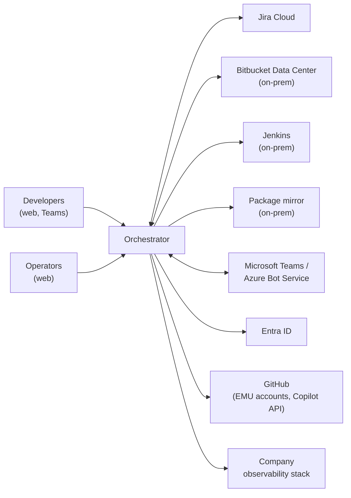
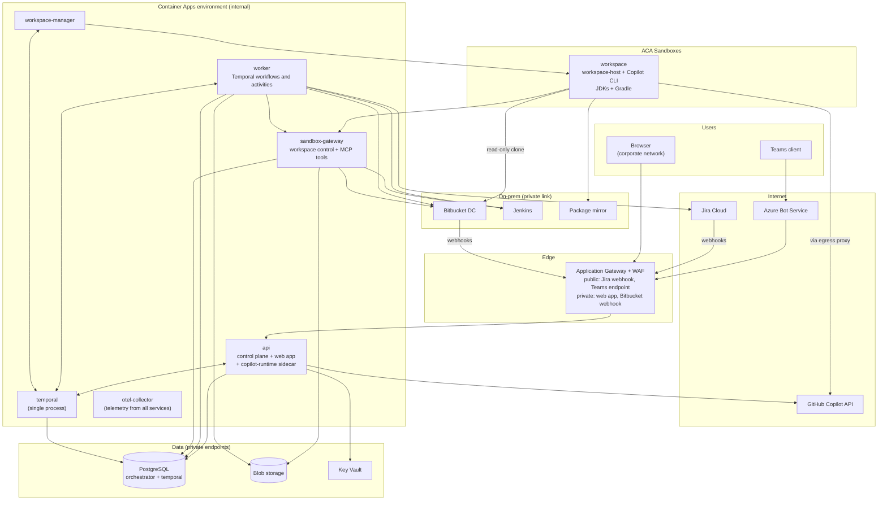
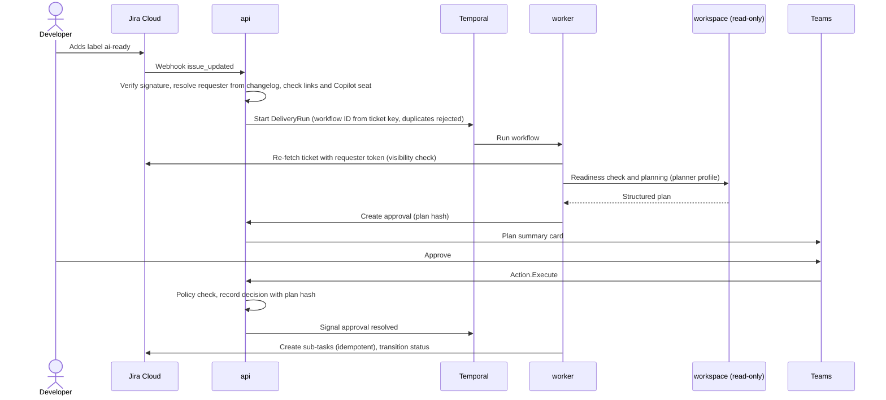
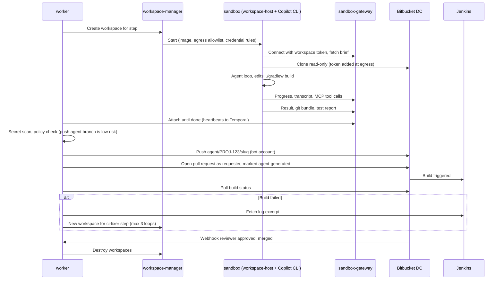
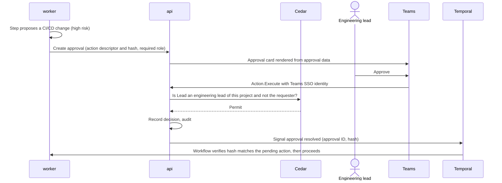
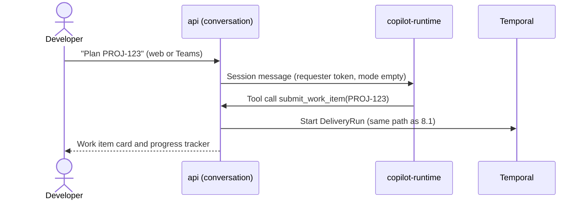

# Orchestrator Layer — Reference Architecture

| | |
|---|---|
| **Status** | Proposed (v1.0) — for review |
| **Date** | 2026-10-17 |
| **Phase** | Reference architecture — follows the [capability map](capabilities.md) and the [non-functional requirements](non-functional-requirements.md) |

## 1. Purpose and scope

This document defines **how** the orchestrator is built: its components and their responsibilities, the interfaces between them, the run event model, the data it keeps, how it is secured, and how it is deployed in the business and the personal deployment.

Every element traces back to a capability (`CAP-xx`), a decision (`Dxx` in the capability map, `AD-xx` here) or a non-functional requirement (`NFR-xx`).

Out of scope for this document: detailed API specifications, database DDL and UI design. These follow during the build.

### Glossary

| Term | Meaning |
|---|---|
| Work item | A ticket (Jira Cloud or GitHub Issues) or a chat request, normalized into one model |
| Run | One execution of the delivery skeleton for one work item |
| Sub-task | One unit of the approved plan; usually one branch and one pull request |
| Step | One agent invocation inside a sub-task (e.g., implement, fix CI, address review) |
| Workspace | The isolated sandbox in which one step's agent reads, changes and builds code |
| Requester | The person a run acts for: who sent the chat request, or who triggered the ticket (AD-05) |
| Agent profile | A versioned agent definition: instructions, tools, model, limits (CAP-01) |

## 2. Inputs and changes to earlier documents

This phase surfaced facts that change or refine earlier documents. The capability map (v1.6) and the non-functional requirements (v1.2) have been updated accordingly.

| Change | Effect |
|---|---|
| **Business source control is Bitbucket Data Center on-prem**, built by Jenkins, with dependencies from an on-prem mirror. GitHub is used only in the personal deployment. | Business ticket tool is Jira Cloud only; D14 becomes Jira Cloud ↔ Bitbucket (already linked natively); sandboxes and workers reach on-prem systems over the existing private link |
| D7 said ticket write-back *consumes* the run event stream | Refined by AD-13: write-back is performed by the workflow itself as durable activities; the event stream remains the single record of what happened |
| NFR-OP-05 asked for one trace ID per run | Refined by AD-19: runs last up to 30 days, too long for one trace; every telemetry record carries the run ID instead |

## 3. Architecture drivers

The requirements that shape the design most:

1. **Long, durable runs.** Runs last up to 30 days, mostly waiting on people, and must never lose work or duplicate a side effect (NFR-SC-06, NFR-AV-02, NFR-AV-03).
2. **Agents run untrusted code next to real credentials.** Ticket text and repository content can carry prompt injection; agents execute builds and tests (NFR-SE-04 to NFR-SE-08, CAP-08, CAP-12).
3. **Same build on a laptop and on Azure** (NFR-OP-01, NFR-OP-02).
4. **Two deployments with different integrations** — business: Jira Cloud, Bitbucket, Jenkins, Teams, Copilot seats; personal: GitHub, Anthropic via bring-your-own-key (D8, D9).
5. **Hybrid connectivity.** Azure services and sandboxes must reach on-prem Bitbucket, Jenkins and the package mirror.
6. **Upgrades never break runs in flight** (NFR-OP-06).
7. **Pilot scale, best-effort availability, growth to ~200 developers** (NFR-SC-01, NFR-AV-01): keep the topology small, with a clear path to scale out.

## 4. Architecture decisions

New decisions of this phase. They complement D1–D15 in the capability map.

| ID | Decision | Rationale | Alternatives considered |
|---|---|---|---|
| AD-01 | **Azure Container Apps** hosts all services, in an internal (VNet-only) environment | Least to operate; fits pilot scale and best-effort availability | AKS: more control, more operations; no existing AKS platform to reuse |
| AD-02 | **ACA Sandboxes** run agent workspaces, behind a `WorkspaceProvider` port. Fallback: ACA dynamic sessions. Local: Docker | MicroVM isolation, blocked-by-default egress, host allowlists and credential injection match NFR-SE-04/05 | ACA dynamic sessions (egress and credential handling to build ourselves); AKS sandboxed pods (preview, needs AKS) |
| AD-03 | **Business source control: Bitbucket Data Center**; CI: Jenkins; dependencies: on-prem mirror. **Personal: GitHub** | Company landscape | — |
| AD-04 | **Users sign in with Entra ID** (web and Teams). **Copilot seats belong to GitHub Enterprise Managed Users** provisioned from Entra; each user links their EMU account once | One directory for people; D10 needs each requester's Copilot token | — |
| AD-05 | **The requester of a ticket run is whoever triggered it** (added the label or assigned the agent) | That person authorized the work | Assignee or reporter: may not have asked for automation |
| AD-06 | **Pull requests are opened on the requester's behalf** (Bitbucket OAuth 2.0) and clearly marked as agent-generated. **Pushes to `agent/**` branches use a bot account** | Bitbucket natively stops authors approving their own pull request, which enforces four-eyes (requester counts as author); the bot cannot change protected branches | Bot-authored pull requests: four-eyes would need a custom merge-check app |
| AD-07 | **Web app reachable only from the corporate network.** Public ingress only for the Jira webhook and the Teams bot endpoint, behind a WAF | Smallest attack surface; Teams covers remote and mobile use | Internet with Entra Conditional Access |
| AD-08 | **Terraform** (AzureRM, plus AzAPI for preview resources such as ACA Sandboxes) | Company standard | Bicep |
| AD-09 | **One standard JVM workspace image** with preinstalled JDKs and Gradle support; each repository's Gradle wrapper and toolchain settings select the versions; nothing is downloaded from the internet | Every business repository builds with Gradle | devcontainer.json per repo; central images per stack |
| AD-10 | **Modular monolith for the control plane**; separate deployables only at trust or scaling boundaries (§6) | Small team, pilot scale; fewer moving parts | Microservice per capability |
| AD-11 | **PostgreSQL is the only stateful store** (orchestrator and Temporal databases on the same server); Blob storage for large artifacts | One point-in-time restore keeps runs and events consistent (NFR-AV-04); portable (NFR-OP-02) | Separate stores per component |
| AD-12 | **Run events live in PostgreSQL** (append-only), with projections updated in the same transaction and live fan-out via `LISTEN/NOTIFY` | Consistent, simple, laptop-friendly; enough for ≤ 1,000 waiting runs | Message broker (Service Bus, Kafka): unnecessary at this scale; revisit per §19 |
| AD-13 | **Side effects are workflow activities with idempotency keys**: ticket write-back, pushes, pull requests, notifications | Temporal retries them durably; no second durability mechanism | Event subscribers with their own checkpoints |
| AD-14 | **The agent harness runs inside the sandbox** (Copilot CLI with its built-in tools), one runtime per workspace. **No write credentials in the sandbox.** Credentials are injected at egress where possible; tools with side effects go through the sandbox gateway | Best agent quality with native tools; Copilot SDK's strongest isolation pattern (one runtime per user); blast radius limited | Harness outside the sandbox with remote custom tools: no secrets inside, but re-implements file and shell tools and adds latency |
| AD-15 | **The front-door agent runs on a shared Copilot runtime in `mode: "empty"`**, with only orchestrator tools and a per-session requester token | No ambient filesystem access; efficient for many chat sessions (Copilot SDK multi-tenancy guidance) | Runtime per user: heavier for light chat traffic |
| AD-16 | **Cedar is the policy engine**, embedded in-process (WebAssembly) | Analyzable policies; "forbid overrides permit" implements "projects may be stricter, never looser" (D15); no extra server | OPA/Rego: general but harder to reason about; extra process |
| AD-17 | **Microsoft Teams SDK (TypeScript)** for the Teams channel | Teams-only bot using Teams-native features (SSO, card refresh, proactive messages); Bot Framework SDK is out of support | Microsoft 365 Agents SDK: multi-channel reach not needed |
| AD-18 | **Workflow versioning with Temporal patching**, enforced by replay tests in CI | Works identically on a laptop and on Azure; in-flight runs move to new code safely (NFR-OP-06) | Pinned worker versions: requires running old workers for up to 30 days |
| AD-19 | **Run ID on every telemetry record; one trace per interaction or step**, linked by run ID | Traces must end; 30-day traces are dropped by backends (refines NFR-OP-05) | One trace per run |
| AD-20 | **Audit trail is a hash-chained append-only table**, with a daily digest written to immutable Blob storage (business) | Tamper-evident (NFR-SE-07) without new infrastructure | Separate ledger service |
| AD-21 | **TypeScript monorepo** with one shared contracts package (schemas for events, APIs, the A2UI catalog and the workspace protocol) | One source of truth for every interface (D11) | Separate repositories per service |
| AD-22 | **Secrets in Azure Key Vault**, reached with Entra workload identity; locally from the OS keychain, injected by the launcher. **User OAuth refresh tokens are envelope-encrypted** in PostgreSQL | NFR-SE-03 | — |
| AD-23 | **Temporal server runs as a single process on Container Apps** for the pilot, on PostgreSQL. Scale-out path in §19 | Matches best-effort availability; minimal operations | Temporal Cloud: run metadata at a third party; AKS Helm: needs AKS |
| AD-24 | **The sandbox has a read-only checkout; commits leave as a git bundle** and are pushed by the worker after secret scanning and a policy check | Nothing inside the sandbox can write to Bitbucket | Pushing from inside the sandbox |

## 5. System context



| External system | Role | Direction | Deployment |
|---|---|---|---|
| Jira Cloud | Work intake (webhooks), write-back (sub-tasks, status, comments) | Both | Business |
| Bitbucket Data Center | Source code, pull requests, review events, build status | Both | Business |
| Jenkins | Build logs for the CI fix loop | Orchestrator reads | Business |
| Package mirror | Gradle distributions and dependencies for builds in sandboxes | Sandboxes read | Business |
| Microsoft Teams / Azure Bot Service | Chat channel, cards, notifications | Both | Business |
| Entra ID | User sign-in, groups for roles, workload identities | Orchestrator reads | Business |
| GitHub (Enterprise Managed Users) | Copilot seats and the Copilot API used by agents | Orchestrator calls | Business |
| GitHub (personal account) | Repositories, issues, pull requests, Actions | Both | Personal |
| Anthropic API | Models via Copilot SDK bring-your-own-key | Orchestrator calls | Personal |
| Observability stack | Traces, metrics, logs via OpenTelemetry | Orchestrator sends | Both (company stack / Grafana) |

## 6. Containers



| Deployable | Responsibility | Technology | Trust zone | Scaling | Main capabilities |
|---|---|---|---|---|---|
| `api` | Control plane (modular monolith): edge and sessions, conversation, channels (web, Teams), run commands and queries, approvals, intake webhooks, registry, identity and credential broker, event fan-out. Also serves the web app's static files | Node.js, TypeScript; Teams SDK; AG-UI; Cedar | Control plane | Horizontal, stateless (min 1) | CAP-01, 02, 07, 08, 09, 10, 11 |
| `copilot-runtime` (sidecar of `api`) | Shared Copilot runtime for front-door agent sessions, `mode: "empty"` | Copilot CLI server | Control plane | With `api` | CAP-10 |
| `worker` | Temporal workflows (delivery skeleton) and activities: intake, policy, approvals, integrations, agent-step supervision, write-back, compensation | Node.js, TypeScript; Temporal SDK | Control plane | Horizontal per task queue (min 1) | CAP-02, 03, 05, 06, 07, 09 |
| `workspace-manager` | Creates, tracks and destroys workspaces; only identity allowed to manage sandboxes; reaper for orphaned workspaces | Node.js, TypeScript; Temporal worker on its own task queue | Control plane (privileged) | 1–2 replicas | CAP-04 |
| `sandbox-gateway` | The only service sandboxes can reach: workspace control channel (step brief, progress, transcript, artifacts) and the MCP tool endpoint with policy enforcement and credential brokering | Node.js, TypeScript; MCP (Streamable HTTP) | Sandbox-facing boundary | Horizontal | CAP-04, 06, 08 |
| `workspace` (image) | Runs one step: `workspace-host` drives a Copilot SDK session with the agent profile; Copilot CLI executes built-in tools in the sandbox | Node.js, Copilot SDK and CLI, git, JDKs, Gradle support | Sandbox | One per active step | CAP-04 |
| `temporal` | Durable execution: timers, signals, updates, retries | Temporal server, all services in one process; Temporal Web UI (internal, platform/SRE only) | Control plane | Single replica (pilot) | CAP-03 |
| `otel-collector` | Receives OpenTelemetry from all services and exports to the company stack | OpenTelemetry Collector | Control plane | 1–2 replicas | CAP-13 |
| PostgreSQL | Orchestrator database; Temporal persistence and visibility databases | Azure Database for PostgreSQL Flexible Server | Data | Vertical; read replica later | CAP-03, 05, 13 |
| Blob storage | Transcripts, artifacts (git bundles, test reports, diffs), audit digests (immutable container) | Azure Blob Storage | Data | Managed | CAP-05, 13 |
| Key Vault | Service secrets and the key-encryption key for user tokens | Azure Key Vault | Data | Managed | CAP-06, 08 |
| `egress-proxy` (personal only) | Allowlist and credential injection for local sandboxes (the role ACA Sandboxes plays on Azure) | Small HTTP proxy | Sandbox-facing boundary | 1 | CAP-04 |

## 7. Component view

### 7.1 `api` modules

| Module | Responsibility | Key interfaces |
|---|---|---|
| Edge | Entra ID sign-in (OIDC, authorization code with PKCE) as a backend-for-frontend: tokens stay server-side, browser holds an httpOnly, SameSite=strict session cookie; CSRF protection; request rate limits | HTTPS |
| Conversation | Front-door agent: one Copilot session per conversation on the shared `copilot-runtime` (AD-15); conversation history persisted in PostgreSQL (the Copilot session is a cache, rebuilt from history when needed); idle sessions closed after 15–30 min | Copilot SDK (JSON-RPC to sidecar) |
| Channels / web | AG-UI event stream over Server-Sent Events, resumable with `Last-Event-ID`; A2UI component payloads | AG-UI |
| Channels / Teams | Teams SDK bot: Teams SSO, A2UI → Adaptive Cards rendering, `Action.Execute` handling, in-place card updates, proactive notifications (conversation references stored per user) | Azure Bot Service |
| Runs | Commands (start, pause, resume, cancel, edit plan, re-route, retry, take over) mapped to Temporal starts, signals and updates; queries served from projections | Temporal client; REST |
| Approvals | Approval objects; renders approval content from orchestrator data only; verifies the approver with policy; signals the workflow | REST, Temporal signal |
| Intake | Webhook receivers (Jira Cloud public; Bitbucket private); signature verification; requester resolution; work item normalization; claiming | HTTPS webhooks |
| Registry | Agent profiles and versions; project configuration (Jira project ↔ repositories, status mapping, risk overrides, budgets); policy versions | REST (operators) |
| Identity | Users, roles (from Entra app roles), account links (EMU GitHub, Jira, Bitbucket) with OAuth flows; token vault; **credential broker** (internal endpoint issuing short-lived credentials to worker, workspace-manager and sandbox-gateway) | Internal HTTPS (mTLS) |
| Fan-out | `LISTEN` on run-event notifications; pushes to connected SSE clients | PostgreSQL |

### 7.2 `worker`: workflows and activities

Task queues separate workloads with different characteristics:

| Task queue | Contents | Concurrency control |
|---|---|---|
| `orchestration` | Workflows; light activities (emit event, policy decision, create approval, notify) | Default |
| `integration` | Jira, Bitbucket, Jenkins, GitHub activities | Per-system rate limits; honor `Retry-After` |
| `agent-steps` | `runAgentStep`: request a workspace, supervise the step (heartbeating), collect the result | Bounded by sandbox capacity |
| `workspaces` | Workspace create/destroy (served by `workspace-manager`) | Bounded by sandbox quota |

Workflow structure (details in §9):

- `DeliveryRunWorkflow` — one per run; the skeleton from intake to close.
- `SubTaskWorkflow` — child workflow per sub-task: implement, verify, push, open pull request, CI loop, review loop, merged or closed.
- Activities never contain decisions that belong to the workflow; all LLM work happens in activities (agent steps), keeping workflows deterministic.

### 7.3 `workspace-manager` and workspaces

- **`WorkspaceProvider` port** with three adapters: `aca-sandboxes` (business default), `aca-dynamic-sessions` (business fallback), `docker` (personal).
- **Workspace specification**: image (from the image catalog), CPU/memory/disk, maximum lifetime, egress allowlist, credential-injection rules, checkout strategy, labels (run, step, tenant).
- **Checkout strategy** (part of the port): *egress credential injection* (sandbox clones; the read token is added by the egress proxy) or *pre-populated checkout* (the manager clones into a volume before the sandbox starts). The sandbox's git remote has no credentials either way.
- **Lifecycle**: created per step, destroyed on step end; a reaper destroys anything older than its lifetime or without a live step (NFR-DR-03: within 1 h).
- **Image catalog**: business `jvm-gradle` (JDK LTS versions in use, git, Node.js runtime for the workspace host, Copilot CLI); personal `general` (common toolchains). Images are prebuilt, scanned and signed in CI (NFR-SE-09).

`workspace-host` (inside the sandbox):

1. Connects out to `sandbox-gateway` with its workspace token; fetches the step brief.
2. Starts a Copilot SDK session with the agent profile: instructions, model, built-in tools allowed by the profile (a permission handler denies all others), MCP server = `sandbox-gateway`.
3. Streams progress and transcript to the gateway; reports usage; enforces step limits (time, turns).
4. On completion: runs the profile's verification command (e.g., `./gradlew build`), commits locally, uploads a git bundle, test reports and a result summary.

### 7.4 `sandbox-gateway`

Two listeners: **sandbox-facing** (workspace control channel and MCP) and **internal** (worker attaches to steps). It holds **no Temporal credentials**.

- **Control channel**: WebSocket over TLS, authenticated by a workspace token (signed, audience = one workspace and one step, expires with the step, revoked on completion).
- **MCP tool endpoint**: read tools (Jira ticket and comments, Bitbucket pull request comments, Jenkins build logs) and, only where a profile allows, controlled writes. Every call is checked with Cedar (profile, step, run, requester), executed with brokered credentials, and recorded for audit.
- **Storage**: transcript and progress to Blob plus a progress index in PostgreSQL; artifacts to Blob with content hashes.
- **Budget and limit enforcement**: can stop a step when its budget or limits are exhausted.

### 7.5 Web app and generative UI

- **One web app**, two areas with role-based navigation: *user view* (chat, my runs) and *operator console* (runs, plan graph, live transcript, approvals inbox, interventions; later audit, evaluation, cost, registry and policy admin).
- **Generative UI** (D4, D13): agents produce A2UI component data from a catalog; the internal model is independent of A2UI so that the pre-1.0 spec only affects the renderer adapters.

| Component | Who may emit it | Web | Teams |
|---|---|---|---|
| Text (markdown) | Agents, system | Rendered | TextBlock |
| Form (text, choice, number, date) | Agents, system | Rendered | `Input.*` + `Action.Execute` |
| Table | Agents, system | Rendered | Table |
| Work item card | System | Rendered | Card |
| Plan editor | System (plan data from the planner, validated by schema) | Full editor | Summary + "Edit on web" |
| Approval card | **System only** | Rendered | `Action.Execute` approve/reject |
| Progress tracker | System | Live | Updated in place at milestones |
| Pull request summary, test report | System | Rendered | Summary card with link |
| Diff viewer | System | Rendered | Link to web |

The `api` strips any system-only component found in agent output before rendering. Because the web app is corporate-network only (AD-07), **Teams cards must fully support the actions people take on the move**: approving, answering clarifying questions and following progress. Plan editing and diffs need the web app.

## 8. Key flows

### 8.1 Ticket to approved plan



If the readiness check finds the ticket unclear, the worker comments the questions on the ticket, notifies the requester and waits for a reply (signal from the Jira webhook), with reminders.

### 8.2 Sub-task execution to merged pull request



Review comments follow the same loop with a review-fix step (bounded). Humans merge in Bitbucket under the repository's rules; the bot has no permission to change protected branches.

### 8.3 Approval of a high-risk action from Teams



### 8.4 Chat request through the front-door agent



The front-door agent's tools are limited to: submit a work item, get run status, list the requester's runs, and render agent-allowed components (text, form, table). Approvals are never available as tools.

## 9. Run lifecycle and workflow design


| Aspect | Design |
|---|---|
| Identity | Workflow ID derived from the work item (`run:jira:PROJ-123:1`); Temporal rejects a second active run for the same ticket (claiming) |
| Signals | `approvalResolved`, `answerReceived`, `ticketChanged`, `scmEvent`, `pause`, `resume`, `cancel` |
| Updates | `editPlan` (validated synchronously, returns errors to the editor) |
| Queries | Current state for diagnostics; user-facing reads come from projections |
| Timers | Approval reminders (1 working day), escalation, 30-day run limit (NFR-SC-06), CI polling backoff |
| Child workflows | One `SubTaskWorkflow` per sub-task; parallel where the plan's dependencies allow |
| Bounded loops | CI fix ≤ 3, review fix ≤ 3 (configurable per project); then escalate to the requester |
| Activity timeouts | Agent steps: start-to-close ≤ 4 h (NFR-CO-01 default), heartbeat 2 min (longer locally to survive laptop sleep) |
| History size | Large payloads never enter Temporal history (claim-check: references to Blob); continue-as-new if history grows beyond a threshold |
| Versioning | Patching (`patched()`) for workflow changes; CI replays recorded production histories against new code and fails on non-determinism (AD-18) |
| Compensation | On cancel or failure: decline open pull requests, delete `agent/**` branches, revert ticket status, comment on the ticket; each step idempotent |
| Ticket changed mid-run | Pause at the next safe point and ask the requester: re-plan, continue or cancel (CAP-07) |

## 10. Run event model

Two streams with different purposes:

| Stream | Content | Ordering | Retention |
|---|---|---|---|
| **Run events** | Milestones and decisions: the authoritative record of a run | Gapless `seq` per run, assigned by the workflow | 1 year (audit) |
| **Step progress** | Agent transcript chunks, tool calls, live progress from workspaces | Per-step sequence | 90 days |

### Envelope

```json
{
  "eventId": "0192f0c4-7b1e-7c3a-9f4e-2d6a1b8c9e01",
  "runId": "run_01JB8Q6Z3K",
  "seq": 42,
  "type": "step.completed",
  "schemaVersion": 1,
  "occurredAt": "2026-10-17T10:15:03.120Z",
  "actor": { "kind": "agent", "id": "implementer@3" },
  "subject": { "subtaskId": "st_2", "stepId": "sp_7" },
  "payload": {},
  "correlation": { "traceId": "4bf92f3577b34da6a3ce929d0e0e4736", "causationId": "0192f0c4-…" },
  "tenantId": "PAY",
  "deployment": "business"
}
```

### Event types (initial)

| Group | Types |
|---|---|
| Run | `run.created`, `run.paused`, `run.resumed`, `run.cancelled`, `run.completed`, `run.failed` |
| Intake | `intake.claimed`, `intake.enriched`, `readiness.question_asked`, `readiness.answered`, `readiness.passed` |
| Plan | `plan.proposed`, `plan.edited`, `plan.approved`, `plan.rejected` |
| Sub-task and step | `subtask.started`, `subtask.completed`, `subtask.failed`, `step.started`, `step.completed`, `step.failed` |
| Approval | `approval.requested`, `approval.resolved`, `approval.expired` |
| Source control and CI | `scm.branch_pushed`, `scm.pr_opened`, `scm.pr_updated`, `scm.review_received`, `scm.pr_merged`, `scm.pr_declined`, `ci.status_changed` |
| Ticket | `ticket.subtasks_created`, `ticket.transitioned`, `ticket.commented` |
| Governance | `policy.denied`, `budget.threshold_reached`, `budget.exhausted`, `compensation.completed` |

### Rules

- **Write path**: the `emitEvent` activity inserts the event (primary key `runId + seq`, so retries are no-ops) and updates projection tables **in the same transaction**, then `NOTIFY` with `{runId, seq}` only.
- **Read path**: the web app and operator console read projections and subscribe via SSE; on reconnect they resume from the last `seq`.
- **Teams**: milestone events update the run's card in place (NFR-PF-05).
- **Schema evolution**: additive changes within a `schemaVersion`; breaking changes create a new version with an upcaster on read (NFR-OP-06).
- **Mapping to AG-UI** happens in the web channel adapter; the event model does not depend on AG-UI or A2UI.

## 11. Data architecture

| Store | Content | Encryption | Backup |
|---|---|---|---|
| PostgreSQL `orchestrator` | Users, identity links, encrypted tokens, registry, work items, runs, sub-tasks, steps, approvals, run events, projections, progress index, usage, conversations, audit log | At rest (platform) + envelope encryption for tokens; TLS | Point-in-time restore, RPO ≤ 1 h (NFR-AV-04) |
| PostgreSQL `temporal`, `temporal_visibility` | Workflow state and visibility | At rest; TLS | Same server, same restore point as `orchestrator` (AD-11) |
| Blob storage | Transcripts, git bundles, test reports, diffs, audit digests | At rest; private endpoint | Soft delete and versioning; immutable container for digests |

Key entities (logical): `user`, `identity_link` (provider, external ID, verified at), `oauth_token` (encrypted refresh token, scopes, expiry), `project` (Jira project, repositories, status mapping, risk overrides, budgets), `repository`, `agent_profile` (id, version, status, spec), `policy_set` (version, Cedar source), `work_item`, `run`, `subtask`, `step`, `approval` (action descriptor, hash, required principal, state), `run_event`, `usage_record`, `conversation`, `notification_ref` (Teams conversation reference), `audit_record`.

- **Retention jobs** enforce NFR-DR-02: run events and audit 1 year; transcripts, progress and artifacts 90 days; deletion on request (NFR-DR-04).
- **Multi-tenancy readiness (CAP-15)**: every table carries `tenant_id` (tenant = project) from day one; PostgreSQL row-level security is enabled when tenancy is switched on in Tier 2.
- **Data flows**: business source code is cloned into Azure sandboxes (approved) and sent to models only through Copilot under the company agreement; nothing is sent to other providers.

## 12. Identity, access and credentials

### Roles

Mapped from Entra app roles (business); the owner holds all roles (personal).

| Role | Can |
|---|---|
| Developer | Request work, follow own runs, answer questions, approve own plans |
| Engineering lead (per project) | Approve high-risk actions and budget increases for the project; see all project runs |
| Agent developer | See transcripts, tool calls, evaluation results; manage agent profiles below production |
| Platform admin | Operate the system; promote profiles; manage policies and configuration; Temporal UI |
| Auditor | Read-only access to audit history and runs |

### Account linking

On first use, a business user links: **GitHub EMU** (authorization of the orchestrator's GitHub App; the orchestrator verifies that the EMU account is provisioned for the same Entra user), **Jira Cloud** (OAuth 2.0 3LO) and **Bitbucket** (OAuth 2.0 incoming application link). Before each run the orchestrator checks the requester still has a Copilot seat and valid links; when an Entra account is disabled, the person's runs pause and the project's engineering lead is notified.

### Credential matrix

| Credential | Held by | Scope | Lifetime | Used for | Never in sandbox? |
|---|---|---|---|---|---|
| Web session | `api` (server side) | One user | Short idle timeout | Web app | Yes |
| GitHub EMU user token | Token vault → credential broker | Copilot use; GitHub App with minimal permissions | Access 8 h, refresh rotated | Front-door sessions; workspace agents (injected at egress) | **Target: yes** (see §22, R-01) |
| Bitbucket user OAuth token | Token vault | Minimum for opening pull requests | Bitbucket-defined | Open pull request as requester | Yes |
| Bitbucket bot write token | Key Vault | Project; protected branches excluded by branch permissions | Expiring, rotated | Push `agent/**` | Yes |
| Bitbucket read token | Key Vault | Project read | Expiring, rotated | Sandbox clone (injected at egress) | Yes |
| Jira user OAuth token | Token vault | Read work (visibility checks) | Access 1 h, rotating refresh | Re-fetch tickets as requester | Yes |
| Jira integration account | Key Vault | Comments, sub-tasks, transitions | Rotated | Write-back; read tools via gateway | Yes |
| Jenkins read token | Key Vault | Read builds and logs | Rotated | Log excerpts | Yes |
| Workspace token | Issued by `sandbox-gateway` | One workspace, one step | Until step end | Control channel, MCP | Held by workspace-host |
| Webhook secrets | Key Vault | Signature verification | Rotated | Intake | Yes |
| Service identities | Entra workload identity | Per deployable | Automatic | PostgreSQL, Key Vault, Blob, registry | Yes |
| Anthropic API key (personal) | OS keychain → `egress-proxy` | Owner's account | Owner-managed | Bring-your-own-key model calls | Yes |
| GitHub App installation token (personal) | Issued on demand | Owner's repositories | 1 h | Push, pull requests, issue polling | Yes |

## 13. Security architecture

### Trust zones and allowed flows

| Zone | Members | May reach |
|---|---|---|
| Internet | Jira Cloud, Azure Bot Service | Public WAF listeners only (Jira webhook, Teams endpoint) |
| Corporate network | Browsers, on-prem Bitbucket | Private WAF listener (web app, Bitbucket webhooks) |
| Control plane | `api`, `worker`, `workspace-manager`, `sandbox-gateway`, `temporal`, `otel-collector` | Data zone, on-prem systems, allowed internet hosts (Copilot API, Jira, Teams) via firewall |
| Sandbox | Workspaces | `sandbox-gateway`, Copilot API hosts, Bitbucket (read), package mirror — nothing else |
| Data | PostgreSQL, Blob, Key Vault, container registry | Private endpoints only |

### Threats and mitigations

| Threat | Example | Mitigation |
|---|---|---|
| Prompt injection via ticket or repository | A ticket instructs the agent to leak code or change CI | No write credentials or secrets in the sandbox; egress allowlist; policy enforced outside the model; high-risk actions need approval; bot cannot touch protected branches |
| Credential theft from the sandbox | Agent reads environment or files | Credentials injected at egress; workspace token scoped to one step; read-only clone token |
| Self-approval or spoofed approval | Agent output contains a fake approval card | Approval cards are system-only; approvals only through authenticated UI actions; Cedar check (role, approver ≠ requester for high risk); decision bound to the action hash |
| Sandbox escape | Malicious build script | MicroVM isolation, non-root, no host mounts, resource limits, short lifetime |
| Exfiltration through allowed hosts | Pushing code to an external service | Only internal hosts and Copilot API hosts allowed; path-level rules where the proxy supports them (R-02) |
| Webhook spoofing | Fake Jira webhook starts runs | Signature verification, source IP allowlists, payload never trusted: ticket and actor re-fetched through the API |
| Session hijacking | Stolen cookie | Server-side tokens, httpOnly SameSite=strict cookies, short sessions, corporate network only |
| Secrets in agent output | Agent commits a credential | Secret scanning before push and on transcripts (NFR-SE-03) |
| Supply chain | Malicious dependency or image | Dependencies only from the curated on-prem mirror; image scanning and signing; pinned base images |
| Audit tampering | Database edit to hide an action | Hash chain plus immutable daily digests (AD-20) |
| Allowance abuse | Runaway run consumes a person's Copilot allowance | Per-run budgets and limits (NFR-CO-01), loop bounds, alerts |

## 14. Integrations

| System | Inbound | Outbound | Idempotency | Limits |
|---|---|---|---|---|
| **Jira Cloud** | Admin webhook filtered by JQL (label `ai-ready` or assignment to the agent user), with secret; reconciliation query every 10 min catches missed webhooks | REST v3: reads with the requester's 3LO token; writes with the integration account | Sub-tasks carry an issue property with the orchestrator key; comments carry a marker | Respect 429 and `Retry-After` |
| **Bitbucket DC** | Webhooks over the private network (pull request opened, updated, approved, merged, declined, comment added; refs changed) | REST: pull requests as requester (OAuth 2.0), push via bot token; build status for a commit | One pull request per source branch; branches named `agent/<JIRA-KEY>/<slug>` (D14) | Coordinate the bot account with Bitbucket admins' rate limits |
| **Jenkins** | — | REST: build result and log excerpt (tail and error extraction, size-capped) | Read-only | Polling with backoff |
| **Teams** | Bot messages and `Action.Execute` via Azure Bot Service | Proactive messages and card updates | Card update by activity ID | Teams app pre-installed for pilot users (open item) |
| **GitHub EMU / Copilot** | — | Copilot API (from `copilot-runtime` and workspaces); GitHub API for seat checks and usage | — | Copilot rate limits per user |
| **GitHub (personal)** | Polling (conditional requests with ETags, every ≤ 5 min) | GitHub App: pushes, pull requests, issue comments, sub-issues | One pull request per branch | GitHub rate limits |
| **Anthropic (personal)** | — | Through `egress-proxy`; Copilot SDK bring-your-own-key `baseUrl` points at the proxy | — | $50 monthly cap (NFR-CO-03) |

Agent-generated work is marked everywhere (NFR-SE-12): pull request title prefix and description footer, commit trailers (`Agent-Run: <runId>`, `Requested-By: <user>`), comments signed by the integration account with the requester named.

## 15. Agent runtime

### Initial agent profiles

| Profile | Purpose | Workspace | Notable tools |
|---|---|---|---|
| `front-door` | Conversation, intent, collecting details | None (shared runtime, `mode: "empty"`) | Orchestrator tools only |
| `readiness-analyst` | Judge ticket clarity; draft questions | Read-only checkout | Jira read |
| `planner` | Produce the structured plan (sub-tasks, dependencies, acceptance criteria, repository) | Read-only checkout | Jira read |
| `implementer` | Implement a sub-task with tests | Read-write checkout | Shell, edit, Gradle |
| `reviewer` | Agent review of the change before the human review | Read-only checkout | Diff, Bitbucket comments read |
| `ci-fixer` | Fix a failing build | Read-write checkout | Jenkins log read |

Profiles are code (versioned in the monorepo), validated in CI and promoted through the registry. A run pins the profile versions it starts with.

### Step contract

| Direction | Fields |
|---|---|
| Brief (in) | Run, sub-task and step IDs; profile and version; repository and base commit; branch; brief document (ticket, plan, sub-task, prior outputs); limits; remaining budget; policy snapshot |
| Result (out) | Status (`succeeded`, `failed`, `needs_input`, `budget_exhausted`); summary; git bundle reference; test report reference; transcript reference; usage; questions when `needs_input` |

### Context and knowledge

- The brief is written into the workspace as a file, not pasted into the prompt; repository instruction files (e.g., `AGENTS.md`) give long-term, team-owned knowledge (CAP-05 essential form).
- Repository selection: from the project configuration (Jira project → repositories); the readiness check asks when ambiguous; a plan may span several repositories (one sub-task per repository).

### Gradle toolchain (AD-09)

- JDKs preinstalled; Gradle finds them via `org.gradle.java.installations.paths`; automatic JDK download disabled.
- Gradle distributions used by onboarded repositories are prebaked into the image (wrappers pointing to the internet cannot download).
- Dependency resolution through the on-prem mirror; a read-only shared dependency cache (`GRADLE_RO_DEP_CACHE`) is prepopulated per repository during image builds for fast first builds (NFR-PF-08).
- Integration tests that need Docker (e.g., Testcontainers) may not run inside sandboxes; Jenkins remains the full gate (R-05).

## 16. Observability, audit and cost

- **Telemetry**: OpenTelemetry SDK in every service; Temporal interceptors propagate context across workflows and activities; the Copilot SDK propagates trace context; workspace telemetry is relayed through `sandbox-gateway`. Every record carries `run.id` (AD-19).
- **Dashboards**: runs by state, step durations, approval wait times, workspace start times, error rates, Copilot latency; agent quality metrics (NFR §4) computed from run events from day one of the pilot.
- **Alerts** (NFR-OP-07): stuck runs, failure spikes, budget breaches, queue backlog, private-link reachability.
- **Audit**: every policy decision, approval, tool call with side effects and external write is an audit record in the hash chain; a daily job writes the chain head to an immutable Blob container and verifies the chain.
- **Cost**: `usage_record` per step (Copilot premium requests as reported or estimated, workspace seconds); allowance read per requester for NFR-CO-01; reconciliation with GitHub billing data daily (NFR-CO-04). Personal: Anthropic usage against the $50 cap, with the Anthropic Console limit as backstop.

## 17. Deployment views

### 17.1 Business on Azure

| Element | Design |
|---|---|
| Network | Spoke VNet peered to the existing hub with the private link to on-prem; subnets for the Container Apps environment, ACA Sandboxes, Application Gateway, private endpoints |
| Ingress | Application Gateway WAF v2: public listener (Jira webhook path, Teams messaging endpoint) with source IP restrictions; private listener (web app, Bitbucket webhooks) |
| Egress | Hub firewall with FQDN allowlist for services (Copilot API, Jira Cloud, Bot Service, Entra); sandbox egress through the ACA Sandboxes proxy |
| Compute | Container Apps environment with workload profiles: `api` (+ `copilot-runtime`), `worker`, `workspace-manager`, `sandbox-gateway`, `temporal`, `temporal-ui`, `otel-collector` |
| Data | PostgreSQL Flexible Server (General Purpose, point-in-time restore); Blob storage with an immutable container; Key Vault; Azure Container Registry — all with private endpoints |
| Identity | Entra app registrations (web app, Teams bot, Bitbucket and Jira OAuth clients); workload identities per deployable; passwordless PostgreSQL access |
| Environments | `dev`, `staging`, `prod`; Terraform per environment; container images built once and promoted |
| Region | One Azure region; data stays in it (NFR-DR-05) |

### 17.2 Personal on a laptop

| Element | Design |
|---|---|
| Runtime | Docker Compose, started by a launcher command that reads secrets from the OS keychain and injects them as environment variables (never written to disk) |
| Services | `postgres`, `temporal` (on PostgreSQL, same configuration shape as Azure), `api` (+ `copilot-runtime`), `worker`, `workspace-manager`, `sandbox-gateway`, `egress-proxy`, optional `otel-lgtm` (Grafana) |
| Network | All ports bound to `127.0.0.1`; sandboxes on an internal Docker network that reaches only `sandbox-gateway` and `egress-proxy` |
| Sandboxes | Docker containers: non-root, read-only root filesystem except workspace and temp, resource limits, no Docker socket; pre-populated checkout. Only `workspace-manager` talks to the Docker engine; rootless Docker or Podman recommended |
| Sign-in | GitHub account, restricted to the owner's user ID |
| Intake | GitHub Issues polling |
| Backups | Daily `pg_dump` plus the artifact directory to a folder the owner chooses (NFR-AV-04 personal) |

## 18. Reliability and failure handling

| Failure | Behavior |
|---|---|
| Worker crash mid-activity | Temporal retries; `runAgentStep` re-attaches to the running workspace by step ID or starts a new one |
| Workspace dies | Heartbeat timeout; the step is retried in a new workspace from the base commit (bounded) |
| Copilot API outage or rate limit | Retry with backoff; run shows "waiting for model provider"; alert after threshold (NFR-AV-05) |
| Private link to on-prem down | Integration activities retry; runs pause; alert |
| Missed Jira webhook | Reconciliation query every 10 min |
| Teams unavailable | Notifications retried; web app unaffected |
| PostgreSQL outage | System stops; Temporal and runs resume when it returns |
| Token refresh fails (revoked consent, leaver) | Run pauses; requester asked to re-link; leavers' runs escalate to the engineering lead |
| Laptop sleeps (personal) | Timers fire on wake; interrupted steps retried |

**Restore and reconciliation.** After a point-in-time restore, external systems may contain changes made after the restore point. On start, a reconciliation job walks active runs and matches external state through idempotency keys (Jira issue properties, pull requests by branch, comment markers) before any new write, so no duplicates are created (NFR-AV-03, NFR-AV-04).

## 19. Scaling path

| Trigger | Change |
|---|---|
| Department rollout or Temporal saturation | Split Temporal into frontend, history and matching services; or move Temporal to AKS (Helm) or a managed offering after a data review |
| Operator queries slow the primary | PostgreSQL read replica for projections and dashboards |
| More than ~10 `api` replicas or high event rates | Replace `LISTEN/NOTIFY` fan-out with Azure Web PubSub or a broker |
| Sandbox queueing | Raise sandbox pool and quota; tune ready instances |
| A formal availability target appears | Zone-redundant PostgreSQL, multiple Temporal replicas, zero-downtime deploys |

## 20. Codebase structure

```
apps/
  api/                 control plane modules (edge, conversation, channels, runs, approvals, intake, registry, identity)
  worker/              Temporal workflows and activities
  workspace-manager/   WorkspaceProvider adapters
  sandbox-gateway/     control channel and MCP tool endpoint
  workspace-host/      runs inside the sandbox
  web/                 user view and operator console
  egress-proxy/        personal deployment only
packages/
  contracts/           schemas: work item, run events, APIs, A2UI catalog, workspace protocol
  policy/              Cedar schema, policies and tests
  adapters/            tickets, source control, CI, channels, storage, secrets
  agent-profiles/      versioned profile definitions
  telemetry/           OpenTelemetry setup
infra/
  terraform/           Azure environments
  local/               Docker Compose and launcher
docs/
```

Quality gates in CI: type checks, unit tests, contract tests for adapters, Temporal replay tests, policy tests, end-to-end tests on the local setup (NFR-OP-01), image scanning and signing.

## 21. Traceability

### Capabilities

| Capability | Realized by |
|---|---|
| CAP-01 Agent registry | `api` registry; `packages/agent-profiles` |
| CAP-02 Planning and routing | `planner` profile; `DeliveryRunWorkflow` |
| CAP-03 Durable execution | Temporal; `worker` |
| CAP-04 Agent workspaces | `workspace-manager`; ACA Sandboxes; `workspace-host`; `sandbox-gateway` |
| CAP-05 State, context, memory | PostgreSQL; Blob; step briefs; repository instruction files |
| CAP-06 Tool and integration gateway | `sandbox-gateway` MCP endpoint; credential broker; integration activities |
| CAP-07 Work intake | `api` intake; Jira and GitHub adapters; reconciliation |
| CAP-08 Identity, policy | Entra ID; account linking; Cedar; Bitbucket branch permissions |
| CAP-09 Human in the loop | `api` approvals; signals; channel renderers |
| CAP-10 User view | Web app; Teams channel; front-door agent; A2UI catalog |
| CAP-11 Operator view | Web app operator console; projections; Temporal UI for platform admins |
| CAP-12 Guardrails (Tier 2) | Egress controls, secret scanning (Tier 1 essentials); injection test suite |
| CAP-13 Observability, audit (Tier 2) | OpenTelemetry; hash-chained audit |
| CAP-14 Evaluation (Tier 2) | Quality metrics from run events; benchmark runs on staging |
| CAP-15 Multi-tenancy (Tier 2) | `tenant_id` everywhere; row-level security when enabled |
| CAP-16 Cost (Tier 2) | `usage_record`; budgets in workflows and the gateway |

### Key non-functional requirements

| Requirement | Mechanism |
|---|---|
| NFR-AV-02 No lost work | Temporal; events and projections in one transaction; claim-check artifacts |
| NFR-AV-03 No duplicates | Idempotency keys on every external write; reconciliation |
| NFR-AV-04 Recovery | One PostgreSQL server, point-in-time restore; reconciliation after restore |
| NFR-OP-01 Same build | Containers; `WorkspaceProvider` and storage/secret adapters; Temporal on PostgreSQL locally |
| NFR-OP-06 Upgrades | Patching and replay tests; versioned events |
| NFR-SE-04/05 Workspace isolation | ACA Sandboxes microVMs; egress allowlist; injected credentials; read-only checkout |
| NFR-SE-07 Audit | Hash chain and immutable digests |
| NFR-PF-02 Reply streaming | Shared `copilot-runtime`; SSE |
| NFR-PF-08 Workspace ready | Prebuilt images; ready pools; Gradle read-only cache |

## 22. Risks and proofs of concept

Proofs of concept come first in the build, ordered by how much of the design depends on them.

| ID | Risk | Proof of concept | Fallback |
|---|---|---|---|
| R-01 | Copilot CLI may not work with credentials injected at egress; the token would then sit in the sandbox for up to 8 h, beyond NFR-SE-04's 1 h | Run a Copilot SDK session in ACA Sandboxes with the EMU user token injected by the egress proxy | Token in the sandbox from a minimal-permission GitHub App, Copilot hosts only, plus a documented NFR-SE-04 exception |
| R-02 | ACA Sandboxes (preview): VNet routing to on-prem, path-level egress rules, start time with a large JVM image, quotas | Clone from Bitbucket, build with the mirror, measure start time | ACA dynamic sessions via the `WorkspaceProvider` port |
| R-03 | Copilot SDK usage data per session may not give premium requests per step | Inspect SDK usage events against GitHub billing data | Estimate from model multipliers and request counts; reconcile daily |
| R-04 | Bitbucket version may lack the OAuth 2.0 provider or webhook secrets | Confirm version (open item) and test opening a pull request as a user | Bot-authored pull requests plus a merge-check app for four-eyes |
| R-05 | Gradle integration tests needing Docker cannot run in sandboxes | Run representative repositories' builds in a sandbox | Agents run unit tests; Jenkins runs the full suite |
| R-06 | Temporal single process on Container Apps (TCP ingress, restarts) | Deploy and run failure tests | Temporal on AKS or managed |
| R-07 | Copilot SDK bring-your-own-key with Anthropic through the proxy `baseUrl` (personal) | First build step (capability map §10) | Anthropic key inside the local sandbox with egress limited to Anthropic |
| R-08 | Shared `copilot-runtime` may need a client-level token besides per-session tokens | Check with the SDK | One runtime per active chat user |

## 23. Open items

| Item | Why it matters | Owner (proposed) |
|---|---|---|
| Bitbucket Data Center version | Decides OAuth 2.0 pull requests on behalf of users, webhook secrets, token expiry (R-04) | You / Bitbucket admins |
| Teams app pre-installation for pilot users | Proactive notifications need the app installed | Teams admins |
| JDK and Gradle versions across business repositories | Content of the `jvm-gradle` image | Platform (scan at onboarding) |
| Gradle remote build cache (if any) | Faster builds in sandboxes | Platform |
| CI/CD for the orchestrator itself | Where images are built and how they reach Azure Container Registry | Platform |

## Change history

| Version | Change |
|---|---|
| 1.0 | Initial proposal |
