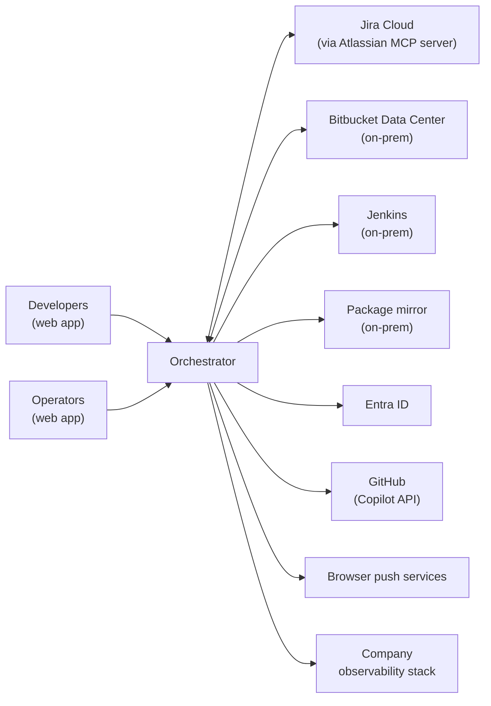
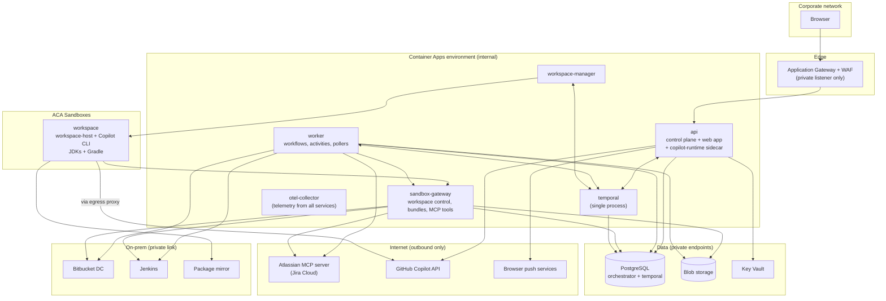
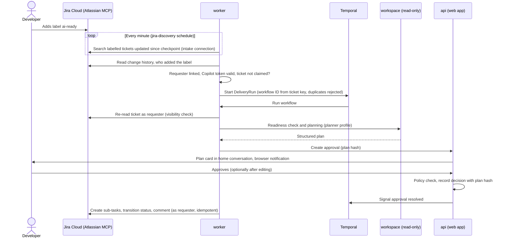
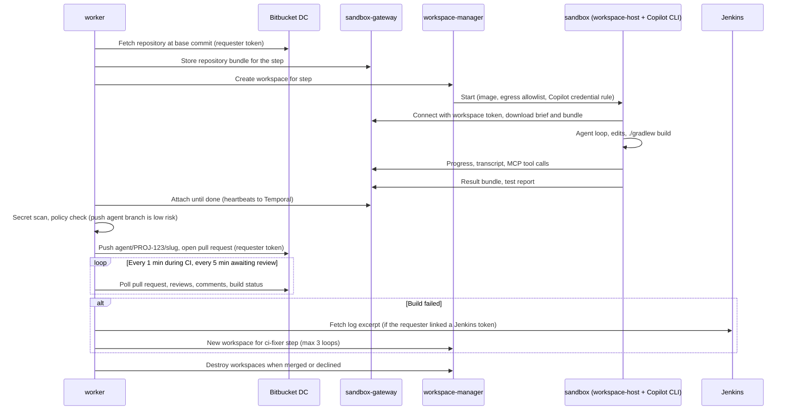
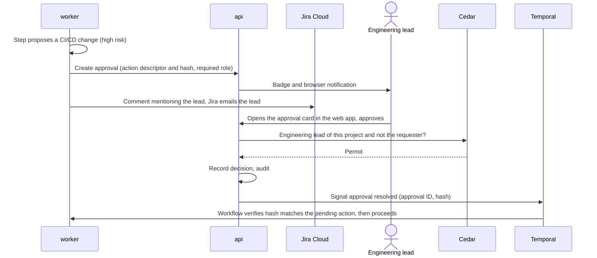
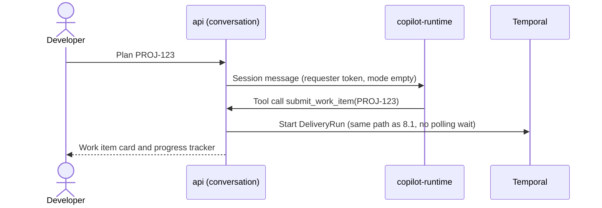
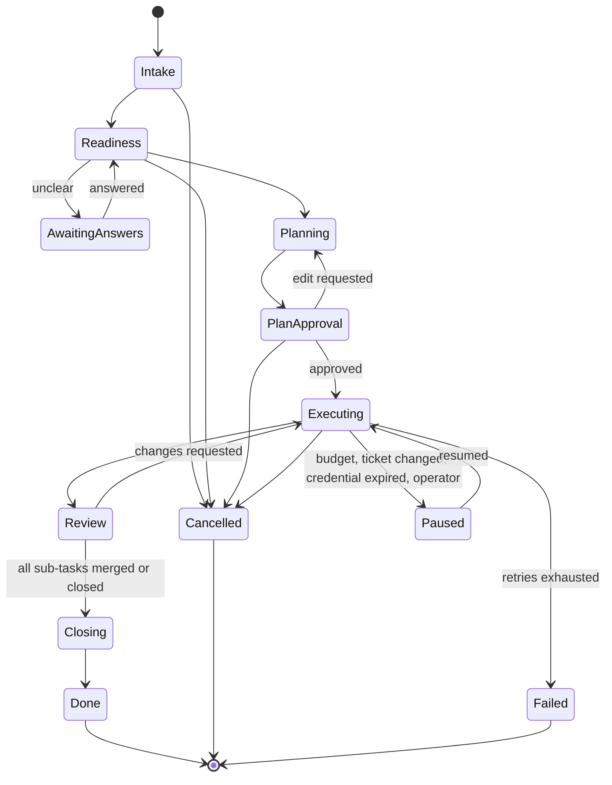

# Orchestrator Layer — Reference Architecture

| | |
|---|---|
| **Status** | Proposed (v1.2) — for review |
| **Date** | 2026-10-18 |
| **Phase** | Reference architecture — follows the [capability map](capabilities.md) and the [non-functional requirements](non-functional-requirements.md) |

## 1. Purpose and scope

This document defines **how** the orchestrator is built: its components and their responsibilities, the interfaces between them, the run event model, the data it keeps, how it is secured, and how it is deployed in the business and the personal deployment.

Every element traces back to a capability (`CAP-xx`), a decision (`Dxx` in the capability map, `AD-xx` here) or a non-functional requirement (`NFR-xx`).

Out of scope for this document: detailed API specifications, database DDL and UI design. These follow during the build.

### Glossary

| Term | Meaning |
|---|---|
| Work item | A ticket (Jira Cloud or GitHub Issues) or a chat request, normalized into one model |
| Run | One execution of the delivery skeleton for one work item |
| Sub-task | One unit of the approved plan; usually one branch and one pull request |
| Step | One agent invocation inside a sub-task (e.g., implement, fix CI, address review) |
| Workspace | The isolated sandbox in which one step's agent reads, changes and builds code |
| Requester | The person a run acts for: who sent the chat request, or who added the `ai-ready` label (AD-05) |
| Agent profile | A versioned agent definition: instructions, tools, model, limits (CAP-01) |
| Linked credential | A token or OAuth connection a user links to their orchestrator account (AD-28) |
| Intake connection | A linked Atlassian connection used to discover new tickets for a project (AD-27) |

## 2. Inputs and changes to earlier documents

| Change | Effect |
|---|---|
| **Business source control is Bitbucket Data Center on-prem**, built by Jenkins, with dependencies from an on-prem mirror. GitHub is used only in the personal deployment. | Business ticket tool is Jira Cloud only; D14 links Jira Cloud ↔ Bitbucket (already linked natively) |
| **No admin rights on Jira, Bitbucket or Teams**: no webhooks, no service or bot accounts, no application links, no Teams bot | Polling everywhere (AD-26); Jira through Atlassian's MCP server with each user's OAuth (AD-27); every credential is linked by its user (AD-28); no public ingress at all (AD-07); Teams deferred to a later release (AD-17); notifications through the web app and Jira mentions (AD-29) |
| D7 said ticket write-back *consumes* the run event stream | Refined by AD-13: write-back runs as durable workflow activities; the event stream remains the single record of what happened |
| NFR-OP-05 asked for one trace ID per run | Refined by AD-19: runs last up to 30 days, too long for one trace; every telemetry record carries the run ID |

The capability map (v1.8) and the non-functional requirements (v1.3) are updated accordingly.

## 3. Architecture drivers

1. **Long, durable runs.** Up to 30 days, mostly waiting on people; never lose work or duplicate a side effect (NFR-SC-06, NFR-AV-02, NFR-AV-03).
2. **Agents run untrusted code next to real credentials.** Ticket text and repository content can carry prompt injection; agents execute builds and tests (NFR-SE-04 to NFR-SE-08, CAP-08, CAP-12).
3. **Same build on a laptop and on Azure** (NFR-OP-01, NFR-OP-02).
4. **Two deployments with different integrations** — business: Jira Cloud, Bitbucket, Jenkins, Copilot seats; personal: GitHub, Anthropic via bring-your-own-key (D8, D9).
5. **Hybrid connectivity.** Azure services reach on-prem Bitbucket, Jenkins and the package mirror over the existing private link.
6. **Upgrades never break runs in flight** (NFR-OP-06).
7. **Pilot scale, best-effort availability, growth to ~200 developers** (NFR-SC-01, NFR-AV-01).
8. **Limited admin rights.** Everything must work with outbound calls and credentials that users can create and link themselves.

## 4. Architecture decisions

New decisions of this phase. They complement D1–D15 in the capability map.

| ID | Decision | Rationale | Alternatives considered |
|---|---|---|---|
| AD-01 | **Azure Container Apps** hosts all services, in an internal (VNet-only) environment | Least to operate; fits pilot scale and best-effort availability | AKS: more control, more operations; no existing AKS platform |
| AD-02 | **ACA Sandboxes** run agent workspaces, behind a `WorkspaceProvider` port. Fallback: ACA dynamic sessions. Local: Docker | MicroVM isolation, blocked-by-default egress, host allowlists and credential injection match NFR-SE-04/05 | ACA dynamic sessions (egress controls to build ourselves); AKS sandboxed pods (preview, needs AKS) |
| AD-03 | **Business source control: Bitbucket Data Center**; CI: Jenkins; dependencies: on-prem mirror. **Personal: GitHub** | Company landscape | — |
| AD-04 | **Users sign in with Entra ID.** Copilot seats belong to GitHub Enterprise Managed Users; **each user links a fine-grained personal access token with only the "Copilot Requests" permission** | No admin needed; the token can be used for Copilot and nothing else (D10) | GitHub App user authorization: needs an organization owner |
| AD-05 | **The requester of a ticket run is whoever added the `ai-ready` label**, read from the ticket's change history | That person authorized the work | Assignee or reporter: may not have asked for automation |
| AD-06 | **Bitbucket pushes and pull requests use the requester's personal HTTP access token.** The worker only ever pushes `agent/**` branches. Pull requests are authored by the requester and marked agent-generated | Bitbucket natively stops authors approving their own pull request, which enforces four-eyes (requester counts as author); no admin-created accounts or links needed | Bot account and OAuth application link: need Bitbucket admins |
| AD-07 | **No public ingress.** The web app is reachable only from the corporate network; every integration is an outbound call | Smallest attack surface; nothing in the design needs inbound traffic from outside | Internet with Entra Conditional Access |
| AD-08 | **Terraform** (AzureRM, plus AzAPI for preview resources such as ACA Sandboxes) | Company standard | Bicep |
| AD-09 | **One standard JVM workspace image** with preinstalled JDKs and Gradle support; each repository's Gradle wrapper and toolchain settings select the versions; nothing is downloaded from the internet | Every business repository builds with Gradle | devcontainer.json per repository; central images per stack |
| AD-10 | **Modular monolith for the control plane**; separate deployables only at trust or scaling boundaries (§6) | Small team, pilot scale | Microservice per capability |
| AD-11 | **PostgreSQL is the only stateful store** (orchestrator and Temporal databases on the same server); Blob storage for large artifacts | One point-in-time restore keeps runs and events consistent (NFR-AV-04); portable (NFR-OP-02) | Separate stores per component |
| AD-12 | **Run events live in PostgreSQL** (append-only), with projections updated in the same transaction and live fan-out via `LISTEN/NOTIFY` | Consistent and laptop-friendly; enough for ≤ 1,000 waiting runs | Message broker: unnecessary at this scale (§19) |
| AD-13 | **Side effects are workflow activities with idempotency keys**: ticket write-back, pushes, pull requests, notifications | Temporal retries them durably | Event subscribers with their own checkpoints |
| AD-14 | **The agent harness runs inside the sandbox** (Copilot CLI with its built-in tools), one runtime per workspace. The sandbox holds **no source-control or ticket-system credentials**; tools with side effects go through the sandbox gateway | Best agent quality with native tools; Copilot SDK's strongest isolation pattern | Harness outside with remote custom tools: re-implements file and shell tools, adds latency |
| AD-15 | **The front-door agent runs on a shared Copilot runtime in `mode: "empty"`**, with only orchestrator tools and a per-session requester token | No ambient filesystem access; efficient for many chat sessions | Runtime per user: heavier for light chat traffic |
| AD-16 | **Cedar is the policy engine**, embedded in-process (WebAssembly) | Analyzable; "forbid overrides permit" implements "projects may be stricter, never looser" (D15) | OPA/Rego: harder to reason about; extra process |
| AD-17 | **Teams is deferred to a later release**; when added, it uses the Microsoft Teams SDK (TypeScript) | No admin path for a bot registration today; the channel-neutral catalog keeps the door open | Microsoft 365 Agents SDK |
| AD-18 | **Workflow versioning with Temporal patching**, enforced by replay tests in CI | Identical on a laptop and on Azure (NFR-OP-06) | Pinned worker versions: old workers kept for up to 30 days |
| AD-19 | **Run ID on every telemetry record; one trace per interaction or step**, linked by run ID | 30-day traces are dropped by backends (refines NFR-OP-05) | One trace per run |
| AD-20 | **Audit trail is a hash-chained append-only table**, with a daily digest written to immutable Blob storage (business) | Tamper-evident (NFR-SE-07) without new infrastructure | Separate ledger service |
| AD-21 | **TypeScript monorepo** with one shared contracts package (events, APIs, component catalog, workspace protocol) | One source of truth for every interface (D11) | Repositories per service |
| AD-22 | **Service secrets in Azure Key Vault** via Entra workload identity; locally from the OS keychain, injected by the launcher. **Linked credentials are envelope-encrypted** in PostgreSQL | NFR-SE-03 | — |
| AD-23 | **Temporal server runs as a single process on Container Apps** for the pilot, on PostgreSQL. Scale-out path in §19 | Matches best-effort availability; minimal operations | Temporal Cloud: run metadata at a third party; AKS Helm: needs AKS |
| AD-24 | **The sandbox has no access to source control.** The worker fetches the repository and hands it over as a git bundle through the sandbox gateway; results leave the same way and are pushed by the worker after secret scanning and a policy check | Nothing inside the sandbox can read other repositories or write anywhere; the sandbox needs no route to Bitbucket | Cloning from inside the sandbox with an injected token: a write-capable token at the proxy could be abused |
| AD-25 | **One web app with two views and a toggle.** User view: conversation with generative UI only. Operator view: conventional role-scoped pages, open to everyone within their scope. Switching keeps context; every run has a home conversation | One sign-in and design system; each audience gets the interaction that fits | Two separate apps; generative UI in the operator view |
| AD-26 | **Polling everywhere, no webhooks.** Temporal Schedules poll Jira for new tickets every minute and watch active tickets every two minutes; each sub-task workflow polls its pull request; GitHub is polled every ≤ 5 min (personal) | No webhook can be created; Schedules are durable, observable and pausable | Webhooks: not available; can be added later to speed things up |
| AD-27 | **Jira through Atlassian's Remote MCP server, with each user's OAuth 2.1 connection**, called programmatically by the worker (no LLM in polling or write-back). Write-back appears under the requester's name, marked agent-generated. Each project has one or more **intake connections** for discovery | The access users can get without admins; respects their Jira permissions | Integration account: needs admins; personal API tokens with REST: fallback if the MCP server falls short (R-10) |
| AD-28 | **Every external credential is linked by its user**: Copilot token, Atlassian connection, Bitbucket token, optional Jenkins token. Stored encrypted, used only server-side, expiry tracked with reminders | No shared service accounts exist or can be created | — |
| AD-29 | **Notifications: in-app pending-actions badge, browser push notifications (Web Push), and Jira @mentions for approvers** other than the requester | Works without admin rights; Jira's own emails reach approvers | Teams (deferred); email (needs IT approval) |

## 5. System context



All arrows from the orchestrator are outbound calls; nothing outside the corporate network calls in (AD-07).

| External system | Role | Deployment |
|---|---|---|
| Jira Cloud, via Atlassian's MCP server | Ticket discovery and watching (polling), write-back (sub-tasks, status, comments, mentions) | Business |
| Bitbucket Data Center | Repository fetch, pushes, pull requests, review and build status (polling) | Business |
| Jenkins | Build logs for the CI fix loop, when the requester linked a token | Business |
| Package mirror | Gradle distributions and dependencies for builds in sandboxes | Business |
| Entra ID | User sign-in, groups for roles, workload identities | Business |
| GitHub (Enterprise Managed Users) | Copilot API used by agents; token checks | Business |
| Browser push services | Delivery of browser notifications | Both |
| GitHub (personal account) | Repositories, issues, pull requests, Actions | Personal |
| Anthropic API | Models via Copilot SDK bring-your-own-key | Personal |
| Observability stack | Traces, metrics, logs via OpenTelemetry | Both (company stack / Grafana) |

## 6. Containers



| Deployable | Responsibility | Technology | Trust zone | Scaling | Main capabilities |
|---|---|---|---|---|---|
| `api` | Control plane (modular monolith): edge and sessions, conversation, web channel, run commands and queries, approvals, chat intake, registry, identity and linked credentials, credential broker, notifications, event fan-out. Serves the web app's static files | Node.js, TypeScript; AG-UI; Cedar; Web Push | Control plane | Horizontal, stateless (min 1) | CAP-01, 02, 07, 08, 09, 10, 11 |
| `copilot-runtime` (sidecar of `api`) | Shared Copilot runtime for front-door agent sessions, `mode: "empty"` | Copilot CLI server | Control plane | With `api` | CAP-10 |
| `worker` | Temporal workflows (delivery skeleton), activities (policy, approvals, integrations, agent-step supervision, write-back, compensation) and pollers (Schedules) | Node.js, TypeScript; Temporal SDK; MCP client | Control plane | Horizontal per task queue (min 1) | CAP-02, 03, 05, 06, 07, 09 |
| `workspace-manager` | Creates, tracks and destroys workspaces; only identity allowed to manage sandboxes; reaper for orphaned workspaces | Node.js, TypeScript; Temporal worker on its own task queue | Control plane (privileged) | 1–2 replicas | CAP-04 |
| `sandbox-gateway` | The only service sandboxes can reach: workspace control channel (brief, progress, transcript, results), repository bundles, MCP tool endpoint with policy enforcement and credential brokering | Node.js, TypeScript; MCP (Streamable HTTP) | Sandbox-facing boundary | Horizontal | CAP-04, 06, 08 |
| `workspace` (image) | Runs one step: `workspace-host` drives a Copilot SDK session with the agent profile; Copilot CLI executes built-in tools in the sandbox | Node.js, Copilot SDK and CLI, git, JDKs, Gradle support | Sandbox | One per active step | CAP-04 |
| `temporal` | Durable execution: timers, signals, updates, retries, Schedules | Temporal server, all services in one process; Temporal Web UI (internal, platform admins only) | Control plane | Single replica (pilot) | CAP-03 |
| `otel-collector` | Receives OpenTelemetry from all services and exports to the company stack | OpenTelemetry Collector | Control plane | 1–2 replicas | CAP-13 |
| PostgreSQL | Orchestrator database; Temporal persistence and visibility databases | Azure Database for PostgreSQL Flexible Server | Data | Vertical; read replica later | CAP-03, 05, 13 |
| Blob storage | Transcripts, artifacts (repository and result bundles, test reports, diffs), audit digests (immutable container) | Azure Blob Storage | Data | Managed | CAP-05, 13 |
| Key Vault | Service secrets; key-encryption key for linked credentials; Web Push signing keys | Azure Key Vault | Data | Managed | CAP-06, 08 |
| `egress-proxy` (personal only) | Allowlist and credential injection for local sandboxes (the role ACA Sandboxes plays on Azure) | Small HTTP proxy | Sandbox-facing boundary | 1 | CAP-04 |

## 7. Component view

### 7.1 `api` modules

| Module | Responsibility | Key interfaces |
|---|---|---|
| Edge | Entra ID sign-in (OIDC, authorization code with PKCE) as a backend-for-frontend: tokens stay server-side, browser holds an httpOnly, SameSite=strict session cookie; CSRF protection; request rate limits | HTTPS |
| Conversation | Front-door agent: one Copilot session per conversation on the shared `copilot-runtime` (AD-15); conversation history persisted in PostgreSQL (the Copilot session is a cache, rebuilt from history when needed); idle sessions closed after 15–30 min | Copilot SDK (JSON-RPC to sidecar) |
| Channels / web | User view: AG-UI event stream over Server-Sent Events, resumable with `Last-Event-ID`, carrying catalog components. Operator view: REST queries on projections plus an SSE subscription to run events. Toggle state and landing-view preference | AG-UI; REST; SSE |
| Channels / Teams | *Later release (AD-17)*: Teams SDK bot, A2UI → Adaptive Cards renderer | — |
| Runs | Commands (start, pause, resume, cancel, edit plan, re-route, retry, take over) mapped to Temporal starts, signals and updates; queries from projections | Temporal client; REST |
| Approvals | Approval objects; renders approval content from orchestrator data only; verifies the approver with policy; signals the workflow | REST, Temporal signal |
| Intake (chat) | Work submitted from the chat (e.g., "plan PROJ-123") starts immediately, without waiting for the next poll. Ticket discovery itself runs in the worker (§14.1) | Temporal client |
| Registry | Agent profiles and versions; project configuration (Jira project ↔ repositories, intake connections, status mapping, risk overrides, budgets); policy versions | REST (operators) |
| Identity | Users and roles (Entra app roles); **linked credentials** (AD-28): link, verify, store encrypted, track expiry, remind, revoke; **credential broker** (internal endpoint that hands short-lived use of a credential to the worker and the sandbox gateway) | Internal HTTPS (mTLS) |
| Notifications | Pending-actions badge feed; Web Push subscriptions and delivery (AD-29) | Web Push |
| Fan-out | `LISTEN` on run-event notifications; pushes to connected SSE clients | PostgreSQL |

### 7.2 `worker`: workflows, activities and pollers

| Task queue | Contents | Concurrency control |
|---|---|---|
| `orchestration` | Workflows; light activities (emit event, policy decision, create approval, notify) | Default |
| `integration` | Jira (MCP), Bitbucket, Jenkins, GitHub activities; poller activities | Per-system rate limits; honor `Retry-After` and 429 |
| `agent-steps` | `runAgentStep`: prepare the repository bundle, request a workspace, supervise the step (heartbeating), collect the result | Bounded by sandbox capacity |
| `workspaces` | Workspace create/destroy (served by `workspace-manager`) | Bounded by sandbox quota |

| Temporal Schedule | Interval | Purpose |
|---|---|---|
| `jira-discovery` (one per project scope) | 1 min | Find newly labelled tickets (§14.1) |
| `jira-watch` | 2 min | Detect answers, edits and label changes on tickets of active runs (§14.1) |
| `github-discovery` (personal) | ≤ 5 min | Find newly labelled issues |
| `credential-expiry` | Daily | Remind users 7 days before a linked credential expires |
| `retention`, `audit-digest` | Daily | NFR-DR-02; AD-20 |

Workflow structure (details in §9): `DeliveryRunWorkflow` per run; `SubTaskWorkflow` per sub-task (including its own pull request polling loop). All LLM work happens in activities, keeping workflows deterministic.

### 7.3 `workspace-manager` and workspaces

- **`WorkspaceProvider` port** with three adapters: `aca-sandboxes` (business default), `aca-dynamic-sessions` (business fallback), `docker` (personal).
- **Workspace specification**: image (from the image catalog), CPU/memory/disk, maximum lifetime, egress allowlist, credential-injection rules (Copilot API only), labels (run, step, tenant).
- **Code in, code out (AD-24)**: before the step, the worker fetches the repository at the base commit with the requester's Bitbucket token and stores a git bundle; `workspace-host` downloads it from `sandbox-gateway`. The sandbox has no route to Bitbucket or any other source control. Bundles are cached per repository and commit.
- **Lifecycle**: created per step, destroyed on step end; a reaper destroys anything older than its lifetime or without a live step (NFR-DR-03: within 1 h).
- **Image catalog**: business `jvm-gradle` (JDK LTS versions in use, git, Node.js runtime for the workspace host, Copilot CLI); personal `general` (common toolchains). Images are prebuilt, scanned and signed in CI (NFR-SE-09).

`workspace-host` (inside the sandbox):

1. Connects out to `sandbox-gateway` with its workspace token; downloads the step brief and the repository bundle.
2. Starts a Copilot SDK session with the agent profile: instructions, model, built-in tools allowed by the profile (a permission handler denies all others), MCP server = `sandbox-gateway`.
3. Streams progress and transcript to the gateway; reports usage; enforces step limits (time, turns).
4. On completion: runs the profile's verification command (e.g., `./gradlew build`), commits locally, uploads a result bundle, test reports and a result summary.

### 7.4 `sandbox-gateway`

Two listeners: **sandbox-facing** (workspace control channel, bundles, MCP) and **internal** (worker attaches to steps, stores bundles). It holds **no Temporal credentials**.

- **Control channel**: WebSocket over TLS, authenticated by a workspace token (signed, audience = one workspace and one step, expires with the step, revoked on completion).
- **Repository bundles**: served to the workspace of the matching step only.
- **MCP tool endpoint**: read tools for agents — Jira ticket and comments (proxied to the Atlassian MCP server with the requester's connection), Bitbucket pull request comments and diffs (requester's token), Jenkins build logs (when the requester linked a token). Every call is checked with Cedar (profile, step, run, requester), executed with brokered credentials, and recorded for audit. Agents get no write tools on external systems in the first release.
- **Storage**: transcript and progress to Blob plus a progress index in PostgreSQL; artifacts to Blob with content hashes.
- **Budget and limit enforcement**: can stop a step when its budget or limits are exhausted.

### 7.5 Web app: user view and operator view

**One web app** — one codebase, one sign-in, one design system — with **two views** and a **toggle in the header** to switch between them (AD-25).

| | User view | Operator view |
|---|---|---|
| Purpose | Ask for work, follow it, answer questions and approve — in a conversation | See and control everything, in technical detail |
| Interaction | Chat with the front-door agent; content appears as generative UI inside the conversation | Conventional pages: lists, graphs, timelines, transcripts, forms |
| Who | Everyone | Everyone, scoped by role |
| Who builds the screen | Composed at runtime from the component catalog by the agent and the orchestrator | Fixed pages designed and built by the team; no agent-generated UI |
| Data channel | AG-UI stream (SSE) per conversation | REST queries on projections plus an SSE subscription to run events |
| Channels | Web (Teams in a later release) | Web only |

#### Toggle and navigation

- **Visible to everyone.** What the operator view shows depends on the person's role (table below).
- **Context is kept when switching:**

| From | To | Opens |
|---|---|---|
| A conversation with a focused run | Operator view | That run's detail page |
| A conversation without a run | Operator view | The runs list (developers: their own runs) |
| A run detail page | User view | That run's conversation for the person |
| Any other operator page | User view | The last conversation |

- **Landing view**: the last view each person used, stored as a server-side preference. First visit: user view for developers, operator view for operator roles.
- **Addressable URLs** for both views (e.g., `/chat/<conversation>`, `/ops/runs/<run>`), used by notifications and links posted on tickets.

#### User view

**Layout.** The conversation fills the center. A **thin frame** around it holds a side panel with past conversations and a **pending-actions badge** (approvals, questions waiting for the person). Selecting a conversation or a pending action opens it in its conversation.

**Conversations and runs.** Every run has a **home conversation** for its requester. A run started from the chat lives in the conversation that started it; a run started from a Jira ticket gets a conversation created at pickup. Other people involved in a run (e.g., an engineering lead asked to approve) get a conversation for that run the first time they are involved. A conversation can hold several runs; the run most recently shown in it is its **focused run**, which the toggle uses.

**Two sources of content** in the conversation timeline:

1. **Agent turns** from the front-door agent: text and agent-allowed components (text, form, table).
2. **Orchestrator cards**: system-only components posted by the orchestrator from run events and approvals (progress tracker, plan editor, approval card, pull request summary, test report). They are visually marked as coming from the orchestrator, so people can trust what an approval card says.

The agent can **bring up an orchestrator card by reference** — "show me the plan of PROJ-123" makes the agent call `show(runId, "plan")` — and the orchestrator renders it from its own data. The agent never writes the content of a system-only component; the `api` strips any that appear in agent output.

**Actions on cards** (approve, reject, answer, edit the plan, pause or cancel one's own run) are sent as typed events straight to the `api` and authorized by policy (CAP-08). They never pass through the agent.

**Component catalog** (D4, D13). Defined in our contracts package; A2UI is used only inside the renderer adapters, so A2UI's move to 1.0 touches the renderers only.

| Component | Source | Web | Teams (later release) |
|---|---|---|---|
| Text (markdown) | Agent, orchestrator | Rendered | TextBlock |
| Form (text, choice, number, date) | Agent, orchestrator | Rendered | `Input.*` + `Action.Execute` |
| Table | Agent, orchestrator | Rendered | Table |
| Work item card | Orchestrator | Rendered | Card |
| Plan editor | Orchestrator (plan data from the planner, validated by schema) | Full editor | Summary + link |
| Approval card | **Orchestrator only** | Rendered | `Action.Execute` approve/reject |
| Progress tracker | Orchestrator | Live, with pause/cancel for the requester | Updated in place |
| Pull request summary, test report | Orchestrator | Rendered | Summary card with link |
| Diff viewer | Orchestrator | Rendered | Link to web |

Until Teams arrives, people need the corporate network or VPN to act on runs; notifications (§7.6) tell them when to.

#### Operator view

| Page | What it shows | Who |
|---|---|---|
| Runs | List and search by state, project, requester, date | Everyone within scope |
| Run detail | Plan graph with sub-task status; event timeline; step detail (brief, result, live transcript, tool calls, usage, cost); linked ticket, pull requests and builds; approvals | Everyone within scope |
| Interventions | Pause, resume, cancel, retry, edit plan, re-route, take over | Engineering leads (their projects), platform admins |
| Approvals inbox | Pending approvals the person may decide | Approvers |
| Intake | Poller health per project: checkpoint lag, intake connections, last errors | Engineering leads (their projects), platform admins |
| Workspaces | Live sandboxes, resource use, blocked egress attempts | Platform admins |
| Agent profiles | Versions, promotion, evaluation results | Agent developers (below production), platform admins |
| Policies and project configuration | Cedar policies, risk overrides, repository mapping, intake connections, budgets | Platform admins |
| Audit | Search and export of the audit trail; chain verification status | Auditors, platform admins |
| Dashboards | Agent quality metrics, cost and usage, system health | Everyone within scope |
| My connections | The person's linked credentials, their status and expiry | Everyone (own only) |

**Scope by role** (§12):

| Role | Sees in the operator view | Can do |
|---|---|---|
| Developer | Their own runs, including transcripts | Read only (pause and cancel happen in the conversation) |
| Engineering lead | All runs of their projects | Interventions and approvals for their projects |
| Agent developer | All runs, including transcripts | Manage agent profiles below production |
| Platform admin | Everything operational | All interventions, configuration, promotion |
| Auditor | Everything, including the audit trail | Read only |

The Temporal Web UI stays a separate, low-level tool for platform admins.

#### Shared foundations

- **One design system.** Catalog components and operator pages are built from the same React component library.
- **Authorization lives in the `api`.** Every request is checked server-side; hiding a button or a page is never the security control.
- **Accessibility and language** apply to both views (NFR-UX-01, NFR-UX-02).

### 7.6 Notifications

| Situation | Requester | Others involved (e.g., approver) |
|---|---|---|
| Question or approval waiting | Badge + browser notification | Badge + browser notification + Jira comment mentioning them |
| Run finished, failed or paused | Badge + browser notification | — |
| Linked credential expiring or invalid | Badge + browser notification; banner in the web app | — |

- **Browser notifications** use Web Push with a service worker; they reach desktop browsers that are open and allowed to show notifications (R-12).
- **Jira mentions** are posted with the requester's connection (Jira does not notify people of their own actions, so they reach others only); each comment links to the run in the web app.
- **Reminders** for unanswered approvals and questions after 1 working day (§9).

## 8. Key flows

### 8.1 Ticket to approved plan



- **Pickup time** is at most one polling interval plus processing: ≤ 2 min (NFR-PF-06). A chat request ("plan PROJ-123") starts at once.
- **Requester not linked yet**: no run starts; the person gets a badge and browser notification asking them to link their accounts (if they have used the web app), and the intake connection comments on the ticket with a link to the web app. The ticket is picked up as soon as the links exist.
- **Unclear ticket**: the readiness check comments its questions on the ticket and in the home conversation; the `jira-watch` poller detects the requester's reply (or the person answers in the web app) and signals the run.

### 8.2 Sub-task execution to merged pull request



Review comments follow the same loop with a review-fix step (bounded). People merge in Bitbucket under the repository's rules. Without a Jenkins token, the `ci-fixer` reproduces the failure by running the Gradle build in its workspace.

### 8.3 Approval of a high-risk action



### 8.4 Chat request through the front-door agent



The front-door agent's tools are limited to: submit a work item, get run status, list the requester's runs, show an orchestrator card by reference, and render agent-allowed components. Approvals are never available as tools.

## 9. Run lifecycle and workflow design



| Aspect | Design |
|---|---|
| Identity | Workflow ID derived from the work item (`run:jira:PROJ-123:1`); Temporal rejects a second active run for the same ticket (claiming) |
| Signals | `approvalResolved`, `answerReceived` and `ticketChanged` (from `jira-watch` or the web app), `pause`, `resume`, `cancel`, `credentialRestored` |
| Updates | `editPlan` (validated synchronously, returns errors to the editor) |
| Queries | Current state for diagnostics; user-facing reads come from projections |
| Timers | Approval and question reminders (1 working day), escalation, 30-day run limit (NFR-SC-06), pull request polling (1–5 min, adaptive) |
| Child workflows | One `SubTaskWorkflow` per sub-task; parallel where the plan's dependencies allow |
| Bounded loops | CI fix ≤ 3, review fix ≤ 3 (configurable per project); then escalate to the requester |
| Activity timeouts | Agent steps: start-to-close ≤ 4 h (NFR-CO-01 default), heartbeat 2 min (longer locally to survive laptop sleep) |
| History size | Large payloads never enter Temporal history (claim-check references to Blob); continue-as-new beyond a threshold |
| Versioning | Patching (`patched()`); CI replays recorded production histories against new code and fails on non-determinism (AD-18) |
| Compensation | On cancel or failure: decline open pull requests, delete `agent/**` branches, revert ticket status, comment on the ticket; each step idempotent |
| Ticket changed mid-run | Includes removal of the `ai-ready` label: pause at the next safe point and ask the requester to re-plan, continue or cancel (CAP-07) |
| Credential expired mid-run | Pause; ask the requester to re-link; resume on `credentialRestored` |

## 10. Run event model

| Stream | Content | Ordering | Retention |
|---|---|---|---|
| **Run events** | Milestones and decisions: the authoritative record of a run | Gapless `seq` per run, assigned by the workflow | 1 year (audit) |
| **Step progress** | Agent transcript chunks, tool calls, live progress from workspaces | Per-step sequence | 90 days |

### Envelope

```json
{
  "eventId": "0192f0c4-7b1e-7c3a-9f4e-2d6a1b8c9e01",
  "runId": "run_01JB8Q6Z3K",
  "seq": 42,
  "type": "step.completed",
  "schemaVersion": 1,
  "occurredAt": "2026-10-17T10:15:03.120Z",
  "actor": { "kind": "agent", "id": "implementer@3" },
  "subject": { "subtaskId": "st_2", "stepId": "sp_7" },
  "payload": {},
  "correlation": { "traceId": "4bf92f3577b34da6a3ce929d0e0e4736", "causationId": "0192f0c4-…" },
  "tenantId": "PAY",
  "deployment": "business"
}
```

### Event types (initial)

| Group | Types |
|---|---|
| Run | `run.created`, `run.paused`, `run.resumed`, `run.cancelled`, `run.completed`, `run.failed` |
| Intake | `intake.claimed`, `intake.enriched`, `readiness.question_asked`, `readiness.answered`, `readiness.passed` |
| Plan | `plan.proposed`, `plan.edited`, `plan.approved`, `plan.rejected` |
| Sub-task and step | `subtask.started`, `subtask.completed`, `subtask.failed`, `step.started`, `step.completed`, `step.failed` |
| Approval | `approval.requested`, `approval.resolved`, `approval.expired` |
| Source control and CI | `scm.branch_pushed`, `scm.pr_opened`, `scm.pr_updated`, `scm.review_received`, `scm.pr_merged`, `scm.pr_declined`, `ci.status_changed` |
| Ticket | `ticket.subtasks_created`, `ticket.transitioned`, `ticket.commented`, `ticket.changed` |
| Governance | `policy.denied`, `budget.threshold_reached`, `budget.exhausted`, `credential.expired`, `compensation.completed` |

### Rules

- **Write path**: the `emitEvent` activity inserts the event (primary key `runId + seq`, so retries are no-ops) and updates projection tables **in the same transaction**, then `NOTIFY` with `{runId, seq}` only.
- **Read path**: the operator view and the user view's orchestrator cards read projections and subscribe via SSE; on reconnect they resume from the last `seq`.
- **Schema evolution**: additive changes within a `schemaVersion`; breaking changes create a new version with an upcaster on read (NFR-OP-06).
- **Mapping to AG-UI** happens in the web channel adapter; the event model does not depend on AG-UI or A2UI.

## 11. Data architecture

| Store | Content | Encryption | Backup |
|---|---|---|---|
| PostgreSQL `orchestrator` | Users, linked credentials (encrypted), registry, work items, runs, sub-tasks, steps, approvals, run events, projections, progress index, usage, conversations, poll checkpoints, push subscriptions, audit log | At rest (platform) + envelope encryption for linked credentials; TLS | Point-in-time restore, RPO ≤ 1 h (NFR-AV-04) |
| PostgreSQL `temporal`, `temporal_visibility` | Workflow state, Schedules, visibility | At rest; TLS | Same server, same restore point as `orchestrator` (AD-11) |
| Blob storage | Transcripts, repository and result bundles, test reports, diffs, audit digests | At rest; private endpoint | Soft delete and versioning; immutable container for digests |

Key entities (logical): `user`, `linked_credential` (provider, encrypted secret, scopes, expires at, last verified), `project` (Jira project, repositories, intake connections, status mapping, risk overrides, budgets), `repository`, `agent_profile` (id, version, status, spec), `policy_set` (version, Cedar source), `work_item`, `run`, `subtask`, `step`, `approval` (action descriptor, hash, required principal, state), `run_event`, `usage_record`, `conversation`, `poll_checkpoint` (scope, last `updated` seen), `push_subscription`, `audit_record`.

- **Retention jobs** enforce NFR-DR-02: run events and audit 1 year; transcripts, progress and artifacts (including bundles) 90 days; deletion on request (NFR-DR-04).
- **Multi-tenancy readiness (CAP-15)**: every table carries `tenant_id` (tenant = project) from day one; PostgreSQL row-level security is enabled when tenancy is switched on in Tier 2.
- **Data flows**: business source code is fetched by the worker into Azure (approved), processed in sandboxes and sent to models only through Copilot under the company agreement.

## 12. Identity, access and credentials

### Roles

Mapped from Entra app roles (business); the owner holds all roles (personal).

| Role | Can |
|---|---|
| Developer | Request work; follow, pause and cancel own runs from the conversation; answer questions; approve own plans; see the technical detail of own runs in the operator view (read-only) |
| Engineering lead (per project) | Approve high-risk actions and budget increases; see and intervene in all project runs; provide an intake connection for the project |
| Agent developer | See transcripts, tool calls, evaluation results; manage agent profiles below production |
| Platform admin | Operate the system; promote profiles; manage policies and configuration; Temporal UI |
| Auditor | Read-only access to audit history and runs |

### Linking credentials (AD-28)

On first use, a business user links in **My connections**:

| Credential | How the user creates it | Verification at link time | Required |
|---|---|---|---|
| GitHub fine-grained personal access token | On their EMU account, permission "Copilot Requests" only, with an expiry | Copilot entitlement check; GitHub login recorded | Yes |
| Atlassian connection | OAuth 2.1 consent to the Atlassian MCP server, started from the web app | Jira account recorded; test search | Yes |
| Bitbucket personal HTTP access token | In Bitbucket profile settings, project/repository read and write, with an expiry | Repository access check; Bitbucket user recorded | Yes |
| Jenkins API token | In Jenkins user settings | Test read of a build | Optional |

Before each run the orchestrator checks the requester's links are valid. Expiry is read where the system reports it (e.g., GitHub's token-expiration response header) or entered by the user; reminders start 7 days ahead. When an Entra account is disabled, that person's credentials are deleted, their runs pause and the project's engineering lead is notified.

### Credential matrix

| Credential | Held by | Scope | Lifetime | Used for | Never in sandbox? |
|---|---|---|---|---|---|
| Web session | `api` (server side) | One user | Short idle timeout | Web app | Yes |
| GitHub fine-grained token (Copilot Requests) | Linked credentials → credential broker | Copilot use only | User-set expiry | Front-door sessions; workspace agents (injected at egress) | **Target: yes** (R-01) |
| Atlassian MCP connection | Linked credentials | The user's Jira permissions | Short access token, rotated refresh | Discovery (intake connections), visibility checks, write-back as requester, agent read tools via gateway | Yes |
| Bitbucket personal HTTP access token | Linked credentials | The user's repository permissions | User-set expiry | Fetch for bundles, push `agent/**`, pull requests, polling, agent read tools via gateway | Yes |
| Jenkins API token (optional) | Linked credentials | The user's Jenkins read access | Until revoked | Log excerpts | Yes |
| Workspace token | Issued by `sandbox-gateway` | One workspace, one step | Until step end | Control channel, bundles, MCP | Held by workspace-host |
| Web Push signing keys | Key Vault | Notification signing | Rotated | Browser notifications | Yes |
| Service identities | Entra workload identity | Per deployable | Automatic | PostgreSQL, Key Vault, Blob, registry | Yes |
| Anthropic API key (personal) | OS keychain → `egress-proxy` | Owner's account | Owner-managed | Bring-your-own-key model calls | Yes |
| GitHub fine-grained token (personal) | Linked credentials | Owner's selected repositories: contents, pull requests, issues | Owner-set expiry | Fetch, push, pull requests, issue polling and write-back | Yes |

Linked credentials are decrypted only in memory, at the moment of use, by the credential broker; every use is audited.

## 13. Security architecture

### Trust zones and allowed flows

| Zone | Members | May reach |
|---|---|---|
| Corporate network | Browsers | Private WAF listener (web app) only |
| Control plane | `api`, `worker`, `workspace-manager`, `sandbox-gateway`, `temporal`, `otel-collector` | Data zone; on-prem Bitbucket and Jenkins; allowed internet hosts via firewall (Copilot API, Atlassian MCP server, browser push services, Entra) |
| Sandbox | Workspaces | `sandbox-gateway`, Copilot API hosts, package mirror — nothing else |
| Data | PostgreSQL, Blob, Key Vault, container registry | Private endpoints only |
| Internet | Everything outside | **No inbound path** (AD-07) |

### Threats and mitigations

| Threat | Example | Mitigation |
|---|---|---|
| Prompt injection via ticket or repository | A ticket instructs the agent to leak code or change CI | No source-control or ticket credentials in the sandbox; no route to source control; egress allowlist; policy enforced outside the model; plan approval before execution; high-risk actions need approval |
| Malicious ticket triggers a run | Someone labels a ticket with harmful instructions | Requester must be a linked user; plan approval required; agent tools bounded by profile and policy |
| Credential theft from the sandbox | Agent reads environment or files | Copilot token injected at egress; workspace token scoped to one step; no other credentials present |
| Theft of linked credentials | Attacker reaches the database | Envelope encryption with a Key Vault key; decrypted only in memory by the credential broker; audit of every use; expiry and revocation on leavers |
| Over-privileged personal tokens | A Bitbucket token can write wherever its user can | Used only by the worker; code and policy allow pushes to `agent/**` only; protected branches still guarded by repository permissions |
| Self-approval or spoofed approval | Agent output contains a fake approval card | Approval cards are system-only; approvals only through authenticated UI actions; Cedar check (role, approver ≠ requester for high risk); decision bound to the action hash |
| Sandbox escape | Malicious build script | MicroVM isolation, non-root, no host mounts, resource limits, short lifetime |
| Exfiltration through allowed hosts | Sending code to an external service | Only the gateway, Copilot API hosts and the package mirror are reachable; path-level rules where the proxy supports them (R-02) |
| Session hijacking | Stolen cookie | Server-side tokens, httpOnly SameSite=strict cookies, short sessions, corporate network only |
| Secrets in agent output | Agent commits a credential | Secret scanning before push and on transcripts (NFR-SE-03) |
| Supply chain | Malicious dependency or image | Dependencies only from the curated on-prem mirror; image scanning and signing; pinned base images |
| Audit tampering | Database edit to hide an action | Hash chain plus immutable daily digests (AD-20) |
| Allowance abuse | Runaway run consumes a person's Copilot allowance | Per-run budgets and limits (NFR-CO-01), loop bounds, alerts |

## 14. Integrations

| System | How changes are detected | How the orchestrator writes | Idempotency | Limits |
|---|---|---|---|---|
| **Jira Cloud** (Atlassian MCP server) | `jira-discovery` and `jira-watch` Schedules (§14.1) | MCP tools for create, transition and comment, with the requester's connection; marked agent-generated | Sub-tasks carry a label `orch-<key>`; comments carry a marker; checked before each write | Site-level hourly limit shared with all MCP use on the site (R-10); back off on 429 |
| **Bitbucket DC** | Pull request polling inside `SubTaskWorkflow` (PR state, activities, build status for the head commit) | REST with the requester's personal token: push `agent/<JIRA-KEY>/<slug>`, open and update pull requests | One pull request per source branch | Per-user rate limits; adaptive intervals |
| **Jenkins** | — (build status comes from Bitbucket) | Read-only: build log excerpt (tail and error extraction, size-capped) | — | Only when the requester linked a token |
| **GitHub EMU / Copilot** | — | Copilot API from `copilot-runtime` and workspaces | — | Copilot rate limits per user |
| **Browser push services** | — | Web Push messages | Notification ID per event | — |
| **GitHub (personal)** | `github-discovery` Schedule, conditional requests with ETags | REST with the owner's token: push, pull requests, issue comments, sub-issues | One pull request per branch | GitHub rate limits |
| **Anthropic (personal)** | — | Through `egress-proxy`; Copilot SDK bring-your-own-key `baseUrl` points at the proxy | — | $50 monthly cap (NFR-CO-03) |

Agent-generated work is marked everywhere (NFR-SE-12): pull request title prefix and description footer, commit trailers (`Agent-Run: <runId>`, `Requested-By: <user>`), and a header on every comment the orchestrator posts under someone's name.

### 14.1 Change detection without webhooks (AD-26)

| Poller | Runs as | Interval | Query | Result |
|---|---|---|---|---|
| Jira discovery | Temporal Schedule per project scope; overlapping runs skipped | 1 min | JQL: project in scope, label `ai-ready`, updated since checkpoint minus 2 min, oldest first | Candidate tickets → validate → start run |
| Jira watch | Temporal Schedule | 2 min | JQL: keys of active tickets (batches of ≤ 50), updated since checkpoint minus 2 min | New comments by the requester → `answerReceived`; edits or label removal → `ticketChanged` |
| Pull request watch | Timer loop in each `SubTaskWorkflow` | 1 min during CI, 5 min awaiting review | Bitbucket pull request, activities, build status | Sub-task advances: CI fix, review fix, merged, declined |
| GitHub discovery (personal) | Temporal Schedule | ≤ 5 min | Issues with the label, conditional request | As Jira discovery |

Rules:

- **Checkpoints** are stored per scope in `poll_checkpoint`. Each query overlaps the previous one by 2 minutes, because JQL dates have minute precision and search results can lag; duplicates are dropped by ticket key and `updated` value, and claiming is guaranteed by the workflow ID.
- **Small pages** (≤ 50 results); when a page is full, the time window is narrowed and the query repeated, so results never depend on deep pagination.
- **Validation before start**: re-read the ticket, confirm the label is still present, find who added it in the change history (AD-05, R-09), check the requester's links.
- **Intake connections**: each project has one or more linked Atlassian connections (typically engineering leads) with access to the project. The poller uses a healthy one and fails over; with none healthy, discovery for that project stops and an alert fires.
- **Rate-limit budget**: at pilot scale, discovery (60 calls/h per scope), watch (~30/h) and per-run reads and writes stay at a few hundred calls per hour; intervals stretch automatically on 429 responses.
- **Health**: checkpoint lag per poller is a metric; lag above 10 minutes alerts (§16).
- **Webhooks later**: if webhooks become available, they can trigger the same validation path immediately; polling stays as the safety net.

## 15. Agent runtime

### Initial agent profiles

| Profile | Purpose | Workspace | Notable tools |
|---|---|---|---|
| `front-door` | Conversation, intent, collecting details | None (shared runtime, `mode: "empty"`) | Orchestrator tools only |
| `readiness-analyst` | Judge ticket clarity; draft questions | Read-only bundle | Jira read |
| `planner` | Produce the structured plan (sub-tasks, dependencies, acceptance criteria, repository) | Read-only bundle | Jira read |
| `implementer` | Implement a sub-task with tests | Read-write bundle | Shell, edit, Gradle |
| `reviewer` | Agent review of the change before the human review | Read-only bundle | Diff, Bitbucket comments read |
| `ci-fixer` | Fix a failing build | Read-write bundle | Jenkins log read (if linked); local Gradle reproduction |

Profiles are code (versioned in the monorepo), validated in CI and promoted through the registry. A run pins the profile versions it starts with.

### Step contract

| Direction | Fields |
|---|---|
| Brief (in) | Run, sub-task and step IDs; profile and version; repository bundle reference and base commit; branch; brief document (ticket, plan, sub-task, prior outputs); limits; remaining budget; policy snapshot |
| Result (out) | Status (`succeeded`, `failed`, `needs_input`, `budget_exhausted`); summary; result bundle reference; test report reference; transcript reference; usage; questions when `needs_input` |

### Context and knowledge

- The brief is written into the workspace as a file, not pasted into the prompt; repository instruction files (e.g., `AGENTS.md`) give long-term, team-owned knowledge (CAP-05 essential form).
- Repository selection: from the project configuration (Jira project → repositories); the readiness check asks when ambiguous; a plan may span several repositories (one sub-task per repository).

### Gradle toolchain (AD-09)

- JDKs preinstalled; Gradle finds them via `org.gradle.java.installations.paths`; automatic JDK download disabled.
- Gradle distributions used by onboarded repositories are prebaked into the image (wrappers pointing to the internet cannot download).
- Dependency resolution through the on-prem mirror; a read-only shared dependency cache (`GRADLE_RO_DEP_CACHE`) is prepopulated per repository during image builds for fast first builds (NFR-PF-08).
- Integration tests that need Docker (e.g., Testcontainers) may not run inside sandboxes; Jenkins remains the full gate (R-05).

## 16. Observability, audit and cost

- **Telemetry**: OpenTelemetry SDK in every service; Temporal interceptors propagate context across workflows and activities; the Copilot SDK propagates trace context; workspace telemetry is relayed through `sandbox-gateway`. Every record carries `run.id` (AD-19).
- **Dashboards**: runs by state, step durations, approval wait times, workspace start times, error rates, Copilot latency, poller lag; agent quality metrics (NFR §4) computed from run events from day one of the pilot.
- **Alerts** (NFR-OP-07): stuck runs, failure spikes, budget breaches, queue backlog, poller lag above 10 minutes, no healthy intake connection, private-link reachability, Atlassian rate-limit responses.
- **Audit**: every policy decision, approval, tool call with side effects, credential use and external write is an audit record in the hash chain; a daily job writes the chain head to an immutable Blob container and verifies the chain.
- **Cost**: `usage_record` per step (Copilot premium requests as reported or estimated, workspace seconds); allowance read per requester for NFR-CO-01; reconciliation with GitHub billing data daily where available (NFR-CO-04). Personal: Anthropic usage against the $50 cap, with the Anthropic Console limit as backstop.

## 17. Deployment views

### 17.1 Business on Azure

| Element | Design |
|---|---|
| Network | Spoke VNet peered to the existing hub with the private link to on-prem; subnets for the Container Apps environment, ACA Sandboxes, Application Gateway, private endpoints |
| Ingress | Application Gateway WAF v2 with a private listener only (web app); no public IP (AD-07) |
| Egress | Hub firewall with FQDN allowlist for services (Copilot API, Atlassian MCP server, browser push services, Entra); sandbox egress through the ACA Sandboxes proxy (Copilot API hosts, package mirror) |
| Compute | Container Apps environment with workload profiles: `api` (+ `copilot-runtime`), `worker`, `workspace-manager`, `sandbox-gateway`, `temporal`, `temporal-ui`, `otel-collector` |
| Data | PostgreSQL Flexible Server (General Purpose, point-in-time restore); Blob storage with an immutable container; Key Vault; Azure Container Registry — all with private endpoints |
| Identity | One Entra app registration for web sign-in; workload identities per deployable; passwordless PostgreSQL access |
| Environments | `dev`, `staging`, `prod`; Terraform per environment; images built once and promoted |
| Region | One Azure region; data stays in it (NFR-DR-05) |
| Prerequisites from other teams | Subscription access, VNet peering to the hub, private DNS, firewall rules (network and cloud platform teams); Entra app registration if users cannot register apps (identity team) |

### 17.2 Personal on a laptop

| Element | Design |
|---|---|
| Runtime | Docker Compose, started by a launcher command that reads secrets from the OS keychain and injects them as environment variables (never written to disk) |
| Services | `postgres`, `temporal` (on PostgreSQL, same configuration shape as Azure), `api` (+ `copilot-runtime`), `worker`, `workspace-manager`, `sandbox-gateway`, `egress-proxy`, optional `otel-lgtm` (Grafana) |
| Network | All ports bound to `127.0.0.1`; sandboxes on an internal Docker network that reaches only `sandbox-gateway` and `egress-proxy` |
| Sandboxes | Docker containers: non-root, read-only root filesystem except workspace and temp, resource limits, no Docker socket; code arrives as a bundle. Only `workspace-manager` talks to the Docker engine; rootless Docker or Podman recommended |
| Sign-in | GitHub account, restricted to the owner's user ID |
| Intake | GitHub Issues polling |
| Backups | Daily `pg_dump` plus the artifact directory to a folder the owner chooses (NFR-AV-04 personal) |

## 18. Reliability and failure handling

| Failure | Behavior |
|---|---|
| Worker crash mid-activity | Temporal retries; `runAgentStep` re-attaches to the running workspace by step ID or starts a new one |
| Workspace dies | Heartbeat timeout; the step is retried in a new workspace from the same bundle (bounded) |
| Copilot API outage or rate limit | Retry with backoff; run shows "waiting for model provider"; alert after threshold (NFR-AV-05) |
| Atlassian MCP server unavailable or rate-limited | Pollers back off; on recovery they catch up from their checkpoints, so no ticket is missed; write-back activities retry |
| No healthy intake connection for a project | Discovery for that project stops; alert to its engineering leads and platform admins |
| Private link to on-prem down | Integration activities retry; runs pause; alert |
| Linked credential expired or revoked | The affected run pauses; the person is notified to re-link; reminders 7 days before expiry prevent most cases |
| PostgreSQL outage | System stops; Temporal and runs resume when it returns |
| Laptop sleeps (personal) | Timers and schedules fire on wake; interrupted steps retried |

**Restore and reconciliation.** After a point-in-time restore, external systems may contain changes made after the restore point. On start, a reconciliation job walks active runs and matches external state through idempotency keys (sub-task labels, pull requests by branch, comment markers) before any new write, so no duplicates are created (NFR-AV-03, NFR-AV-04). Poll checkpoints restored to an earlier point simply re-read a slightly longer window.

## 19. Scaling path

| Trigger | Change |
|---|---|
| Department rollout or Temporal saturation | Split Temporal into frontend, history and matching services; or move Temporal to AKS (Helm) or a managed offering after a data review |
| Atlassian MCP rate limit approached | Longer watch intervals, larger batches; request API-token access or admin-registered webhooks |
| Operator queries slow the primary | PostgreSQL read replica for projections and dashboards |
| More than ~10 `api` replicas or high event rates | Replace `LISTEN/NOTIFY` fan-out with Azure Web PubSub or a broker |
| Sandbox queueing | Raise sandbox pool and quota; tune ready instances |
| A formal availability target appears | Zone-redundant PostgreSQL, multiple Temporal replicas, zero-downtime deploys |

## 20. Codebase structure

```
apps/
  api/                 control plane modules (edge, conversation, channels, runs, approvals, intake, registry, identity, notifications)
  worker/              Temporal workflows, activities and pollers
  workspace-manager/   WorkspaceProvider adapters
  sandbox-gateway/     control channel, bundles and MCP tool endpoint
  workspace-host/      runs inside the sandbox
  web/                 one web app: user view and operator view
  egress-proxy/        personal deployment only
packages/
  contracts/           schemas: work item, run events, APIs, component catalog, workspace protocol
  policy/              Cedar schema, policies and tests
  adapters/            tickets (Jira via MCP, GitHub Issues), source control (Bitbucket, GitHub), CI (Jenkins), storage, secrets
  agent-profiles/      versioned profile definitions
  telemetry/           OpenTelemetry setup
infra/
  terraform/           Azure environments
  local/               Docker Compose and launcher
docs/
```

Quality gates in CI: type checks, unit tests, contract tests for adapters (recorded MCP and REST responses), Temporal replay tests, policy tests, end-to-end tests on the local setup (NFR-OP-01), image scanning and signing.

## 21. Traceability

### Capabilities

| Capability | Realized by |
|---|---|
| CAP-01 Agent registry | `api` registry; `packages/agent-profiles` |
| CAP-02 Planning and routing | `planner` profile; `DeliveryRunWorkflow` |
| CAP-03 Durable execution | Temporal; `worker` |
| CAP-04 Agent workspaces | `workspace-manager`; ACA Sandboxes; `workspace-host`; `sandbox-gateway` bundles |
| CAP-05 State, context, memory | PostgreSQL; Blob; step briefs; repository instruction files |
| CAP-06 Tool and integration gateway | `sandbox-gateway` MCP endpoint; credential broker; integration activities |
| CAP-07 Work intake | Jira and GitHub pollers (Temporal Schedules); Atlassian MCP client; chat intake |
| CAP-08 Identity, policy | Entra ID; linked credentials; Cedar; Bitbucket branch permissions |
| CAP-09 Human in the loop | `api` approvals; signals; notifications and Jira mentions |
| CAP-10 User view | Web app user view; front-door agent; component catalog; orchestrator cards (Teams later) |
| CAP-11 Operator view | Web app operator view (role-scoped pages); projections; Temporal UI for platform admins |
| CAP-12 Guardrails (Tier 2) | Egress controls, secret scanning (Tier 1 essentials); injection test suite |
| CAP-13 Observability, audit (Tier 2) | OpenTelemetry; hash-chained audit |
| CAP-14 Evaluation (Tier 2) | Quality metrics from run events; benchmark runs on staging |
| CAP-15 Multi-tenancy (Tier 2) | `tenant_id` everywhere; row-level security when enabled |
| CAP-16 Cost (Tier 2) | `usage_record`; budgets in workflows and the gateway |

### Key non-functional requirements

| Requirement | Mechanism |
|---|---|
| NFR-AV-02 No lost work | Temporal; events and projections in one transaction; claim-check artifacts; poll checkpoints |
| NFR-AV-03 No duplicates | Idempotency keys on every external write; claiming by workflow ID; reconciliation |
| NFR-AV-04 Recovery | One PostgreSQL server, point-in-time restore; reconciliation after restore |
| NFR-OP-01 Same build | Containers; `WorkspaceProvider` and storage/secret adapters; Temporal on PostgreSQL locally |
| NFR-OP-06 Upgrades | Patching and replay tests; versioned events |
| NFR-SE-04/05 Workspace isolation | MicroVMs; egress allowlist; no source-control access; injected Copilot credential |
| NFR-SE-07 Audit | Hash chain and immutable digests |
| NFR-PF-02 Reply streaming | Shared `copilot-runtime`; SSE |
| NFR-PF-06 Pickup | `jira-discovery` every minute; chat starts at once |
| NFR-PF-08 Workspace ready | Prebuilt images; ready pools; cached bundles; Gradle read-only cache |

## 22. Risks and proofs of concept

Proofs of concept come first in the build, ordered by how much of the design depends on them.

| ID | Risk | Proof of concept | Fallback |
|---|---|---|---|
| R-01 | Copilot CLI may not work with its token injected at egress; the token would then sit in the sandbox | Run a Copilot SDK session in ACA Sandboxes with the fine-grained token injected by the egress proxy | Token in the sandbox: Copilot-only scope, short user-set expiry, plus a documented NFR-SE-04 exception |
| R-02 | ACA Sandboxes (preview): routing to the on-prem package mirror, path-level egress rules, start time with a large JVM image, quotas | Download a bundle, build with the mirror, measure start time | ACA dynamic sessions via the `WorkspaceProvider` port |
| R-03 | Copilot SDK usage data may not give premium requests per step | Inspect SDK usage events against GitHub billing data | Estimate from model multipliers and request counts |
| R-04 | The Bitbucket version may lack personal HTTP access tokens with expiry, or APIs we rely on | Confirm the version (open item); push and open a pull request with a personal token | Personal tokens without expiry plus stricter rotation reminders |
| R-05 | Gradle integration tests needing Docker cannot run in sandboxes | Run representative repositories' builds in a sandbox | Agents run unit tests; Jenkins runs the full suite |
| R-06 | Temporal single process on Container Apps (TCP ingress, restarts) | Deploy and run failure tests | Temporal on AKS or managed |
| R-07 | Copilot SDK bring-your-own-key with Anthropic through the proxy `baseUrl` (personal) | First build step (capability map §10) | Anthropic key inside the local sandbox with egress limited to Anthropic |
| R-08 | Shared `copilot-runtime` may need a client-level token besides per-session tokens | Check with the SDK | One runtime per active chat user |
| R-09 | The Atlassian MCP server may not expose a ticket's change history, which AD-05 needs | Call the MCP tools on a test ticket | Decide then between a comment command and confirming the requester in the web app |
| R-10 | Atlassian MCP limits: site-level hourly quota shared with everyone using MCP on the site; suitability for automated polling | Measure the polling budget for a week; check the site's plan and terms with Atlassian admins | Longer intervals; personal API tokens with the REST API if the organization allows them |
| R-11 | The GitHub enterprise may restrict fine-grained personal access tokens or the "Copilot Requests" permission | Each pilot user creates one; check enterprise policy with its owners | GitHub App user authorization (needs an organization owner) |
| R-12 | Corporate browser policy may block notifications | Test on a managed laptop | Badge and Jira mentions only; email if IT approves |

## 23. Open items

| Item | Why it matters | Owner (proposed) |
|---|---|---|
| Bitbucket Data Center version | Personal token features and APIs (R-04) | You / Bitbucket admins |
| Jenkins: can users create personal API tokens? | Log access for the CI fix loop | You / Jenkins admins |
| GitHub enterprise policy on fine-grained tokens | Copilot access for every requester (R-11) | GitHub enterprise owners |
| Atlassian site plan and MCP usage terms | Polling budget (R-10) | Atlassian admins |
| Azure prerequisites: subscription access, VNet peering, private DNS, firewall rules, Entra app registration | Business deployment | Network, cloud platform and identity teams |
| JDK and Gradle versions across business repositories | Content of the `jvm-gradle` image | Platform (scan at onboarding) |
| Gradle remote build cache (if any) | Faster builds in sandboxes | Platform |
| CI/CD for the orchestrator itself | Where images are built and how they reach Azure Container Registry | Platform |

## Change history

| Version | Change |
|---|---|
| 1.0 | Initial proposal |
| 1.1 | §7.5 rewritten: one web app with a user view (conversation and generative UI only) and an operator view (conventional role-scoped pages), switched by a context-preserving toggle (AD-25); home conversation per run; roles updated |
| 1.2 | Limited admin rights: polling everywhere instead of webhooks (AD-26, §14.1); Jira through Atlassian's MCP server with user OAuth (AD-27); user-linked credentials including a Copilot-only fine-grained token and personal Bitbucket tokens (AD-04, AD-06, AD-28); no public ingress (AD-07); sandbox gets code as a bundle and has no route to source control (AD-24); Teams deferred (AD-17); notifications through badge, browser push and Jira mentions (AD-29, §7.6); risks R-09 to R-12 |
