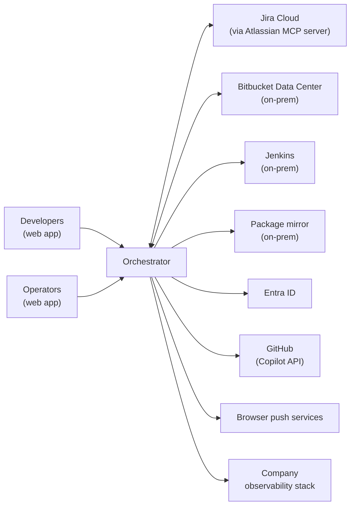
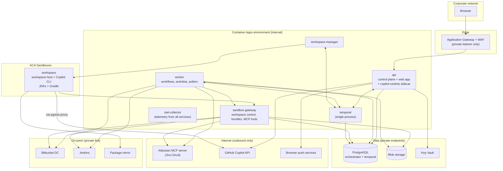
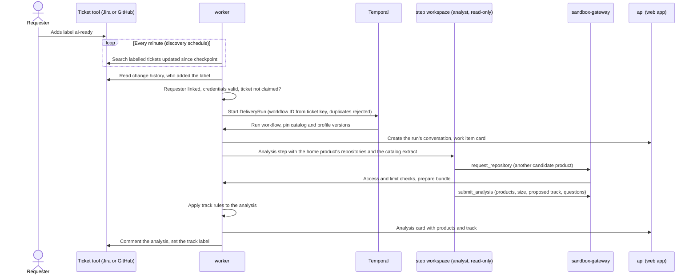
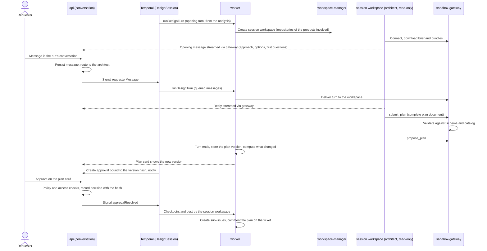
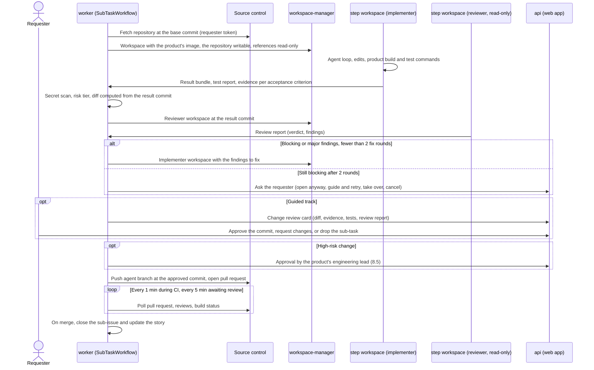
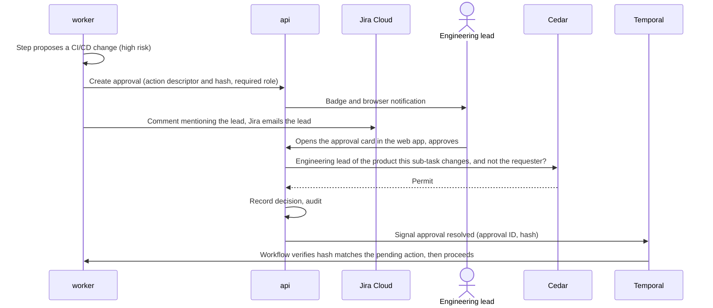
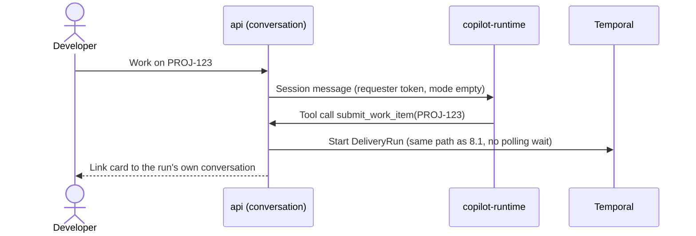
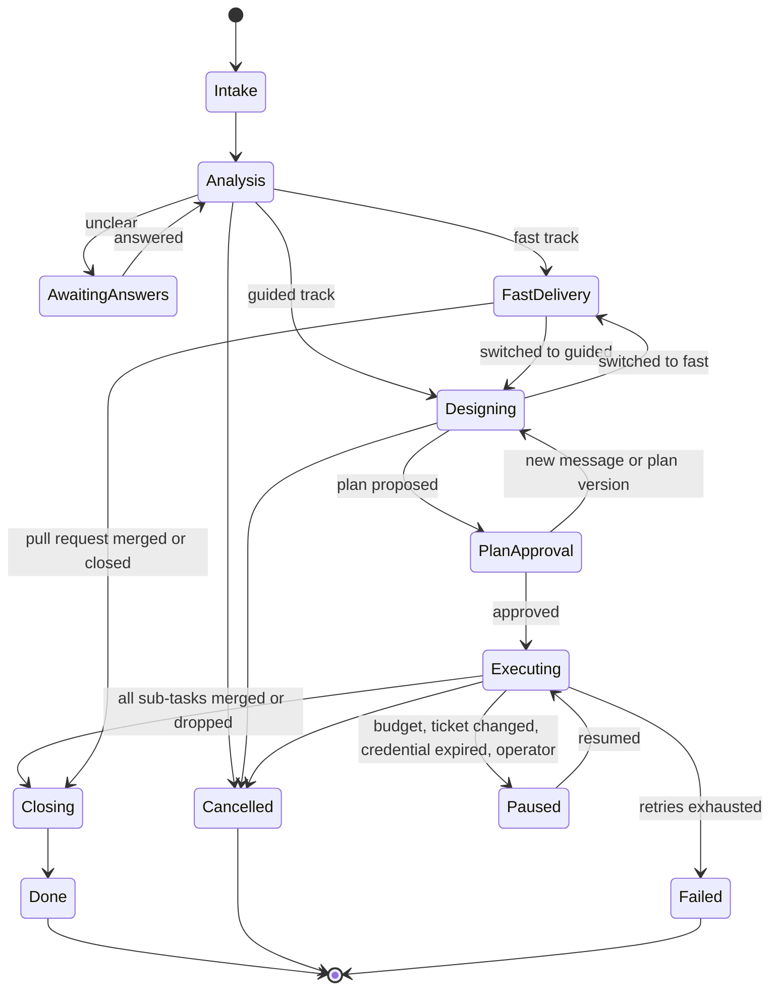
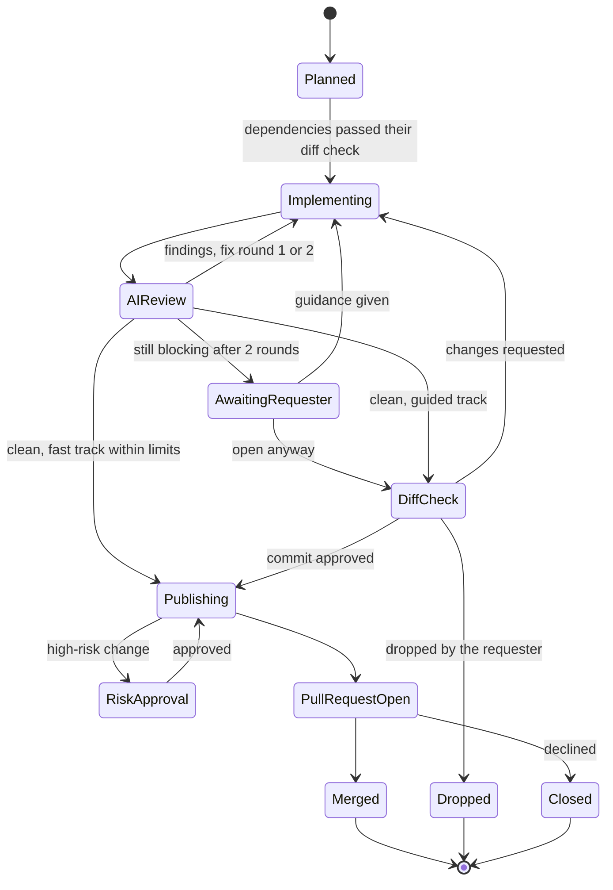

# Orchestrator Layer — Reference Architecture

| | |
|---|---|
| **Status** | Proposed (v2.0) — for review |
| **Date** | 2026-11-09 |
| **Phase** | Reference architecture — follows the [capability map](capabilities.md), the [non-functional requirements](non-functional-requirements.md) and the [functional requirements](functional-requirements.md) of iteration 2 |

## 1. Purpose and scope

This document defines **how** the orchestrator is built: its components and their responsibilities, the interfaces between them, the run event model, the data it keeps, how it is secured, and how it is deployed in the business and the personal deployment.

Every element traces back to a capability (`CAP-xx`), a decision (`Dxx` in the capability map, `AD-xx` here), a non-functional requirement (`NFR-xx`) or a functional requirement (`FR-xx`).

Version 2.0 adds the design for **iteration 2**: two tracks, the analyst, architect and reviewer agents, the design session, versioned hand-off plans, the AI review and the diff check, and work across products (decisions AD-30 to AD-42). §24 says what of it is built now on the local stack, and in which order.

Out of scope for this document: detailed API specifications, database DDL and UI design. These follow during the build.

### Glossary

| Term | Meaning |
|---|---|
| Work item | A ticket (Jira Cloud or GitHub Issues) or a chat request, normalized into one model |
| Run | One execution of the delivery skeleton for one work item. It belongs to the ticket, not to a repository (AD-31) |
| Product | Something a team owns and ships: one or more repositories, owners, a toolchain and commands (AD-30) |
| Product catalog | The trusted configuration that describes every product; it replaces the earlier project configuration |
| Track | Fast (one small change, no stops before the pull request) or guided (design session, approved plan, diff checks) |
| Analysis | The analyst agent's structured result: understanding, products involved, size, proposed track, questions |
| Design session | The conversation between the requester and the architect agent that produces the hand-off plan |
| Hand-off plan, plan version | The plan of a guided run. Every change creates a new immutable version; approval is bound to one version (AD-36) |
| Contract | An interface between products that the plan fixes: an API, an event, a schema or a shared library |
| Sub-task | One unit of the approved plan: one product, one repository, one branch, one pull request |
| Step | One agent invocation with a result (e.g., analyse, implement, review, fix) |
| Review report | The reviewer agent's structured result for one change: verdict and findings |
| Diff check | The requester's approval of one sub-task's change in the web app, before its pull request opens |
| Workspace | The isolated sandbox in which an agent reads, changes and builds code. A **step workspace** lives for one step; a **session workspace** lives for a design session and is saved when idle (AD-34) |
| Requester | The person a run acts for: who sent the chat request, or who added the `ai-ready` label (AD-05) |
| Agent profile | A versioned agent definition: instructions, tools, model, limits (CAP-01) |
| Linked credential | A token or OAuth connection a user links to their orchestrator account (AD-28) |
| Intake connection | A linked Atlassian connection used to discover new tickets for a project (AD-27) |

## 2. Inputs and changes to earlier documents

| Change | Effect |
|---|---|
| **Business source control is Bitbucket Data Center on-prem**, built by Jenkins, with dependencies from an on-prem mirror. GitHub is used only in the personal deployment. | Business ticket tool is Jira Cloud only; D14 links Jira Cloud ↔ Bitbucket (already linked natively) |
| **No admin rights on Jira, Bitbucket or Teams**: no webhooks, no service or bot accounts, no application links, no Teams bot | Polling everywhere (AD-26); Jira through Atlassian's MCP server with each user's OAuth (AD-27); every credential is linked by its user (AD-28); no public ingress at all (AD-07); Teams deferred to a later release (AD-17); notifications through the web app and Jira mentions (AD-29) |
| D7 said ticket write-back *consumes* the run event stream | Refined by AD-13: write-back runs as durable workflow activities; the event stream remains the single record of what happened |
| NFR-OP-05 asked for one trace ID per run | Refined by AD-19: runs last up to 30 days, too long for one trace; every telemetry record carries the run ID |

The capability map (v1.8) and the non-functional requirements (v1.3) are updated accordingly.

**Iteration 2** (this version) takes the [functional requirements](functional-requirements.md) v1.3 as input:

| Change | Effect |
|---|---|
| **Two tracks**, chosen after a preliminary analysis; the requester can switch (FR-A1 to FR-A3) | Track-dependent workflow (AD-32, §9); `readiness-analyst` and `planner` are replaced by `analyst` and `architect` (§15) |
| **The plan is shaped only in a chat with the architect agent**; the requester never edits it (FR-P1 to FR-P4) | Session workspaces (AD-34), durable design turns (AD-35), immutable plan versions (AD-36). The plan editor and the `editPlan` update of v1.2 are removed |
| **AI review of every change, fix loop, diff check** (FR-R1 to FR-R4) | `reviewer` step and review report (AD-39); change review bound to a commit (AD-40); `SubTaskWorkflow` reshaped (§9) |
| **Work across products** (FR-M1 to FR-M6) | Product catalog (AD-30); a run belongs to the ticket (AD-31); agents specialized per product by composition (AD-33); workspaces with several repositories (AD-37); dependencies across repositories (AD-41). The tenant is now the product |
| **One conversation per run** (decided for this iteration) | Refines AD-25: a run started from a chat no longer lives in that chat (AD-38) |
| **Write access across products is broad at work** (confirmed) | The requester's own token stays the only write credential (AD-06); access is still checked before a plan can be approved (AD-42) |
| Capability map wording: "readiness check", "planner", "edit plan" | Read as: preliminary analysis, architect, and re-plan through the architect. The capability map itself is unchanged |
| Non-functional requirements | NFR-PF-10 added for design-session replies (v1.4) |

## 3. Architecture drivers

1. **Long, durable runs.** Up to 30 days, mostly waiting on people; never lose work or duplicate a side effect (NFR-SC-06, NFR-AV-02, NFR-AV-03).
2. **Agents run untrusted code next to real credentials.** Ticket text and repository content can carry prompt injection; agents execute builds and tests (NFR-SE-04 to NFR-SE-08, CAP-08, CAP-12).
3. **Same build on a laptop and on Azure** (NFR-OP-01, NFR-OP-02).
4. **Two deployments with different integrations** — business: Jira Cloud, Bitbucket, Jenkins, Copilot seats; personal: GitHub, Anthropic via bring-your-own-key (D8, D9).
5. **Hybrid connectivity.** Azure services reach on-prem Bitbucket, Jenkins and the package mirror over the existing private link.
6. **Upgrades never break runs in flight** (NFR-OP-06).
7. **Pilot scale, best-effort availability, growth to ~200 developers** (NFR-SC-01, NFR-AV-01).
8. **Limited admin rights.** Everything must work with outbound calls and credentials that users can create and link themselves.
9. **Work crosses products owned by different teams.** One story can change several repositories with different toolchains and conventions; each team keeps control of its own (FR-M1 to FR-M6).
10. **Interactive agent work next to long batch steps.** The design session needs chat latency (NFR-PF-02) with the same isolation as a build step.

## 4. Architecture decisions

New decisions of this phase. They complement D1–D15 in the capability map.

| ID | Decision | Rationale | Alternatives considered |
|---|---|---|---|
| AD-01 | **Azure Container Apps** hosts all services, in an internal (VNet-only) environment | Least to operate; fits pilot scale and best-effort availability | AKS: more control, more operations; no existing AKS platform |
| AD-02 | **ACA Sandboxes** run agent workspaces, behind a `WorkspaceProvider` port. Fallback: ACA dynamic sessions. Local: Docker | MicroVM isolation, blocked-by-default egress, host allowlists and credential injection match NFR-SE-04/05 | ACA dynamic sessions (egress controls to build ourselves); AKS sandboxed pods (preview, needs AKS) |
| AD-03 | **Business source control: Bitbucket Data Center**; CI: Jenkins; dependencies: on-prem mirror. **Personal: GitHub** | Company landscape | — |
| AD-04 | **Users sign in with Entra ID.** Copilot seats belong to GitHub Enterprise Managed Users; **each user links a fine-grained personal access token with only the "Copilot Requests" permission** | No admin needed; the token can be used for Copilot and nothing else (D10) | GitHub App user authorization: needs an organization owner |
| AD-05 | **The requester of a ticket run is whoever added the `ai-ready` label**, read from the ticket's change history | That person authorized the work | Assignee or reporter: may not have asked for automation |
| AD-06 | **Bitbucket pushes and pull requests use the requester's personal HTTP access token.** The worker only ever pushes `agent/**` branches. Pull requests are authored by the requester and marked agent-generated | Bitbucket natively stops authors approving their own pull request, which enforces four-eyes (requester counts as author); no admin-created accounts or links needed | Bot account and OAuth application link: need Bitbucket admins |
| AD-07 | **No public ingress.** The web app is reachable only from the corporate network; every integration is an outbound call | Smallest attack surface; nothing in the design needs inbound traffic from outside | Internet with Entra Conditional Access |
| AD-08 | **Terraform** (AzureRM, plus AzAPI for preview resources such as ACA Sandboxes) | Company standard | Bicep |
| AD-09 | **One standard JVM workspace image** with preinstalled JDKs and Gradle support; each repository's Gradle wrapper and toolchain settings select the versions; nothing is downloaded from the internet | Every business repository builds with Gradle | devcontainer.json per repository; central images per stack |
| AD-10 | **Modular monolith for the control plane**; separate deployables only at trust or scaling boundaries (§6) | Small team, pilot scale | Microservice per capability |
| AD-11 | **PostgreSQL is the only stateful store** (orchestrator and Temporal databases on the same server); Blob storage for large artifacts | One point-in-time restore keeps runs and events consistent (NFR-AV-04); portable (NFR-OP-02) | Separate stores per component |
| AD-12 | **Run events live in PostgreSQL** (append-only), with projections updated in the same transaction and live fan-out via `LISTEN/NOTIFY` | Consistent and laptop-friendly; enough for ≤ 1,000 waiting runs | Message broker: unnecessary at this scale (§19) |
| AD-13 | **Side effects are workflow activities with idempotency keys**: ticket write-back, pushes, pull requests, notifications | Temporal retries them durably | Event subscribers with their own checkpoints |
| AD-14 | **The agent harness runs inside the sandbox** (Copilot CLI with its built-in tools), one runtime per workspace. The sandbox holds **no source-control or ticket-system credentials**; tools with side effects go through the sandbox gateway | Best agent quality with native tools; Copilot SDK's strongest isolation pattern | Harness outside with remote custom tools: re-implements file and shell tools, adds latency |
| AD-15 | **The front-door agent runs on a shared Copilot runtime in `mode: "empty"`**, with only orchestrator tools and a per-session requester token | No ambient filesystem access; efficient for many chat sessions | Runtime per user: heavier for light chat traffic |
| AD-16 | **Cedar is the policy engine**, embedded in-process (WebAssembly) | Analyzable; "forbid overrides permit" implements "projects may be stricter, never looser" (D15) | OPA/Rego: harder to reason about; extra process |
| AD-17 | **Teams is deferred to a later release**; when added, it uses the Microsoft Teams SDK (TypeScript) | No admin path for a bot registration today; the channel-neutral catalog keeps the door open | Microsoft 365 Agents SDK |
| AD-18 | **Workflow versioning with Temporal patching**, enforced by replay tests in CI | Identical on a laptop and on Azure (NFR-OP-06) | Pinned worker versions: old workers kept for up to 30 days |
| AD-19 | **Run ID on every telemetry record; one trace per interaction or step**, linked by run ID | 30-day traces are dropped by backends (refines NFR-OP-05) | One trace per run |
| AD-20 | **Audit trail is a hash-chained append-only table**, with a daily digest written to immutable Blob storage (business) | Tamper-evident (NFR-SE-07) without new infrastructure | Separate ledger service |
| AD-21 | **TypeScript monorepo** with one shared contracts package (events, APIs, component catalog, workspace protocol) | One source of truth for every interface (D11) | Repositories per service |
| AD-22 | **Service secrets in Azure Key Vault** via Entra workload identity; locally from the OS keychain, injected by the launcher. **Linked credentials are envelope-encrypted** in PostgreSQL | NFR-SE-03 | — |
| AD-23 | **Temporal server runs as a single process on Container Apps** for the pilot, on PostgreSQL. Scale-out path in §19 | Matches best-effort availability; minimal operations | Temporal Cloud: run metadata at a third party; AKS Helm: needs AKS |
| AD-24 | **The sandbox has no access to source control.** The worker fetches the repository and hands it over as a git bundle through the sandbox gateway; results leave the same way and are pushed by the worker after secret scanning and a policy check | Nothing inside the sandbox can read other repositories or write anywhere; the sandbox needs no route to Bitbucket | Cloning from inside the sandbox with an injected token: a write-capable token at the proxy could be abused |
| AD-25 | **One web app with two views and a toggle.** User view: conversation with generative UI only. Operator view: conventional role-scoped pages, open to everyone within their scope. Switching keeps context; every run has a home conversation | One sign-in and design system; each audience gets the interaction that fits | Two separate apps; generative UI in the operator view |
| AD-26 | **Polling everywhere, no webhooks.** Temporal Schedules poll Jira for new tickets every minute and watch active tickets every two minutes; each sub-task workflow polls its pull request; GitHub is polled every ≤ 5 min (personal) | No webhook can be created; Schedules are durable, observable and pausable | Webhooks: not available; can be added later to speed things up |
| AD-27 | **Jira through Atlassian's Remote MCP server, with each user's OAuth 2.1 connection**, called programmatically by the worker (no LLM in polling or write-back). Write-back appears under the requester's name, marked agent-generated. Each project has one or more **intake connections** for discovery | The access users can get without admins; respects their Jira permissions | Integration account: needs admins; personal API tokens with REST: fallback if the MCP server falls short (R-10) |
| AD-28 | **Every external credential is linked by its user**: Copilot token, Atlassian connection, Bitbucket token, optional Jenkins token. Stored encrypted, used only server-side, expiry tracked with reminders | No shared service accounts exist or can be created | — |
| AD-29 | **Notifications: in-app pending-actions badge, browser push notifications (Web Push), and Jira @mentions for approvers** other than the requester | Works without admin rights; Jira's own emails reach approvers | Teams (deferred); email (needs IT approval) |
| AD-30 | **The product catalog is trusted configuration and the product is the tenant.** It holds, per product: description, owners, where its tickets live, repositories with their roles, toolchain image, build and test commands, high-risk and contract paths, allowed registries. It is validated when loaded, versioned, and pinned by each run at start. A file in this iteration; managed in the operator view later | One place decides what agents may touch and how they build; nothing an agent can read (a repository, a ticket) can change it | Configuration files inside each repository: they are untrusted content. A flat repository list per Jira project: no ownership, toolchain or commands per product |
| AD-31 | **A run belongs to the story ticket; every sub-task names one product and one repository.** One `DeliveryRunWorkflow` per ticket, one `SubTaskWorkflow` per sub-task | One plan, one approval and one place that orders the changes across products | A run per product: cross-product ordering becomes distributed coordination. Sub-tasks spanning repositories: pull requests that cannot be reviewed or merged as a unit |
| AD-32 | **Agents propose the track, rules decide what is allowed.** The analyst's structured analysis proposes a track; the workflow applies deterministic rules (more than one product or a Story → guided) and re-checks the fast-track limits against the real diff before a pull request opens | Classification is model output on untrusted input, so it cannot be the control | Trusting the classification: a prompt-injected ticket could choose the track with no stops |
| AD-33 | **Four agent roles as versioned profiles (`analyst`, `architect`, `implementer`, `reviewer`), specialized per product by composition**: base profile (code) + product settings from the catalog (trusted) + the product's guidance files in its repository (untrusted content) | Product teams shape agent behavior without touching orchestrator code, and cannot widen tools, commands or network | One profile per product and role: many profiles to maintain, and product teams would need to change the orchestrator |
| AD-34 | **The design session runs in a warm, read-only session workspace.** It is created when the run enters the design phase, kept while the conversation is active, and checkpointed and destroyed after 20 minutes of silence; the next message restores it. The record lives outside the sandbox: messages, plan versions and the checkpoint | Native code exploration with full isolation, chat latency while active, no cost while idle | A new sandbox per message: every reply waits for a start. The architect in the control plane with remote read tools: weaker exploration, repository content processed outside the sandbox |
| AD-35 | **Design turns are durable workflow work; token streaming is out of band.** A message is persisted, signalled to the `DesignSessionWorkflow` and delivered by an activity; the reply streams workspace → gateway → `api` → browser without entering Temporal history | One owner of the workspace lifecycle; turns survive restarts and are never lost or run twice | The `api` talking to the workspace directly: two owners, lost turns on restart |
| AD-36 | **Plans are immutable versions written only by the architect through a tool.** The orchestrator validates each version (schema, catalog, dependencies), stores it with the request that prompted it, computes what changed, and renders it. Approval is a user action bound to a version hash; a newer version voids a pending approval | The requester steers, the architect writes, and what is approved is exactly what is built (FR-P3, FR-P4) | An editable plan (v1.2): changes without explanation. Patch operations from the agent: harder to validate, versions drift |
| AD-37 | **Workspaces hold several repositories; at most one is writable.** Read-only workspaces (analysis, design, review) get the repositories of the products involved as separate bundles and can ask for more catalog repositories, within a limit. An implementer workspace gets its one repository writable, plus read-only copies of approved changes it depends on. Only the writable repository's branch can leave a workspace | Agents see what they need across products; the damage a step can do stays one branch in one repository | One workspace per repository: no cross-product reasoning. All repositories writable: cross-repository changes outside the plan |
| AD-38 | **One conversation per run; the `api` routes by run state, not a model.** While a design session is open, the requester's messages go to the architect; otherwise to the front-door agent scoped to that run. Every agent message is labelled with its author | Two agents never compete in one thread, and routing cannot be talked into anything | Sharing the chat that started the run: two agents and several runs in one thread |
| AD-39 | **Every change is reviewed by the reviewer agent in a fresh read-only workspace**, from the change, the sub-task, the plan and the product's guidance — not from the implementer's transcript. Where a deployment offers several model families, the reviewer's default model differs from the implementer's. The verdict drives the fix loop and fast-track publishing only | An independent second look; errors of the first agent are less likely to be repeated | Self-review by the implementer: same context, same blind spots |
| AD-40 | **The diff check approves a commit.** The worker computes the diff from the result commit; the change review card is rendered from it; the approval carries the commit hash, and exactly that commit is pushed | What the requester saw is what is published | Approving a description of the change |
| AD-41 | **Dependent sub-tasks: stacked in one repository, referenced across repositories.** In the same repository the dependent branch starts from the approved commit of the one it depends on, and its pull request targets that branch until it merges. Across repositories the dependent implementer gets a read-only copy of the approved change and the contract; pull requests state the merge order and the orchestrator flags violations | Work continues without waiting for merges; reviewers see only each sub-task's own diff | Waiting for each merge: days of idle time. One long-lived branch per story: one huge review |
| AD-42 | **Access is checked before commitment.** Analysis needs the requester's read access to each repository it opens; a plan can be approved only when the requester can push to every repository in it and (business) create issues in every Jira project involved | No story is left half-built because a credential cannot reach one product | Finding out at push time |

## 5. System context



All arrows from the orchestrator are outbound calls; nothing outside the corporate network calls in (AD-07).

| External system | Role | Deployment |
|---|---|---|
| Jira Cloud, via Atlassian's MCP server | Ticket discovery and watching (polling), write-back (sub-tasks, status, comments, mentions) | Business |
| Bitbucket Data Center | Repository fetch, pushes, pull requests, review and build status (polling) | Business |
| Jenkins | Build logs for the CI fix loop, when the requester linked a token | Business |
| Package mirror | Gradle distributions and dependencies for builds in sandboxes | Business |
| Entra ID | User sign-in, groups for roles, workload identities | Business |
| GitHub (Enterprise Managed Users) | Copilot API used by agents; token checks | Business |
| Browser push services | Delivery of browser notifications | Both |
| GitHub (personal account) | Repositories, issues, pull requests, Actions | Personal |
| Anthropic API | Models via Copilot SDK bring-your-own-key | Personal |
| Observability stack | Traces, metrics, logs via OpenTelemetry | Both (company stack / Grafana) |

## 6. Containers



| Deployable | Responsibility | Technology | Trust zone | Scaling | Main capabilities |
|---|---|---|---|---|---|
| `api` | Control plane (modular monolith): edge and sessions, conversation and its routing, web channel, run commands and queries, approvals, chat intake, registry and product catalog, identity and linked credentials, credential broker, notifications, event fan-out. Serves the web app's static files | Node.js, TypeScript; AG-UI; Cedar; Web Push | Control plane | Horizontal, stateless (min 1) | CAP-01, 02, 07, 08, 09, 10, 11 |
| `copilot-runtime` (sidecar of `api`) | Shared Copilot runtime for front-door agent sessions, `mode: "empty"` | Copilot CLI server | Control plane | With `api` | CAP-10 |
| `worker` | Temporal workflows (delivery run, design session, sub-task), activities (policy, approvals, integrations, agent-step and design-turn supervision, plan validation, diffs, write-back, compensation) and pollers (Schedules) | Node.js, TypeScript; Temporal SDK; MCP client | Control plane | Horizontal per task queue (min 1) | CAP-02, 03, 05, 06, 07, 09 |
| `workspace-manager` | Creates, tracks and destroys workspaces; only identity allowed to manage sandboxes; reaper for orphaned workspaces | Node.js, TypeScript; Temporal worker on its own task queue | Control plane (privileged) | 1–2 replicas | CAP-04 |
| `sandbox-gateway` | The only service sandboxes can reach: workspace control channel (brief, progress, transcript, results), repository bundles, MCP tool endpoint with policy enforcement and credential brokering | Node.js, TypeScript; MCP (Streamable HTTP) | Sandbox-facing boundary | Horizontal | CAP-04, 06, 08 |
| `workspace` (image) | Runs one step or one design session: `workspace-host` drives a Copilot SDK session with the agent profile; Copilot CLI executes built-in tools in the sandbox | Node.js, Copilot SDK and CLI, git, the product's toolchain (JDKs and Gradle support in the business image) | Sandbox | One per active step, one per active design session | CAP-04 |
| `temporal` | Durable execution: timers, signals, updates, retries, Schedules | Temporal server, all services in one process; Temporal Web UI (internal, platform admins only) | Control plane | Single replica (pilot) | CAP-03 |
| `otel-collector` | Receives OpenTelemetry from all services and exports to the company stack | OpenTelemetry Collector | Control plane | 1–2 replicas | CAP-13 |
| PostgreSQL | Orchestrator database; Temporal persistence and visibility databases | Azure Database for PostgreSQL Flexible Server | Data | Vertical; read replica later | CAP-03, 05, 13 |
| Blob storage | Transcripts, artifacts (repository and result bundles, test reports, diffs, review reports, design-session checkpoints), audit digests (immutable container) | Azure Blob Storage | Data | Managed | CAP-05, 13 |
| Key Vault | Service secrets; key-encryption key for linked credentials; Web Push signing keys | Azure Key Vault | Data | Managed | CAP-06, 08 |
| `egress-proxy` (personal only) | Allowlist and credential injection for local sandboxes (the role ACA Sandboxes plays on Azure) | Small HTTP proxy | Sandbox-facing boundary | 1 | CAP-04 |

Iteration 2 adds **no deployable**: the new agent roles, the design session and the product catalog live in the existing services.

## 7. Component view

### 7.1 `api` modules

| Module | Responsibility | Key interfaces |
|---|---|---|
| Edge | Entra ID sign-in (OIDC, authorization code with PKCE) as a backend-for-frontend: tokens stay server-side, browser holds an httpOnly, SameSite=strict session cookie; CSRF protection; request rate limits | HTTPS |
| Conversation | Conversations and their messages, persisted in PostgreSQL. **Routing (AD-38):** in a run's conversation, a message goes to the architect while the run's design session is open (persist, then signal the `DesignSessionWorkflow`), otherwise to the front-door agent. Front-door agent: one Copilot session per conversation on the shared `copilot-runtime` (AD-15); the Copilot session is a cache, rebuilt from history when needed; idle sessions closed after 15–30 min | Copilot SDK (JSON-RPC to sidecar); Temporal signal |
| Channels / web | User view: AG-UI event stream over Server-Sent Events, resumable with `Last-Event-ID`, carrying catalog components. Operator view: REST queries on projections plus an SSE subscription to run events. Toggle state and landing-view preference | AG-UI; REST; SSE |
| Channels / Teams | *Later release (AD-17)*: Teams SDK bot, A2UI → Adaptive Cards renderer | — |
| Runs | Commands (start, pause, resume, cancel, change track, retry, take over) mapped to Temporal starts and signals; queries from projections, including plan versions, review reports and diffs | Temporal client; REST |
| Approvals | Approval objects for plan versions, changes (diff check), unresolved review findings and high-risk actions; renders approval content from orchestrator data only; verifies the approver with policy; signals the workflow | REST, Temporal signal |
| Intake (chat) | Work submitted from the chat (e.g., "plan PROJ-123") starts immediately, without waiting for the next poll. Ticket discovery itself runs in the worker (§14.1) | Temporal client |
| Registry | Agent profiles and versions; **product catalog** (§15: products, repositories, owners, toolchain, commands, risk and contract paths; plus intake connections, status mapping and budgets per product); policy versions | REST (operators) |
| Identity | Users and roles (Entra app roles); **linked credentials** (AD-28): link, verify, store encrypted, track expiry, remind, revoke; **credential broker** (internal endpoint that hands short-lived use of a credential to the worker and the sandbox gateway) | Internal HTTPS (mTLS) |
| Notifications | Pending-actions badge feed; Web Push subscriptions and delivery (AD-29) | Web Push |
| Fan-out | `LISTEN` on run-event notifications; pushes to connected SSE clients | PostgreSQL |

### 7.2 `worker`: workflows, activities and pollers

| Task queue | Contents | Concurrency control |
|---|---|---|
| `orchestration` | Workflows; light activities (emit event, policy decision, create approval, notify) | Default |
| `integration` | Jira (MCP), Bitbucket, Jenkins, GitHub activities; poller activities | Per-system rate limits; honor `Retry-After` and 429 |
| `agent-steps` | `runAgentStep`: prepare the repository bundles, request a workspace, supervise the step (heartbeating), collect the result. `runDesignTurn`: make sure the session workspace is up (create or restore), deliver one turn, supervise it. `checkpointSession` | Bounded by sandbox capacity; warm sessions capped per person and in total |
| `workspaces` | Workspace create/destroy (served by `workspace-manager`) | Bounded by sandbox quota |

| Temporal Schedule | Interval | Purpose |
|---|---|---|
| `jira-discovery` (one per product's Jira project) | 1 min | Find newly labelled tickets (§14.1) |
| `jira-watch` | 2 min | Detect answers, edits and label changes on tickets of active runs (§14.1) |
| `github-discovery` (personal) | ≤ 5 min | Find newly labelled issues in every repository of the catalog |
| `credential-expiry` | Daily | Remind users 7 days before a linked credential expires |
| `retention`, `audit-digest` | Daily | NFR-DR-02; AD-20 |

Workflow structure (details in §9): `DeliveryRunWorkflow` per run; a `DesignSessionWorkflow` child for the design phase of a guided run; a `SubTaskWorkflow` child per sub-task (including its own pull request polling loop) — the fast track runs one. All LLM work happens in activities, keeping workflows deterministic.

### 7.3 `workspace-manager` and workspaces

- **`WorkspaceProvider` port** with three adapters: `aca-sandboxes` (business default), `aca-dynamic-sessions` (business fallback), `docker` (personal).
- **Workspace specification**: kind (step or session), image, CPU/memory/disk, maximum lifetime, egress allowlist, credential-injection rules (model API only), labels (run, step or session, product). Image, commands and extra registries come from the product catalog (AD-30), never from the repository.
- **Code in, code out (AD-24)**: the worker fetches each repository at a pinned commit with the requester's token and stores a git bundle; `workspace-host` downloads the bundles from `sandbox-gateway`. The sandbox has no route to any source control. Bundles are cached per repository and commit; read-only repositories use shallow bundles.
- **Image catalog**: business `jvm-gradle` (JDK LTS versions in use, git, Node.js runtime for the workspace host, Copilot CLI); personal `general` (common toolchains). Images are prebuilt, scanned and signed in CI (NFR-SE-09). A product chooses its image in the catalog.

| | Step workspace | Session workspace (AD-34) |
|---|---|---|
| Used by | `analyst`, `implementer`, `reviewer` | `architect` |
| Lifetime | One step; destroyed at step end | Created when the design phase starts; destroyed after 20 min without a turn (configurable) or after 8 h, with a checkpoint first |
| Repositories | Analyst, reviewer: read-only. Implementer: one writable, references read-only | Read-only |
| Egress | Model API; for the implementer also the product's package registries | Model API only |
| Leaves the sandbox | One validated result (analysis, review report, or result bundle for the writable repository) | Chat text and validated plan versions |

**Layout inside a workspace (AD-37):**

```
/workspace/repos/<product>/<repository>   one checkout per repository; exactly one is writable in an implementer workspace
/workspace/refs/<product>/<repository>    read-only copies of approved changes this sub-task depends on
/workspace/context/                       brief, ticket, analysis, plan, contracts, catalog extract, findings to fix
```

- **More repositories on demand.** The analyst and the architect call the gateway tool `request_repository` to add a catalog repository. The gateway checks that the repository is in the catalog, that the requester can read it (AD-42) and that the limit (8 per step or session by default) is not reached; the worker then stores the bundle and the host checks it out.
- **Reaper**: destroys any workspace older than its lifetime, any step workspace without a live step and any session workspace without an open design session (NFR-DR-03: within 1 h).

`workspace-host` (inside the sandbox) has two modes.

**Step mode:**

1. Connects out to `sandbox-gateway` with its workspace token; downloads the step brief and the repository bundles.
2. Starts a Copilot SDK session with the agent profile: instructions, model, built-in tools allowed by the profile (a permission handler denies all others), MCP server = `sandbox-gateway`.
3. Streams progress and transcript to the gateway; reports usage; enforces step limits (time, turns).
4. On completion — implementer: runs the product's build and test commands from the brief, commits locally, uploads a result bundle, test reports and a result summary with evidence per acceptance criterion; analyst and reviewer: submit their structured result through a gateway tool (`submit_analysis`, `submit_review`).

**Session mode:**

1. Connects, downloads the brief and bundles, and either starts a new Copilot session or restores one from a checkpoint (`resumeSession`), with automatic context compaction enabled for long sessions.
2. Waits for turns on the control channel. For each turn it sends the requester's messages to the session, streams the reply and tool activity to the gateway, and reports the turn's end with usage. Turns carry an ID, so a turn delivered twice is run once.
3. The architect writes plans only through the gateway tools `submit_plan` and `propose_plan` (§7.4).
4. On a checkpoint request it archives the Copilot session state and uploads it to the gateway, then exits.

**Restoring a session.** A new workspace gets the same repository commits (pinned for the session) and the checkpoint. If the checkpoint cannot be restored (missing, or incompatible after an upgrade), the session is rebuilt from the record: the analysis, the conversation history and the latest plan version. The architect loses its exploration notes, not the agreed result (R-13).

### 7.4 `sandbox-gateway`

Two listeners: **sandbox-facing** (workspace control channel, bundles, MCP) and **internal** (worker attaches to steps and turns, stores bundles). It holds **no Temporal credentials**.

- **Control channel**: WebSocket over TLS, authenticated by a workspace token (signed, audience = one workspace and one step or session, expires with it, revoked on completion). It carries the brief, progress, transcript, results and — for session workspaces — turns and checkpoint requests.
- **Repository bundles**: served only to the workspace they were prepared for.
- **MCP tool endpoint**, every call checked with Cedar (profile, step or session, run, requester), executed with brokered credentials where needed, and recorded for audit:

| Tool | For | What the gateway does |
|---|---|---|
| Ticket and comments (read) | All roles | Proxied to the Atlassian MCP server or GitHub with the requester's credential |
| Pull request comments and diffs, build logs (read) | `implementer`, `reviewer` | Requester's token; Jenkins only when linked |
| `request_repository` | `analyst`, `architect` | Catalog, access and limit checks; asks the worker for the bundle (§7.3) |
| `submit_analysis` | `analyst` | Validates against the analysis schema and the catalog; the validated document becomes the step's result |
| `submit_plan` | `architect` | Validates a complete plan document (below); on failure returns the errors to the agent, on success attaches the document to the turn's result |
| `propose_plan` | `architect` | Flags the turn's accepted plan (or the latest stored version) for approval |
| `submit_review` | `reviewer` | Validates the review report; it becomes the step's result |
| `submit_result` | `implementer` | Validates the summary and the evidence per acceptance criterion; the result bundle is uploaded separately |

  Agents get no write tools on external systems.
- **Plan validation (`submit_plan`, FR-P2):** schema; every sub-task has a stable key, acceptance criteria, and a product and repository from the catalog; exactly one repository per sub-task; dependencies reference existing keys and have no cycles; with more than one product, contracts name their provider and consumer sub-tasks. **One writer:** the gateway only validates. When the turn or step ends, a workflow activity stores the result — a plan version with its hash, its parent version, the profile version that wrote it and the requester's message that prompted it — and emits the event in the same transaction; a proposal then becomes an approval object (AD-13).
- **Storage**: transcript and progress to Blob plus a progress index in PostgreSQL; artifacts and checkpoints to Blob with content hashes.
- **Budget and limit enforcement**: can stop a step or a turn when its budget or limits are exhausted.

### 7.5 Web app: user view and operator view

**One web app** — one codebase, one sign-in, one design system — with **two views** and a **toggle in the header** to switch between them (AD-25).

| | User view | Operator view |
|---|---|---|
| Purpose | Ask for work, design it with the architect, follow it, answer questions, check changes and approve — in a conversation | See and control everything, in technical detail |
| Interaction | Chat with the front-door agent and, during a design session, the architect agent; content appears as generative UI inside the conversation | Conventional pages: lists, graphs, timelines, transcripts, forms |
| Who | Everyone | Everyone, scoped by role |
| Who builds the screen | Composed at runtime from the component catalog by the agent and the orchestrator | Fixed pages designed and built by the team; no agent-generated UI |
| Data channel | AG-UI stream (SSE) per conversation | REST queries on projections plus an SSE subscription to run events |
| Channels | Web (Teams in a later release) | Web only |

#### Toggle and navigation

- **Visible to everyone.** What the operator view shows depends on the person's role (table below).
- **Context is kept when switching:**

| From | To | Opens |
|---|---|---|
| A run's conversation | Operator view | That run's detail page |
| A general chat | Operator view | The runs list (developers: their own runs) |
| A run detail page | User view | That run's conversation for the person |
| Any other operator page | User view | The last conversation |

- **Landing view**: the last view each person used, stored as a server-side preference. First visit: user view for developers, operator view for operator roles.
- **Addressable URLs** for both views (e.g., `/chat/<conversation>`, `/ops/runs/<run>`), used by notifications and links posted on tickets.

#### User view

**Layout.** The conversation fills the center. A **thin frame** around it holds a side panel with past conversations and a **pending-actions badge** (approvals, questions waiting for the person). Selecting a conversation or a pending action opens it in its conversation.

**Conversations and runs (AD-38).** Every run has **its own conversation** for its requester, created when the run starts. When the run was started from a chat, that chat shows a link card to the run's conversation and stays a general chat with the front-door agent. Other people involved in a run (e.g., an engineering lead asked to approve) get a conversation for that run the first time they are involved. The toggle uses the run of the open conversation.

**Who answers.** The `api` routes each message by the run's state, never by asking a model:

| Run state | The requester's message goes to | Shown in the conversation |
|---|---|---|
| Design session open (designing, or plan proposed and not yet approved) | The **architect agent** | A header strip: "Design session with the architect", with the session state (active, resuming) |
| Any other state | The **front-door agent**, scoped to this run (status, showing cards) | Nothing extra |

Every agent message carries the name of the agent that wrote it. While a session workspace is starting or resuming, a status line appears within the acknowledgement time (NFR-PF-01), so the wait is never silent (NFR-PF-10).

**Two sources of content** in the conversation timeline:

1. **Agent turns** from the front-door agent or the architect agent: text and agent-allowed components (text, form, table). The architect uses a form to offer design options; the choice comes back as a message.
2. **Orchestrator cards**: system-only components posted by the orchestrator from run events and approvals (analysis, plan, change review, review report, story, progress tracker, approval card, pull request summary). They are visually marked as coming from the orchestrator, so people can trust what an approval card says. Where a card shows text an agent wrote (a plan's approach, a finding, the evidence for an acceptance criterion), that text is validated by schema, shown as plain text and labelled with the agent that wrote it.

The agent can **bring up an orchestrator card by reference** — "show me the plan of PROJ-123" makes the agent call `show(runId, "plan")` — and the orchestrator renders it from its own data. The agent never writes the content of a system-only component; the `api` strips any that appear in agent output.

**Actions on cards** (approve a plan version, approve a change, request changes, drop a sub-task, change the track, answer, pause or cancel one's own run) are sent as typed events straight to the `api` and authorized by policy (CAP-08). They never pass through an agent: typing "approve" in the chat approves nothing (FR-P4).

**Agent text is rendered defensively.** Markdown from agents is rendered without remote images or embedded content, and links show their full address and open only on a click; the web app's content security policy allows connections and images from its own origin only. An agent that has read confidential code cannot make the browser send it anywhere (§13).

**Component catalog** (D4, D13). Defined in our contracts package; A2UI is used only inside the renderer adapters, so A2UI's move to 1.0 touches the renderers only.

| Component | Source | Web | Teams (later release) |
|---|---|---|---|
| Text (markdown) | Agent, orchestrator | Rendered | TextBlock |
| Form (text, choice, number, date) | Agent, orchestrator | Rendered | `Input.*` + `Action.Execute` |
| Table | Agent, orchestrator | Rendered | Table |
| Work item card | Orchestrator | Rendered | Card |
| Analysis card | Orchestrator (analysis from the analyst, validated by schema) | Summary, products involved with reasons, size, track with reasons and a **change track** action; on the fast track, the intended approach | Summary + link |
| Plan card | Orchestrator (plan versions from the architect, validated by schema) | Read-only: goal, approach, contracts, sub-tasks grouped by product, dependencies; version selector and **what changed** since the previous version; failed checks; **Approve** once the version is proposed | Summary + link |
| Change review card | Orchestrator (diff computed by the worker) | Summary, acceptance criteria with the implementer's evidence, files changed with a diff viewer (unified and side by side), test results, review report; **Approve**, **Request changes**, **Drop the sub-task** | Link to web |
| Review report | Orchestrator (report from the reviewer, validated by schema) | Verdict, findings by severity with file and line | Summary + link |
| Story view | Orchestrator | Sub-tasks grouped by product with status, links and merge order; warnings for pull requests merged out of order | Summary + link |
| Approval card | **Orchestrator only** | Rendered | `Action.Execute` approve/reject |
| Progress tracker | Orchestrator | Live, with pause/cancel for the requester | Updated in place |
| Pull request summary, test report | Orchestrator | Rendered | Summary card with link |

Until Teams arrives, people need the corporate network or VPN to act on runs; notifications (§7.6) tell them when to.

#### Operator view

| Page | What it shows | Who |
|---|---|---|
| Runs | List and search by state, project, requester, date | Everyone within scope |
| Run detail | Track and its history; products involved; analysis; plan versions with what changed; plan graph with sub-task status by product; design session (state, turns, live transcript, workspace); review reports and diffs; event timeline; step detail (brief, result, live transcript, tool calls, usage, cost); linked ticket, sub-issues, pull requests and builds; approvals | Everyone within scope |
| Interventions | Pause, resume, cancel, retry, change track, take over. Plans are never edited here either (FR-P3) | Engineering leads (their products), platform admins |
| Approvals inbox | Pending approvals the person may decide | Approvers |
| Intake | Poller health per product: checkpoint lag, intake connections, last errors | Engineering leads (their products), platform admins |
| Products | The catalog: products, repositories, owners, toolchain, commands, risk and contract paths; the catalog version each run pinned. Read-only while the catalog is a file | Everyone (read); platform admins (edit, later) |
| Workspaces | Live sandboxes, resource use, blocked egress attempts | Platform admins |
| Agent profiles | Versions, promotion, evaluation results | Agent developers (below production), platform admins |
| Policies and product configuration | Cedar policies, risk overrides, intake connections, budgets | Platform admins |
| Audit | Search and export of the audit trail; chain verification status | Auditors, platform admins |
| Dashboards | Agent quality metrics, cost and usage, system health | Everyone within scope |
| My connections | The person's linked credentials, their status and expiry | Everyone (own only) |

**Scope by role** (§12):

| Role | Sees in the operator view | Can do |
|---|---|---|
| Developer | Their own runs, including transcripts | Read only (pause and cancel happen in the conversation) |
| Engineering lead | All runs in which one of their products is involved | Interventions on runs whose ticket belongs to their product; high-risk approvals for sub-tasks that change their product |
| Agent developer | All runs, including transcripts | Manage agent profiles below production |
| Platform admin | Everything operational | All interventions, configuration, promotion |
| Auditor | Everything, including the audit trail | Read only |

The Temporal Web UI stays a separate, low-level tool for platform admins.

#### Shared foundations

- **One design system.** Catalog components and operator pages are built from the same React component library.
- **Authorization lives in the `api`.** Every request is checked server-side; hiding a button or a page is never the security control.
- **Accessibility and language** apply to both views (NFR-UX-01, NFR-UX-02).

### 7.6 Notifications

| Situation | Requester | Others involved (e.g., approver) |
|---|---|---|
| Question or approval waiting (plan proposed, change ready for the diff check, review findings unresolved, high-risk action) | Badge + browser notification | Badge + browser notification + Jira comment mentioning them |
| The architect replied while the requester was away from the conversation | Badge + browser notification | — |
| Run finished, failed or paused | Badge + browser notification | — |
| Linked credential expiring or invalid | Badge + browser notification; banner in the web app | — |

- **Browser notifications** use Web Push with a service worker; they reach desktop browsers that are open and allowed to show notifications (R-12).
- **Jira mentions** are posted with the requester's connection (Jira does not notify people of their own actions, so they reach others only); each comment links to the run in the web app.
- **Reminders** for unanswered approvals and questions after 1 working day (§9).

## 8. Key flows

### 8.1 Ticket to analysis and track



- **Pickup time** is at most one polling interval plus processing: ≤ 2 min (NFR-PF-06). A chat request ("work on PROJ-123") starts at once.
- **Requester not linked yet**: no run starts; the person gets a badge and browser notification asking them to link their accounts (if they have used the web app), and the intake connection comments on the ticket with a link to the web app. The ticket is picked up as soon as the links exist.
- **Unclear ticket**: the analysis carries questions; they are posted on the ticket and in the conversation. The watch poller detects the requester's reply (or the person answers in the web app), and the analysis step runs again with the answers.
- **Placing the work (FR-M2)**: the analyst starts from the product where the ticket lives and the catalog descriptions, and opens candidate repositories on demand. The requester can correct the product list in the conversation; the correction is an answer that re-runs the analysis.
- **Track rules (AD-32)**, applied by the workflow to the validated analysis: more than one product → guided; ticket type Story → guided; otherwise the analyst's proposal. The requester can change the track (§9).

### 8.2 Design session to approved plan



- **The session opens by itself.** As soon as the run is guided, the workflow starts the opening turn, so the workspace is already warm when the requester arrives.
- **One turn at a time.** Messages that arrive during a turn are queued and delivered together as the next turn.
- **Streaming** goes workspace → gateway → `LISTEN/NOTIFY` → `api` → browser as step progress; only the turn's start and end are workflow events (AD-35).
- **Idle**: 20 minutes after the last turn the workflow checkpoints and destroys the workspace. The next message restores it; the conversation shows "resuming" at once, and the reply follows within the workspace start time (NFR-PF-10).
- **A new plan version after the proposal** (the requester asked for one more change) voids the pending approval; the architect proposes again when the version is ready. An approval for an older hash is refused.
- **Before approval is possible (AD-42)** the `api` checks that the requester can push to every repository in the plan and, in the business deployment, create issues in every Jira project involved. Missing access is listed on the plan card.
- **Products can change during the session (FR-M2)**: the architect adds a repository with `request_repository`; the plan version that follows shows the added or removed product.

### 8.3 Sub-task: implement, AI review, diff check, pull request



- **The reviewer starts clean (AD-39):** it gets the diff, the sub-task with its acceptance criteria, the plan's scope, constraints and contracts, the product's guidance at the base commit, and the test results — not the implementer's transcript.
- **Fast track:** the same workflow runs once, without the diff check. Before the push the worker re-checks the fast-track limits against the real diff (files changed, one repository, no high-risk or contract paths). When they are exceeded, the run stops and asks the requester: continue, switch to guided, or cancel.
- **Request changes** at the diff check starts another implement and review round with the requester's feedback; the card returns with a new commit.
- **Drop the sub-task** closes it as not done; sub-tasks that depend on it wait for the requester's decision.
- **The pull request description** carries the review summary, resolved and unresolved findings, test results, the story link and, across products, the related pull requests and the merge order (FR-R3, FR-M5).
- People merge in their source control under each repository's own rules. Fixing CI failures and review comments by agents is a later iteration (FR-N3).

### 8.4 Dependencies between sub-tasks and across products

Sub-tasks run one at a time in this iteration, in the order given by the plan's dependencies (FR-M4). A sub-task starts when every sub-task it depends on has passed its diff check, not when it is merged (AD-41).

| Dependency | Base of the dependent work | Pull request | When the first one merges |
|---|---|---|---|
| Same repository | The approved commit of the sub-task it depends on (stacked branch) | Targets that sub-task's branch, so reviewers see only its own diff | The worker retargets the pull request to the default branch and merges the default branch into the agent branch; conflicts go to a bounded fix step |
| Another repository or product | The default branch of its own repository; the approved change it depends on is mounted read-only under `/workspace/refs/`, and the contract is in the brief | Targets the default branch; states "merge after" with a link | Nothing to do |

- **Merge order** is advice the orchestrator watches, not a lock it can enforce without admin rights: each pull request states it, the story view shows it, and a pull request merged before one it depends on raises a warning on the story and a comment on the ticket (FR-M5).
- **A dependency changes after the dependent work started** (the requester asked for changes, or review comments led to new commits): the dependent sub-task is brought up to date when it is retargeted (same repository) or the requester is told that the reference changed (another repository).

### 8.5 Approval of a high-risk action



In a story across products, the approver is a lead of **the product the sub-task changes**, which may differ from the product of the ticket. In the personal deployment the owner holds every role and approves.

### 8.6 Chat request through the front-door agent



The front-door agent's tools are limited to: submit a work item, get run status, list the requester's runs, show an orchestrator card by reference, and render agent-allowed components. Approvals and track changes are never available as tools.

## 9. Run lifecycle and workflow design



Every state before `Closing` can be cancelled (three are drawn); `FastDelivery` can pause and fail like `Executing`.

Each sub-task (and the single change of the fast track) follows its own lifecycle inside a `SubTaskWorkflow`:



| Aspect | Design |
|---|---|
| Identity | Workflow ID derived from the work item (`run:jira:PROJ-123:1`, `run:github:owner/repo#12`); Temporal rejects a second active run for the same ticket (claiming). Children: `design:<run>`, `subtask:<run>:<key>` |
| Pinned at start | Catalog version and agent profile versions; a catalog change applies to new runs |
| Track | Workflow state, set by the rules of AD-32 from the analysis. `changeTrack` (requester): fast → guided at any time before the pull request opens — the running sub-task is cancelled, its workspace destroyed, nothing was pushed, and a design session starts from the analysis. Guided → fast only before the plan is approved and with one product: the latest plan version collapses into one change |
| Signals | `approvalResolved` (plan version, change, unresolved findings, high risk), `answerReceived` and `ticketChanged` (from the watch poller or the web app), `requesterMessage` (to the design session), `changeTrack`, `pause`, `resume`, `cancel`, `credentialRestored` |
| Updates | None. The `editPlan` update of v1.2 is removed: plans change only through the architect (AD-36) |
| Queries | Current state for diagnostics; user-facing reads come from projections |
| Design session | A `DesignSessionWorkflow` child: loops over turns (activity `runDesignTurn`), the idle timer (20 min → `checkpointSession`), plan proposals and the approval. It returns the approved plan version, a switch to the fast track, or a cancellation. Its history is separate from the run's and continues-as-new on long sessions. Re-planning during execution (FR-N6) will start it again with the current plan |
| Child workflows | One `SubTaskWorkflow` per sub-task, started in dependency order, **one at a time in this iteration**; parallel where the plan allows is the later step (FR-N7) |
| Timers | Design-session idle (20 min); approval, diff-check and question reminders (1 working day); 30-day run limit (NFR-SC-06); pull request polling (1–5 min, adaptive) |
| Bounded loops | AI review fix rounds ≤ 2 (FR-R2), then the requester decides; rounds requested by the requester at the diff check are not bounded but counted; merge-conflict fix after retargeting ≤ 2. Later iteration: CI fix ≤ 3, review-comment fix ≤ 3 |
| Activity timeouts | Agent steps: start-to-close ≤ 4 h (NFR-CO-01 default), heartbeat 2 min (longer locally to survive laptop sleep). Design turns: start-to-close 15 min, same heartbeat |
| History size | Large payloads never enter Temporal history (claim-check references to Blob); continue-as-new beyond a threshold |
| Versioning | Patching (`patched()`); CI replays recorded production histories against new code and fails on non-determinism (AD-18) |
| Compensation | On cancel or failure: decline open pull requests, delete `agent/**` branches, close open sub-issues as not planned, revert ticket status, comment on the ticket, destroy the session workspace; each step idempotent |
| Ticket changed mid-run | Includes removal of the `ai-ready` label: pause at the next safe point and ask the requester to re-plan, continue or cancel (CAP-07) |
| Credential expired mid-run | Pause; ask the requester to re-link; resume on `credentialRestored` |

## 10. Run event model

| Stream | Content | Ordering | Retention |
|---|---|---|---|
| **Run events** | Milestones and decisions: the authoritative record of a run | Gapless `seq` per run, assigned by the workflow | 1 year (audit) |
| **Step progress** | Agent transcript chunks, tool calls, live progress from workspaces | Per-step sequence | 90 days |

### Envelope

```json
{
  "eventId": "0192f0c4-7b1e-7c3a-9f4e-2d6a1b8c9e01",
  "runId": "run_01JB8Q6Z3K",
  "seq": 42,
  "type": "step.completed",
  "schemaVersion": 1,
  "occurredAt": "2026-10-17T10:15:03.120Z",
  "actor": { "kind": "agent", "id": "implementer@3" },
  "subject": { "productId": "payments-api", "subtaskId": "st_2", "stepId": "sp_7" },
  "payload": {},
  "correlation": { "traceId": "4bf92f3577b34da6a3ce929d0e0e4736", "causationId": "0192f0c4-…" },
  "tenantId": "payments-api",
  "deployment": "business"
}
```

### Event types (initial)

| Group | Types |
|---|---|
| Run | `run.created`, `run.paused`, `run.resumed`, `run.cancelled`, `run.completed`, `run.failed` |
| Intake and analysis | `intake.claimed`, `intake.enriched`, `analysis.question_asked`, `analysis.answered`, `analysis.completed`, `products.identified`, `products.changed` |
| Track | `track.set`, `track.changed`, `track.limits_exceeded` |
| Design session | `design.opened`, `design.turn_started`, `design.turn_completed`, `design.suspended`, `design.resumed`, `design.closed` |
| Plan | `plan.version_created`, `plan.proposed`, `plan.approval_voided`, `plan.approved` |
| Sub-task and step | `subtask.started`, `subtask.completed`, `subtask.dropped`, `subtask.blocked`, `subtask.failed`, `step.started`, `step.completed`, `step.failed` |
| Review | `review.completed`, `review.fix_requested`, `review.unresolved`, `change.check_requested`, `change.approved`, `change.changes_requested` |
| Approval | `approval.requested`, `approval.resolved`, `approval.expired` |
| Source control and CI | `scm.branch_pushed`, `scm.pr_opened`, `scm.pr_updated`, `scm.pr_retargeted`, `scm.review_received`, `scm.pr_merged`, `scm.pr_declined`, `scm.merge_order_violated`, `ci.status_changed` |
| Ticket | `ticket.subtasks_created`, `ticket.subtask_closed`, `ticket.transitioned`, `ticket.commented`, `ticket.changed` |
| Governance | `policy.denied`, `budget.threshold_reached`, `budget.exhausted`, `credential.expired`, `compensation.completed` |

### Rules

- **Write path**: the `emitEvent` activity inserts the event (primary key `runId + seq`, so retries are no-ops) and updates projection tables **in the same transaction**, then `NOTIFY` with `{runId, seq}` only.
- **Read path**: the operator view and the user view's orchestrator cards read projections and subscribe via SSE; on reconnect they resume from the last `seq`.
- **Schema evolution**: additive changes within a `schemaVersion`; breaking changes create a new version with an upcaster on read (NFR-OP-06).
- **Mapping to AG-UI** happens in the web channel adapter; the event model does not depend on AG-UI or A2UI.
- **Events carry references, not content.** A `plan.version_created` event names the version and its hash; the plan document, review reports and diffs live in their own tables and in Blob storage.
- **The success measures of the functional requirements (§6 there)** are computed from these events: track kept (`track.set` without `track.changed`), products kept, plan versions between `plan.proposed` and `plan.approved`, changes approved at the first diff check, fix rounds per change.

## 11. Data architecture

| Store | Content | Encryption | Backup |
|---|---|---|---|
| PostgreSQL `orchestrator` | Users, linked credentials (encrypted), registry and product catalog versions, work items, runs, analyses, plan versions, design sessions, sub-tasks, steps, review reports, change reviews, approvals, run events, projections, progress index, usage, conversations, poll checkpoints, push subscriptions, audit log | At rest (platform) + envelope encryption for linked credentials; TLS | Point-in-time restore, RPO ≤ 1 h (NFR-AV-04) |
| PostgreSQL `temporal`, `temporal_visibility` | Workflow state, Schedules, visibility | At rest; TLS | Same server, same restore point as `orchestrator` (AD-11) |
| Blob storage | Transcripts, repository and result bundles, test reports, diffs, design-session checkpoints, audit digests | At rest; private endpoint | Soft delete and versioning; immutable container for digests |

Key entities (logical); new or changed in iteration 2 in **bold**:

| Entity | Main content |
|---|---|
| `user`, `linked_credential` | Provider, encrypted secret, scopes, expires at, last verified |
| **`catalog_version`**, **`product`**, **`product_repository`** | Catalog hash and content; per product: description, owners, ticket source (Jira project or GitHub repositories), intake connections, status mapping, risk overrides, budgets; per repository: role, toolchain image, commands, risk and contract paths, registries |
| `agent_profile`, `policy_set` | Id, version, status, spec; Cedar source |
| `work_item`, **`run`** | Run: home product (tenant), track and its history, pinned catalog and profile versions, conversation |
| **`analysis`** | Run, version, document (understanding, products with reasons, size, proposed track, questions, fast-track approach) |
| **`design_session`** | Run, state (active, suspended, closed), workspace, pinned repository commits, checkpoint reference, last turn |
| **`plan_version`** | Run, number, hash, parent, document, status (draft, proposed, approved, superseded), author profile version, the message that prompted it |
| **`subtask`** | Run, plan version, stable key, product, repository, depends on, state (§9), branch, base and head commit, pull request, ticket reference |
| `step` | Sub-task or run, profile version, kind (analyse, implement, review, fix), round, result reference |
| **`review_report`** | Sub-task, round, head commit, verdict, findings (severity, file, line, explanation, suggestion) |
| **`change_review`** | Sub-task, head commit, diff reference, state, the requester's feedback |
| `approval` | Subject (plan version, change, unresolved findings, high-risk action), hash, required principal, state |
| **`conversation`**, **`message`** | Conversation: kind (general or run), run. Message: author (requester, front-door, architect, orchestrator), text, components |
| `run_event`, `usage_record`, `poll_checkpoint`, `push_subscription`, `audit_record` | As before; usage is recorded per step and per design turn, with the product it served |

- **Retention jobs** enforce NFR-DR-02: run events and audit 1 year; transcripts, progress and artifacts (including bundles and diffs) 90 days; design-session checkpoints until the run closes plus 7 days; deletion on request (NFR-DR-04).
- **Multi-tenancy readiness (CAP-15)**: every table carries `tenant_id` from day one. **The tenant is the product** (AD-30): a run's tenant is the product its ticket belongs to, and sub-tasks, steps, usage and events also carry the product they change. A lead of an involved product can see the run; row-level security, enabled in Tier 2, follows the same rule.
- **Data flows**: business source code is fetched by the worker into Azure (approved), processed in sandboxes and sent to models only through Copilot under the company agreement.

## 12. Identity, access and credentials

### Roles

Mapped from Entra app roles (business); the owner holds all roles (personal).

| Role | Can |
|---|---|
| Developer | Request work; design it with the architect; change the track; approve own plan versions and changes (diff check); drop sub-tasks; follow, pause and cancel own runs from the conversation; answer questions; see the technical detail of own runs in the operator view (read-only) |
| Engineering lead (per product; the product's owners in the catalog) | Approve high-risk actions on sub-tasks that change their product, and budget increases; see every run their product is involved in and intervene in runs whose ticket belongs to it; provide an intake connection for the product |
| Agent developer | See transcripts, tool calls, evaluation results; manage agent profiles below production |
| Platform admin | Operate the system; promote profiles; manage policies and configuration; Temporal UI |
| Auditor | Read-only access to audit history and runs |

### Linking credentials (AD-28)

On first use, a business user links in **My connections**:

| Credential | How the user creates it | Verification at link time | Required |
|---|---|---|---|
| GitHub fine-grained personal access token | On their EMU account, permission "Copilot Requests" only, with an expiry | Copilot entitlement check; GitHub login recorded | Yes |
| Atlassian connection | OAuth 2.1 consent to the Atlassian MCP server, started from the web app | Jira account recorded; test search | Yes |
| Bitbucket personal HTTP access token | In Bitbucket profile settings, project/repository read and write, with an expiry | Repository access check; Bitbucket user recorded | Yes |
| Jenkins API token | In Jenkins user settings | Test read of a build | Optional |

Before each run the orchestrator checks the requester's links are valid. **Access is checked before commitment (AD-42):** read access when a repository is opened for analysis or design, and push access to every repository of a plan (plus issue creation in every Jira project involved) before that plan can be approved. Write access across products is broad in the company, so this check is a safety net rather than a frequent stop. Expiry is read where the system reports it (e.g., GitHub's token-expiration response header) or entered by the user; reminders start 7 days ahead. When an Entra account is disabled, that person's credentials are deleted, their runs pause and the project's engineering lead is notified.

### Credential matrix

| Credential | Held by | Scope | Lifetime | Used for | Never in sandbox? |
|---|---|---|---|---|---|
| Web session | `api` (server side) | One user | Short idle timeout | Web app | Yes |
| GitHub fine-grained token (Copilot Requests) | Linked credentials → credential broker | Copilot use only | User-set expiry | Front-door sessions; workspace agents (injected at egress) | **Target: yes** (R-01) |
| Atlassian MCP connection | Linked credentials | The user's Jira permissions | Short access token, rotated refresh | Discovery (intake connections), visibility checks, write-back as requester, agent read tools via gateway | Yes |
| Bitbucket personal HTTP access token | Linked credentials | The user's repository permissions | User-set expiry | Fetch for bundles, push `agent/**`, pull requests, polling, agent read tools via gateway | Yes |
| Jenkins API token (optional) | Linked credentials | The user's Jenkins read access | Until revoked | Log excerpts | Yes |
| Workspace token | Issued by `sandbox-gateway` | One workspace, one step or design session | Until the step ends or the session workspace is destroyed | Control channel, bundles, MCP | Held by workspace-host |
| Web Push signing keys | Key Vault | Notification signing | Rotated | Browser notifications | Yes |
| Service identities | Entra workload identity | Per deployable | Automatic | PostgreSQL, Key Vault, Blob, registry | Yes |
| Anthropic API key (personal) | OS keychain → `egress-proxy` | Owner's account | Owner-managed | Bring-your-own-key model calls | Yes |
| GitHub fine-grained token (personal) | Linked credentials | Owner's selected repositories: contents, pull requests, issues | Owner-set expiry | Fetch, push, pull requests, issue polling and write-back | Yes |

Linked credentials are decrypted only in memory, at the moment of use, by the credential broker; every use is audited.

## 13. Security architecture

### Trust zones and allowed flows

| Zone | Members | May reach |
|---|---|---|
| Corporate network | Browsers | Private WAF listener (web app) only |
| Control plane | `api`, `worker`, `workspace-manager`, `sandbox-gateway`, `temporal`, `otel-collector` | Data zone; on-prem Bitbucket and Jenkins; allowed internet hosts via firewall (Copilot API, Atlassian MCP server, browser push services, Entra) |
| Sandbox | Workspaces | `sandbox-gateway` and Copilot API hosts; implementer workspaces also the package mirror — nothing else |
| Data | PostgreSQL, Blob, Key Vault, container registry | Private endpoints only |
| Internet | Everything outside | **No inbound path** (AD-07) |

### Threats and mitigations

| Threat | Example | Mitigation |
|---|---|---|
| Prompt injection via ticket or repository | A ticket instructs the agent to leak code or change CI | No source-control or ticket credentials in the sandbox; no route to source control; egress allowlist; policy enforced outside the model; high-risk actions need approval. Guided track: plan approval before execution and a diff check before each pull request. Fast track: limits re-checked on the real diff, and a person reviews the pull request before anything merges |
| Malicious ticket triggers a run | Someone labels a ticket with harmful instructions | Requester must be a linked user and is the person who added the label (AD-05); agent tools bounded by profile and policy; nothing reaches a protected branch without a person's review |
| Credential theft from the sandbox | Agent reads environment or files | Copilot token injected at egress; workspace token scoped to one step; no other credentials present |
| Theft of linked credentials | Attacker reaches the database | Envelope encryption with a Key Vault key; decrypted only in memory by the credential broker; audit of every use; expiry and revocation on leavers |
| Over-privileged personal tokens | A Bitbucket token can write wherever its user can | Used only by the worker; code and policy allow pushes to `agent/**` only; protected branches still guarded by repository permissions |
| Self-approval or spoofed approval | Agent output contains a fake approval card | Approval cards are system-only; approvals only through authenticated UI actions; Cedar check (role, approver ≠ requester for high risk); decision bound to the action hash |
| Sandbox escape | Malicious build script | MicroVM isolation, non-root, no host mounts, resource limits, short lifetime |
| Exfiltration through allowed hosts | Sending code to an external service | Only the gateway, Copilot API hosts and the package mirror are reachable; path-level rules where the proxy supports them (R-02) |
| Session hijacking | Stolen cookie | Server-side tokens, httpOnly SameSite=strict cookies, short sessions, corporate network only |
| Secrets in agent output | Agent commits a credential | Secret scanning before push and on transcripts (NFR-SE-03) |
| Supply chain | Malicious dependency or image | Dependencies only from the curated on-prem mirror; image scanning and signing; pinned base images |
| Audit tampering | Database edit to hide an action | Hash chain plus immutable daily digests (AD-20) |
| Allowance abuse | Runaway run consumes a person's Copilot allowance | Per-run budgets and limits (NFR-CO-01), loop bounds, alerts; design sessions count against the run's budget and stop when it is exhausted |
| A ticket chooses its own track | Injected text makes the analyst propose "fast" for a large change | The track is decided by rules on validated data, and the fast-track limits are re-checked against the real diff before the push (AD-32); high-risk paths still need approval |
| The architect is steered by repository content | A file tells the architect to add a sub-task that weakens CI | The architect can only write chat text and plan versions; the plan is validated and rendered by the orchestrator; the requester approves a specific version; high-risk paths need a lead's approval whatever the plan says |
| Agent output makes the browser leak data | Markdown with an image address that carries code to an external host | No remote images or embedded content in agent text, links open only on a click, strict content security policy (§7.5) |
| Guidance files as an injection path | A change to `AGENTS.md` tells agents to skip tests or ignore findings | Guidance is content, not configuration: tools, commands and network come from the profile and the catalog (AD-33). Agents read guidance at the base commit, not from the change under review. Guidance files are high-risk paths by default, so changing them needs a lead's approval |
| Reaching into other products | A step writes to a repository outside the plan, or reads unrelated repositories | Exactly one writable repository per workspace and only its branch can leave (AD-37); `request_repository` is limited to the catalog, the requester's read access and a count; every request is audited |
| Implementer and reviewer fail together | Both follow the same injected instruction | The reviewer starts from a clean context and, where available, another model (AD-39); orchestrator checks (secret scan, risk tier, fast-track limits) do not depend on either; a person reviews every pull request |
| Data in session checkpoints | A checkpoint contains code excerpts and the conversation | Stored like transcripts (encrypted, private endpoint), bound to its run, deleted 7 days after the run closes |
| Approval of something else | The plan or the change is altered after the requester looked | Approvals are bound to the plan version hash or the commit hash; a newer version voids a pending approval (AD-36, AD-40) |

## 14. Integrations

| System | How changes are detected | How the orchestrator writes | Idempotency | Limits |
|---|---|---|---|---|
| **Jira Cloud** (Atlassian MCP server) | `jira-discovery` and `jira-watch` Schedules (§14.1) | MCP tools for create, transition and comment, with the requester's connection; marked agent-generated. A sub-task of the story's own product is a Jira sub-task; one of another product is an issue in that product's project, linked to the story (open item, §23) | Sub-tasks carry a label `orch-<key>`; comments carry a marker; checked before each write | Site-level hourly limit shared with all MCP use on the site (R-10); back off on 429 |
| **Bitbucket DC** | Pull request polling inside `SubTaskWorkflow` (PR state, activities, build status for the head commit) | REST with the requester's personal token, in the repository of each sub-task: push `agent/<JIRA-KEY>/<slug>`, open and update pull requests, change a stacked pull request's target (AD-41, R-17) | One pull request per source branch | Per-user rate limits; adaptive intervals |
| **Jenkins** | — (build status comes from Bitbucket) | Read-only: build log excerpt (tail and error extraction, size-capped) | — | Only when the requester linked a token |
| **GitHub EMU / Copilot** | — | Copilot API from `copilot-runtime` and workspaces | — | Copilot rate limits per user |
| **Browser push services** | — | Web Push messages | Notification ID per event | — |
| **GitHub (personal)** | `github-discovery` Schedule over the catalog's repositories, conditional requests with ETags | REST with the owner's token: push, pull requests and their base, issue comments, `track:` labels, sub-issues created in the repository each sub-task changes and attached to the story (R-15) | One pull request per branch; one sub-issue per sub-task key (marker in the body) | GitHub rate limits |
| **Anthropic (personal)** | — | Through `egress-proxy`; Copilot SDK bring-your-own-key `baseUrl` points at the proxy | — | $50 monthly cap (NFR-CO-03) |

Agent-generated work is marked everywhere (NFR-SE-12): pull request title prefix and description footer, commit trailers (`Agent-Run: <runId>`, `Requested-By: <user>`), and a header on every comment the orchestrator posts under someone's name.

### 14.1 Change detection without webhooks (AD-26)

| Poller | Runs as | Interval | Query | Result |
|---|---|---|---|---|
| Jira discovery | Temporal Schedule per product's Jira project; overlapping runs skipped | 1 min | JQL: project in scope, label `ai-ready`, updated since checkpoint minus 2 min, oldest first | Candidate tickets → validate → start run |
| Jira watch | Temporal Schedule | 2 min | JQL: keys of active tickets (batches of ≤ 50), updated since checkpoint minus 2 min | New comments by the requester → `answerReceived`; edits or label removal → `ticketChanged` |
| Pull request watch | Timer loop in each `SubTaskWorkflow` | 1 min during CI, 5 min awaiting review | Bitbucket pull request, activities, build status | Sub-task advances: CI fix, review fix, merged, declined |
| GitHub discovery (personal) | Temporal Schedule | ≤ 5 min | Issues with the label in each catalog repository, conditional requests | As Jira discovery |

Rules:

- **Checkpoints** are stored per scope in `poll_checkpoint`. Each query overlaps the previous one by 2 minutes, because JQL dates have minute precision and search results can lag; duplicates are dropped by ticket key and `updated` value, and claiming is guaranteed by the workflow ID.
- **Small pages** (≤ 50 results); when a page is full, the time window is narrowed and the query repeated, so results never depend on deep pagination.
- **Validation before start**: re-read the ticket, confirm the label is still present, find who added it in the change history (AD-05, R-09), check the requester's links.
- **Intake connections**: each product (one Jira project per product) has one or more linked Atlassian connections (typically engineering leads) with access to the project. The poller uses a healthy one and fails over; with none healthy, discovery for that project stops and an alert fires.
- **Rate-limit budget**: at pilot scale, discovery (60 calls/h per scope), watch (~30/h) and per-run reads and writes stay at a few hundred calls per hour; intervals stretch automatically on 429 responses.
- **Health**: checkpoint lag per poller is a metric; lag above 10 minutes alerts (§16).
- **Webhooks later**: if webhooks become available, they can trigger the same validation path immediately; polling stays as the safety net.

## 15. Agent runtime

### Agent profiles

| Profile | Purpose | Workspace | Tools | Result |
|---|---|---|---|---|
| `front-door` | Conversation, intent, collecting details | None (shared runtime, `mode: "empty"`) | Orchestrator tools only | Chat text, agent components |
| `analyst` | Preliminary analysis of every work item: understand it, place it in products, size it, propose a track, ask questions (replaces `readiness-analyst`) | Step, read-only, several repositories | Read tools, ticket read, `request_repository` | `submit_analysis` |
| `architect` | Design the solution with the requester and write the hand-off plan (replaces `planner`); guided track only | Session, read-only, several repositories | Read tools, git history, ticket read, `request_repository`, agent components | Chat text; `submit_plan`, `propose_plan` |
| `implementer` | Implement one sub-task with tests, or fix review findings | Step, one repository writable, references read-only | Shell, edit, the product's build and test commands | `submit_result` with evidence per acceptance criterion; result bundle |
| `reviewer` | Review one change against the sub-task, the plan, the contracts and the product's guidance | Step, read-only, at the result commit | Read tools, diff, test results | `submit_review` |
| `ci-fixer` | Fix a failing build (later iteration, FR-N3) | Step, one repository writable | Jenkins log read (if linked); local build reproduction | Result bundle |

Profiles are code (versioned in the monorepo), validated in CI and promoted through the registry. A run pins the profile versions it starts with. The model is a profile setting: the most capable model for `analyst`, `architect` and `reviewer`; where several model families are available, `reviewer` defaults to a different one than `implementer` (AD-39).

### Specialization per product (AD-33)

The agent that works on a product is put together when its workspace is prepared:

| Layer | Source | Trust | Decides |
|---|---|---|---|
| Base profile | Orchestrator code | Trusted | Role instructions, allowed tools, model, limits, result schema |
| Product settings | Product catalog | Trusted | Sandbox image, build and test commands, registries, high-risk and contract paths |
| Guidance | `AGENTS.md` or `.github/copilot-instructions.md` in the product's repository, at the base commit | Untrusted content | Conventions, architecture notes, areas not to touch, how to test |

- The implementer's verification commands are run by `workspace-host` from the catalog, so guidance cannot replace them.
- Agents working on several repositories (analyst, architect) get the list of guidance files in their brief and read each one before working in that repository.
- "The implementer of product X" is therefore not a separate program: it is the `implementer` profile with product X's settings and guidance.

### Product catalog (AD-30)

```yaml
products:
  - id: payments-api
    name: Payments API
    description: >
      Owns payment authorization and capture, and the public REST API.
      Does not own the checkout pages (web-shop) or the ledger.
    owners: [alice, bob]                 # engineering leads; Entra group in the business deployment
    tickets: { jira: PAY }               # or: { github: [acme/payments-api] }
    defaults:
      image: jvm-gradle
      commands: { build: "./gradlew assemble", test: "./gradlew test" }
      highRiskPaths: ["deploy/**"]
    repositories:
      - id: PAY/payments-api             # Bitbucket project/repository, or GitHub owner/name
        role: service
        contractPaths: ["api/openapi.yaml"]
      - id: PAY/payments-client
        role: library
        commands: { build: "./gradlew assemble", test: "./gradlew check" }
```

- **Validation at load**: schema; unique product and repository ids; every repository belongs to exactly one product; images exist in the image catalog. An invalid catalog stops new runs and raises an alert; running runs keep the version they pinned.
- **Defaults added by the orchestrator**: guidance files and CI/CD, infrastructure, dependency and ownership files are high-risk paths in every product (D15).
- **Contract paths** mark where a product's interfaces live. A change that touches one is never fast track, and the reviewer checks it against the plan's contracts.
- The description is what the analyst uses to place work (FR-M2); keeping it accurate is the product owners' job.

### Step contract

| Direction | Fields |
|---|---|
| Brief (in) | Run, sub-task and step IDs; profile and version; kind and round; product settings (commands, guidance file paths); repositories with product, role, commit and mode (writable, read-only, reference); branch; brief documents (ticket, analysis, plan version, sub-task, contracts, findings to fix, the requester's feedback); limits; remaining budget; policy snapshot |
| Result (out) | Status (`succeeded`, `failed`, `needs_input`, `budget_exhausted`); the role's structured result (analysis, review report, or summary with evidence); result bundle reference (implementer only); test report reference; transcript reference; usage; questions when `needs_input` |

A design turn uses the same envelope with a turn ID, the requester's messages in, and the reply, usage and any new plan version out.

### Context and knowledge

- The brief is written into the workspace as files under `/workspace/context/`, not pasted into the prompt; guidance files give long-term, team-owned knowledge (CAP-05 essential form, FR-M6).
- **Which repositories an agent sees**: the analyst starts with the repositories of the ticket's product and opens others on demand; the architect starts with those of the products the analysis found; the implementer gets the one repository of its sub-task plus references; the reviewer gets the same as the implementer, read-only.
- **What carries across agents** is always a validated document, never a transcript: the analysis to the architect, the plan version and contracts to implementers and reviewers, the review findings back to the implementer.

### Gradle toolchain (AD-09)

- JDKs preinstalled; Gradle finds them via `org.gradle.java.installations.paths`; automatic JDK download disabled.
- Gradle distributions used by onboarded repositories are prebaked into the image (wrappers pointing to the internet cannot download).
- Dependency resolution through the on-prem mirror; a read-only shared dependency cache (`GRADLE_RO_DEP_CACHE`) is prepopulated per repository during image builds for fast first builds (NFR-PF-08).
- Integration tests that need Docker (e.g., Testcontainers) may not run inside sandboxes; Jenkins remains the full gate (R-05).

## 16. Observability, audit and cost

- **Telemetry**: OpenTelemetry SDK in every service; Temporal interceptors propagate context across workflows and activities; the Copilot SDK propagates trace context; workspace telemetry is relayed through `sandbox-gateway`. Every record carries `run.id` (AD-19).
- **Dashboards**: runs by state and track, step durations, design-session turn latency and restore times, approval and diff-check wait times, workspace start times, error rates, Copilot latency, poller lag; agent quality metrics (NFR §4) and the success measures of the functional requirements (§6 there) computed from run events from day one of the pilot, per product.
- **Alerts** (NFR-OP-07): stuck runs, failure spikes, budget breaches, queue backlog, poller lag above 10 minutes, no healthy intake connection, private-link reachability, Atlassian rate-limit responses.
- **Audit**: every policy decision, approval, tool call with side effects, credential use and external write is an audit record in the hash chain; a daily job writes the chain head to an immutable Blob container and verifies the chain.
- **Cost**: `usage_record` per step and per design turn, with the product it served (Copilot premium requests as reported or estimated, workspace seconds, including the idle time of session workspaces); allowance read per requester for NFR-CO-01; reconciliation with GitHub billing data daily where available (NFR-CO-04). Personal: Anthropic usage against the $50 cap, with the Anthropic Console limit as backstop.

## 17. Deployment views

### 17.1 Business on Azure

| Element | Design |
|---|---|
| Network | Spoke VNet peered to the existing hub with the private link to on-prem; subnets for the Container Apps environment, ACA Sandboxes, Application Gateway, private endpoints |
| Ingress | Application Gateway WAF v2 with a private listener only (web app); no public IP (AD-07) |
| Egress | Hub firewall with FQDN allowlist for services (Copilot API, Atlassian MCP server, browser push services, Entra); sandbox egress through the ACA Sandboxes proxy (Copilot API hosts, package mirror) |
| Compute | Container Apps environment with workload profiles: `api` (+ `copilot-runtime`), `worker`, `workspace-manager`, `sandbox-gateway`, `temporal`, `temporal-ui`, `otel-collector` |
| Data | PostgreSQL Flexible Server (General Purpose, point-in-time restore); Blob storage with an immutable container; Key Vault; Azure Container Registry — all with private endpoints |
| Identity | One Entra app registration for web sign-in; workload identities per deployable; passwordless PostgreSQL access |
| Environments | `dev`, `staging`, `prod`; Terraform per environment; images built once and promoted |
| Region | One Azure region; data stays in it (NFR-DR-05) |
| Prerequisites from other teams | Subscription access, VNet peering to the hub, private DNS, firewall rules (network and cloud platform teams); Entra app registration if users cannot register apps (identity team) |

### 17.2 Personal on a laptop

| Element | Design |
|---|---|
| Runtime | Docker Compose, started by a launcher command that reads secrets from the OS keychain and injects them as environment variables (never written to disk) |
| Services | `postgres`, `temporal` (on PostgreSQL, same configuration shape as Azure), `api` (+ `copilot-runtime`), `worker`, `workspace-manager`, `sandbox-gateway`, `egress-proxy`, optional `otel-lgtm` (Grafana) |
| Network | All ports bound to `127.0.0.1`; sandboxes on an internal Docker network that reaches only `sandbox-gateway` and `egress-proxy` |
| Sandboxes | Docker containers: non-root, read-only root filesystem except workspace and temp, resource limits, no Docker socket; code arrives as a bundle. Only `workspace-manager` talks to the Docker engine; rootless Docker or Podman recommended |
| Sign-in | GitHub account, restricted to the owner's user ID |
| Intake | GitHub Issues polling over the catalog's repositories |
| Products | `products.yaml` next to `.env`, mounted read-only into `api` and `worker` |
| Backups | Daily `pg_dump` plus the artifact directory to a folder the owner chooses (NFR-AV-04 personal) |

## 18. Reliability and failure handling

| Failure | Behavior |
|---|---|
| Worker crash mid-activity | Temporal retries; `runAgentStep` re-attaches to the running workspace by step ID or starts a new one |
| Workspace dies | Heartbeat timeout; the step is retried in a new workspace from the same bundle (bounded) |
| Session workspace dies mid-turn | Heartbeat timeout; `runDesignTurn` restores the session from the last checkpoint or from the record and delivers the same turn again (turn IDs prevent a double answer); the conversation shows "resuming" |
| Checkpoint cannot be restored | The session is rebuilt from the analysis, the conversation history and the latest plan version (§7.3) |
| A dependency is dropped or declined | Sub-tasks that depend on it stop as blocked; the requester decides: re-plan with the architect, continue without it, or cancel |
| Pull request merged out of order | Warning on the story and the ticket; nothing is reverted |
| The requester loses access to one product's repository mid-run | That sub-task pauses with a clear message; other sub-tasks continue where the plan allows |
| Catalog file invalid | New runs do not start; alert; running runs continue on their pinned version |
| Copilot API outage or rate limit | Retry with backoff; run shows "waiting for model provider"; alert after threshold (NFR-AV-05) |
| Atlassian MCP server unavailable or rate-limited | Pollers back off; on recovery they catch up from their checkpoints, so no ticket is missed; write-back activities retry |
| No healthy intake connection for a project | Discovery for that project stops; alert to its engineering leads and platform admins |
| Private link to on-prem down | Integration activities retry; runs pause; alert |
| Linked credential expired or revoked | The affected run pauses; the person is notified to re-link; reminders 7 days before expiry prevent most cases |
| PostgreSQL outage | System stops; Temporal and runs resume when it returns |
| Laptop sleeps (personal) | Timers and schedules fire on wake; interrupted steps retried |

**Restore and reconciliation.** After a point-in-time restore, external systems may contain changes made after the restore point. On start, a reconciliation job walks active runs and matches external state through idempotency keys (sub-task labels, pull requests by branch, comment markers) before any new write, so no duplicates are created (NFR-AV-03, NFR-AV-04). Poll checkpoints restored to an earlier point simply re-read a slightly longer window.

## 19. Scaling path

| Trigger | Change |
|---|---|
| Department rollout or Temporal saturation | Split Temporal into frontend, history and matching services; or move Temporal to AKS (Helm) or a managed offering after a data review |
| Atlassian MCP rate limit approached | Longer watch intervals, larger batches; request API-token access or admin-registered webhooks |
| Operator queries slow the primary | PostgreSQL read replica for projections and dashboards |
| More than ~10 `api` replicas or high event rates | Replace `LISTEN/NOTIFY` fan-out with Azure Web PubSub or a broker |
| Sandbox queueing | Raise sandbox pool and quota; tune ready instances |
| Many design sessions open at once | Warm session workspaces are capped per person (2) and in total; beyond the cap the least recently used session is checkpointed early; shorten the idle timeout before raising quota |
| A formal availability target appears | Zone-redundant PostgreSQL, multiple Temporal replicas, zero-downtime deploys |

## 20. Codebase structure

```
apps/
  api/                 control plane modules (edge, conversation, channels, runs, approvals, intake, registry, identity, notifications)
  worker/              Temporal workflows (delivery run, design session, sub-task), activities and pollers
  workspace-manager/   WorkspaceProvider adapters
  sandbox-gateway/     control channel, bundles and MCP tool endpoint
  workspace-host/      runs inside the sandbox
  web/                 one web app: user view and operator view
  egress-proxy/        personal deployment only
packages/
  contracts/           schemas: work item, analysis, plan, review report, run events, APIs, component catalog, workspace protocol
  catalog/             product catalog schema, loader and validation
  policy/              Cedar schema, policies and tests
  adapters/            tickets (Jira via MCP, GitHub Issues), source control (Bitbucket, GitHub), CI (Jenkins), storage, secrets
  agent-profiles/      versioned profile definitions
  telemetry/           OpenTelemetry setup
infra/
  terraform/           Azure environments
  local/               Docker Compose and launcher
docs/
```

Quality gates in CI: type checks, unit tests, contract tests for adapters (recorded MCP and REST responses), Temporal replay tests, policy tests, end-to-end tests on the local setup (NFR-OP-01), image scanning and signing.

## 21. Traceability

### Capabilities

| Capability | Realized by |
|---|---|
| CAP-01 Agent registry | `api` registry; `packages/agent-profiles`; product catalog and specialization per product (AD-30, AD-33) |
| CAP-02 Planning and routing | `analyst` and `architect` profiles; track rules; `DesignSessionWorkflow`; plan versions; `DeliveryRunWorkflow` |
| CAP-03 Durable execution | Temporal; `worker` |
| CAP-04 Agent workspaces | `workspace-manager`; ACA Sandboxes; `workspace-host` (step and session modes); `sandbox-gateway` bundles; several repositories per workspace (AD-37) |
| CAP-05 State, context, memory | PostgreSQL; Blob; step briefs; validated documents between agents; guidance files in product repositories; design-session checkpoints |
| CAP-06 Tool and integration gateway | `sandbox-gateway` MCP endpoint; credential broker; integration activities |
| CAP-07 Work intake | Jira and GitHub pollers (Temporal Schedules); Atlassian MCP client; chat intake |
| CAP-08 Identity, policy | Entra ID; linked credentials; Cedar; Bitbucket branch permissions |
| CAP-09 Human in the loop | `api` approvals (plan version, diff check, unresolved findings, high risk); track change; signals; notifications and Jira mentions |
| CAP-10 User view | Web app user view; one conversation per run with routing to the front-door or the architect agent; component catalog; orchestrator cards (Teams later) |
| CAP-11 Operator view | Web app operator view (role-scoped pages); projections; Temporal UI for platform admins |
| CAP-12 Guardrails (Tier 2) | Egress controls, secret scanning, track rules and fast-track limits, defensive rendering of agent text (Tier 1 essentials); `reviewer` agent; injection test suite |
| CAP-13 Observability, audit (Tier 2) | OpenTelemetry; hash-chained audit |
| CAP-14 Evaluation (Tier 2) | Quality metrics and success measures from run events; review reports; benchmark runs on staging |
| CAP-15 Multi-tenancy (Tier 2) | `tenant_id` everywhere, tenant = product; row-level security when enabled |
| CAP-16 Cost (Tier 2) | `usage_record`; budgets in workflows and the gateway |

### Functional requirements (iteration 2)

| Requirement | Realized by |
|---|---|
| FR-A1 Preliminary analysis | `analyst` step in a read-only workspace; `submit_analysis`; analysis card and ticket comment (§8.1) |
| FR-A2 Classification | Track rules on the validated analysis; fast-track limits re-checked on the real diff (AD-32) |
| FR-A3 Change the track | `changeTrack` signal; track history on the run; `track:` label (§9) |
| FR-A4 Clarifying questions | Questions in the analysis; watch poller and web app answers (§8.1) |
| FR-P1 Design session | Session workspace (AD-34); `DesignSessionWorkflow`; conversation routing (AD-38); §8.2 |
| FR-P2 Plan content and checks | Plan schema and validation in `submit_plan` (§7.4) |
| FR-P3 Revise in the conversation | Immutable plan versions with the prompting message and computed differences (AD-36); no edit path in either view |
| FR-P4 Approve | Approval bound to the version hash, UI action only; newer version voids it |
| FR-P5 Mirror on the ticket | Write-back activities: plan comment, sub-issues or sub-tasks per §14 |
| FR-P6 Fast-track approach | Approach in the analysis, shown on the analysis card |
| FR-B1 Sub-tasks | `SubTaskWorkflow` per sub-task; one branch each; stacked or referenced dependencies (AD-41) |
| FR-R1, FR-R2 AI review and fix loop | `reviewer` step (AD-39); review report; bounded loop in `SubTaskWorkflow` |
| FR-R3 Report on the pull request | Pull request description built by the worker from the review report and test results |
| FR-R4 Diff check | Change review card on a worker-computed diff; approval bound to the commit (AD-40) |
| FR-R5 Fast-track publishing | Same workflow without the diff check; fast-track limits (§8.3) |
| FR-R6 High-risk changes | Risk tier by policy; approval by the product's lead (§8.5) |
| FR-R7 Story view | Story view card and run detail from sub-task projections |
| FR-M1 Product catalog | Catalog schema, validation and pinning (AD-30, §15) |
| FR-M2 Products involved | Analyst with catalog descriptions and `request_repository`; `products.*` events |
| FR-M3 Design across products | Architect session over several repositories; contracts in the plan schema; one repository per sub-task (AD-31, AD-37) |
| FR-M4 Product implementers | Specialization by composition (AD-33); product image and commands; reference copies of approved changes |
| FR-M5 Pull requests across products | Pull request per repository; merge order in descriptions; `scm.merge_order_violated` (§8.4) |
| FR-M6 Guidance kept by the product team | Guidance read at the base commit as untrusted content; high-risk path by default (§13, §15) |

### Key non-functional requirements

| Requirement | Mechanism |
|---|---|
| NFR-AV-02 No lost work | Temporal; events and projections in one transaction; claim-check artifacts; poll checkpoints |
| NFR-AV-03 No duplicates | Idempotency keys on every external write; claiming by workflow ID; reconciliation |
| NFR-AV-04 Recovery | One PostgreSQL server, point-in-time restore; reconciliation after restore |
| NFR-OP-01 Same build | Containers; `WorkspaceProvider` and storage/secret adapters; Temporal on PostgreSQL locally |
| NFR-OP-06 Upgrades | Patching and replay tests; versioned events |
| NFR-SE-04/05 Workspace isolation | MicroVMs; egress allowlist; no source-control access; injected Copilot credential |
| NFR-SE-07 Audit | Hash chain and immutable digests |
| NFR-PF-02 Reply streaming | Shared `copilot-runtime`; SSE |
| NFR-PF-10 Design-session replies | Warm session workspace; opening turn started by the workflow; status line while resuming; checkpoints |
| NFR-PF-06 Pickup | `jira-discovery` every minute; chat starts at once |
| NFR-PF-08 Workspace ready | Prebuilt images; ready pools; cached bundles; Gradle read-only cache |

## 22. Risks and proofs of concept

Proofs of concept come first in the build, ordered by how much of the design depends on them.

| ID | Risk | Proof of concept | Fallback |
|---|---|---|---|
| R-01 | Copilot CLI may not work with its token injected at egress; the token would then sit in the sandbox | Run a Copilot SDK session in ACA Sandboxes with the fine-grained token injected by the egress proxy | Token in the sandbox: Copilot-only scope, short user-set expiry, plus a documented NFR-SE-04 exception |
| R-02 | ACA Sandboxes (preview): routing to the on-prem package mirror, path-level egress rules, start time with a large JVM image, quotas | Download a bundle, build with the mirror, measure start time | ACA dynamic sessions via the `WorkspaceProvider` port |
| R-03 | Copilot SDK usage data may not give premium requests per step | Inspect SDK usage events against GitHub billing data | Estimate from model multipliers and request counts |
| R-04 | The Bitbucket version may lack personal HTTP access tokens with expiry, or APIs we rely on | Confirm the version (open item); push and open a pull request with a personal token | Personal tokens without expiry plus stricter rotation reminders |
| R-05 | Gradle integration tests needing Docker cannot run in sandboxes | Run representative repositories' builds in a sandbox | Agents run unit tests; Jenkins runs the full suite |
| R-06 | Temporal single process on Container Apps (TCP ingress, restarts) | Deploy and run failure tests | Temporal on AKS or managed |
| R-07 | Copilot SDK bring-your-own-key with Anthropic through the proxy `baseUrl` (personal) | First build step (capability map §10) | Anthropic key inside the local sandbox with egress limited to Anthropic |
| R-08 | Shared `copilot-runtime` may need a client-level token besides per-session tokens | Check with the SDK | One runtime per active chat user |
| R-09 | The Atlassian MCP server may not expose a ticket's change history, which AD-05 needs | Call the MCP tools on a test ticket | Decide then between a comment command and confirming the requester in the web app |
| R-10 | Atlassian MCP limits: site-level hourly quota shared with everyone using MCP on the site; suitability for automated polling | Measure the polling budget for a week; check the site's plan and terms with Atlassian admins | Longer intervals; personal API tokens with the REST API if the organization allows them |
| R-11 | The GitHub enterprise may restrict fine-grained personal access tokens or the "Copilot Requests" permission | Each pilot user creates one; check enterprise policy with its owners | GitHub App user authorization (needs an organization owner) |
| R-12 | Corporate browser policy may block notifications | Test on a managed laptop | Badge and Jira mentions only; email if IT approves |
| R-13 | A Copilot session checkpoint may not restore in a new sandbox, or across SDK upgrades | Checkpoint a session with tool history, restore it in a fresh container, continue the conversation | Rebuild from the record: analysis, conversation history, latest plan version (§7.3) |
| R-14 | Long design sessions over several repositories grow the context: slower, costlier, weaker answers | Run a 40-turn session on two real repositories with compaction on; measure latency and cost per turn | Turn and budget limits per session; a visible "start a fresh session from the current plan" action |
| R-15 | Creating sub-issues in another repository than their parent through the GitHub API; in Jira, linking issues across projects with the requester's connection | Create and attach a cross-repository sub-issue with a fine-grained token; create and link an issue in a second Jira project | Issues linked by reference with a checklist on the story |
| R-16 | The reviewer agrees too easily with the implementer, or floods the requester with minor findings | Review a set of known good and bad changes; measure caught defects and noise | Another model for the reviewer; tune severities; treat review quality as a tracked measure (functional requirements §6) |
| R-17 | Stacked pull requests: changing a pull request's target through the Bitbucket API, and what happens when the target branch is deleted on merge | Stack two pull requests, merge the first, retarget the second | Open the dependent pull request only after the first merges |
| R-18 | The analyst places work in the wrong products when catalog descriptions are thin | Replay real past tickets against the catalog; compare with where the work really landed | The requester corrects the list (FR-M2); improve descriptions; ticket component or label as an extra hint |
| R-19 | Warm session workspaces use sandbox capacity while people think | Measure concurrent sessions in the pilot | Shorter idle timeout; lower caps (§19) |
| R-20 | The Copilot runtime may not load guidance files by itself in every mode, or may load them from the change under review | Check which instruction files the runtime reads and from where | `workspace-host` lists guidance files in the brief and takes them from the base commit; turn off the runtime's own loading |

## 23. Open items

| Item | Why it matters | Owner (proposed) |
|---|---|---|
| Bitbucket Data Center version | Personal token features and APIs (R-04) | You / Bitbucket admins |
| Jenkins: can users create personal API tokens? | Log access for the CI fix loop | You / Jenkins admins |
| GitHub enterprise policy on fine-grained tokens | Copilot access for every requester (R-11) | GitHub enterprise owners |
| Atlassian site plan and MCP usage terms | Polling budget (R-10) | Atlassian admins |
| Azure prerequisites: subscription access, VNet peering, private DNS, firewall rules, Entra app registration | Business deployment | Network, cloud platform and identity teams |
| JDK and Gradle versions across business repositories | Content of the `jvm-gradle` image | Platform (scan at onboarding) |
| Gradle remote build cache (if any) | Faster builds in sandboxes | Platform |
| CI/CD for the orchestrator itself | Where images are built and how they reach Azure Container Registry | Platform |
| Jira project type per product (company-managed or team-managed) | How a sub-task of another product is linked to the story (functional requirements §9, R-15) | You / Jira admins |
| Model families available to agents through Copilot at work | Whether the reviewer can use another model than the implementer (AD-39) | You / GitHub enterprise owners |
| First products of the pilot: descriptions, owners, repositories, commands | Content of the first catalog (R-18) | You / product owners |

## 24. Iteration 2: what is built now, and in which order

Iteration 2 is built on the **personal deployment** (local Docker, GitHub, Anthropic models), for a demo and pilot. It extends the [MVP](mvp.md); the business stack follows the same design later.

| Area | Built in iteration 2 | Stays as in the MVP, or later |
|---|---|---|
| Product catalog | `products.yaml`, validated at start, pinned per run; replaces `GITHUB_REPOS` | Editing in the operator view (FR-N5) |
| Agents | `analyst`, `architect`, `reviewer` profiles; `implementer` with product settings and fix rounds | `ci-fixer`; another model family for the reviewer (one provider locally) |
| Workspaces | Several repositories per workspace; session workspace as a Docker container with idle checkpoint and restore; product image choice (`general`, optional JDK) | ACA Sandboxes; warm pools |
| Control channel | Long-polling over HTTP between `workspace-host` and `sandbox-gateway` | WebSocket |
| Workflows | Track rules; `DesignSessionWorkflow`; `SubTaskWorkflow` with AI review, fix loop, diff check, stacked and referenced dependencies; one sub-task at a time | Parallel sub-tasks (FR-N7); CI and review-comment fix loops (FR-N3); re-plan during execution (FR-N6) |
| Conversation | One conversation per run; routing to the architect; agent labels; defensive rendering of agent text | AG-UI and A2UI transport (own SSE as in the MVP) |
| Cards | Analysis, plan (versions, what changed), change review with diff viewer, review report, story view | Teams renderers |
| Source control and tickets | One branch and pull request per sub-task, in its repository; sub-issues; `track:` labels; merge-order notes and warnings | Jira, Bitbucket, Jenkins |
| Policy | Track rules, access checks, approvals bound to hashes — in code | Cedar (AD-16); engineering-lead approvals (the owner holds every role locally) |
| Not in this iteration | — | Sign-in, audit trail, observability stack, budgets, Web Push (as agreed for the MVP) |

**Build order.** Each increment ends with something that can be shown, and the end-to-end test with the fake GitHub and the fake model grows with it.

| # | Increment | Shows | Proofs done first |
|---|---|---|---|
| 1 | Catalog; workspaces with several repositories; `analyst`; track rules; analysis card; one conversation per run | A ticket is analysed, placed in its products and given a track | R-20 |
| 2 | `SubTaskWorkflow`: branch and pull request per sub-task; `reviewer`; fix loop; fast-track limits; review report on the pull request | **Demo scenario 1**: a bug from label to reviewed pull request with no stops | R-16 (first measurement) |
| 3 | Session workspace; `DesignSessionWorkflow`; routing; plan versions and plan card; approval; sub-issues | A story is designed in the chat and its plan approved | R-13, R-15 |
| 4 | Change review card and diff viewer; dependencies (stacked, referenced); story view; merge-order warnings | **Demo scenario 2**: a story across two products | R-17 (GitHub side) |
| 5 | Hardening: checkpoint restore paths, track switching, dropped sub-tasks, failure cases of §18; documentation | Pilot-ready | R-14 |

## Change history

| Version | Change |
|---|---|
| 1.0 | Initial proposal |
| 1.1 | §7.5 rewritten: one web app with a user view (conversation and generative UI only) and an operator view (conventional role-scoped pages), switched by a context-preserving toggle (AD-25); home conversation per run; roles updated |
| 1.2 | Limited admin rights: polling everywhere instead of webhooks (AD-26, §14.1); Jira through Atlassian's MCP server with user OAuth (AD-27); user-linked credentials including a Copilot-only fine-grained token and personal Bitbucket tokens (AD-04, AD-06, AD-28); no public ingress (AD-07); sandbox gets code as a bundle and has no route to source control (AD-24); Teams deferred (AD-17); notifications through badge, browser push and Jira mentions (AD-29, §7.6); risks R-09 to R-12 |
| 2.0 | **Iteration 2**: product catalog and product as tenant (AD-30); runs belong to the ticket (AD-31); two tracks decided by rules (AD-32); `analyst`, `architect`, `reviewer` profiles specialized per product (AD-33); design session in a warm session workspace with durable turns (AD-34, AD-35); immutable plan versions, plan editor removed (AD-36); workspaces with several repositories (AD-37); one conversation per run (AD-38); AI review and diff check (AD-39, AD-40); dependencies across sub-tasks and products (AD-41); access checks (AD-42); flows §8 and lifecycle §9 rewritten; events, data, threats, traceability to functional requirements, risks R-13 to R-20; build scope and order (§24) |
