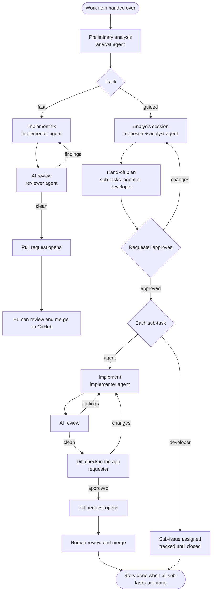

# Orchestrator — Functional Requirements (iteration 2)

| | |
|---|---|
| **Status** | Agreed baseline (v1.0) |
| **Date** | 2026-11-07 |
| **Scope** | The next iteration after the [MVP](mvp.md): pilot-ready experience, focused on understanding the work, shaping the plan and reviewing the result |

## 1. Purpose and context

The [capability map](capabilities.md) says what the orchestrator must be able to do; this document says **what each person can do, step by step, and how we know it works**. It drives the next iteration of the MVP.

| Decision | Answer |
|---|---|
| Goal of the iteration | A convincing **demo and pilot at work** |
| Stack | **GitHub first, Jira-ready**: journeys use Jira concepts (issue types, stories, sub-tasks) mapped onto GitHub, so the business stack slots in later (§4) |
| Autonomy | **Proportional to complexity**: two tracks, chosen after a preliminary analysis (§3) |
| Focus journeys | **Shape the plan** and **review the result** |
| Work it must be good at | Small bugs and fixes, small features, larger features |

### Terms

| Term | Meaning |
|---|---|
| Requester | The person who hands the work over and works with the agents in the user view (previously called "operator" in discussion; "operator view" stays the name of the technical view) |
| Developer | A person who implements a sub-task assigned to a human |
| Analyst agent | Studies the work with the requester, classifies it and writes the hand-off plan |
| Implementer agent | Implements an agent sub-task in a sandbox |
| Reviewer agent | Reviews every change before a pull request opens |
| Front-door agent | The chat assistant in the user view |
| Track | Fast (bugs, small changes) or guided (stories, larger features) |
| Hand-off plan | The approved plan of a guided-track item: goal, approach, sub-tasks and who builds each one |

## 2. Product principles

1. **Autonomy follows complexity.** Small, clear work runs without stops; larger work is shaped with the requester before anyone builds.
2. **Agents propose, people decide.** Track, plan and every guided-track change are the requester's call; nothing the agents write can approve itself.
3. **A second pair of eyes, always.** Every change is reviewed by the reviewer agent before a person sees it, and by a person before it is merged.
4. **No surprises.** Before a pull request opens on the guided track, the requester has seen the diff, the tests and the review.
5. **Ticket-native.** The ticket stays the system of record people already use; the orchestrator mirrors plans, sub-tasks and status there.

## 3. The two tracks

| | Fast track | Guided track |
|---|---|---|
| Typical work | Bugs, small changes with a clear expected behavior | Stories, larger features, anything needing design choices |
| Analysis | Automatic; questions only if something is unclear | Interactive session with the requester |
| Sub-tasks | None | From the analysis, each assigned to an agent or a developer |
| Human stops before the pull request | None (except high-risk changes and unresolved review findings) | Plan approval; diff check of each agent sub-task |
| Pull requests | One | One per agent sub-task |

## 4. Work model (Jira-ready)

| Concept | GitHub now | Jira later |
|---|---|---|
| Work item | Issue | Issue |
| Type (hint for the analysis) | Labels `bug`, `enhancement`, `story` (mapping configurable) | Issue type Bug, Task, Story |
| Hand-over | Label `ai-ready`, or the chat | Label `ai-ready`, or the chat |
| Track | Label `track:fast` / `track:guided`, set by the orchestrator | Label or custom field |
| Sub-task | Sub-issue | Sub-task |
| Sub-task assignee | Agent (the orchestrator) or a GitHub user | Agent or a Jira user |
| Status write-back | Labels and comments | Transitions and comments |

## 5. Functional requirements

Priorities: **Now** = this iteration; **Next** = the one after; **Later** = backlog.

### 5.1 Understand the work (analysis and classification)

#### FR-A1 Preliminary analysis · Now · CAP-02, CAP-05
As a requester, I get an analysis of every work item I hand over, so that the agents and I share the same understanding before anything is built.
- The analyst agent reads the ticket (title, description, type, comments, linked issues) and explores the repository.
- It produces an **analysis summary**: what it understood, affected areas and likely files, risks and assumptions, open questions, an estimated size (S, M, L) and a **proposed track with reasons**.
- The summary appears as a card in the run's conversation and as a comment on the ticket.

#### FR-A2 Classification · Now · CAP-02
As a requester, I get a track proposal I can trust, so that small work flows and large work gets attention.
- **Fast track** when all hold: clear expected behavior; changes confined to one area; size S (indicatively ≤ 5 files); no public API, schema or data-migration change; no high-risk files.
- **Guided track** otherwise, or when the ticket type is Story.
- The ticket type is a hint, never the deciding factor alone: a Bug that touches many modules goes guided.
- Thresholds are configuration, tuned during the pilot.

#### FR-A3 Change the track · Now · CAP-09
As a requester, I can switch the track at any time before a pull request opens, so that I can take control of a tricky bug or speed up a simple story.
- Fast → guided: the work pauses and an analysis session starts from the existing analysis.
- Guided → fast: allowed until the hand-off plan is approved; the plan is collapsed into a single change.
- The switch, who made it and why are recorded in the run's timeline; the `track:` label on the ticket follows.

#### FR-A4 Clarifying questions · Now (exists) · CAP-09
As a requester, I can answer the agent's questions in the chat or on the ticket, so that unclear work becomes clear without meetings.

#### FR-A5 Analysis session · Now · CAP-10
As a requester on the guided track, I can work through the analysis with the analyst agent in the conversation, so that the plan reflects decisions we made together.
- I can ask about the code ("where is the retry logic?"), challenge assumptions, choose between options the agent proposes, and add constraints.
- The analyst keeps the **analysis summary** and a **draft hand-off plan** up to date as we talk; each update is a new version.
- The session has no fixed length; it ends when I ask for the plan for approval, or the analyst proposes it and I accept.
- The analyst has read-only access to the repository during the session.

### 5.2 Shape the plan (guided track)

#### FR-P1 Hand-off plan content · Now · CAP-02
As a requester, I get a plan complete enough to hand to an agent or a colleague.
- **Plan level:** goal, approach, out of scope, risks and assumptions, constraints, definition of done.
- **Per sub-task:** title, description, acceptance criteria, likely files or areas, dependencies on other sub-tasks, size (S, M, L), **assignee type** (agent or developer) with the analyst's suggestion and reason, developer (when assigned to one).
- The analyst splits the work into sub-tasks along the chunks of activity found in the analysis; each sub-task is independently reviewable.

#### FR-P2 Edit the plan inline · Now · CAP-02, CAP-10
As a requester, I can edit the plan directly, so that I don't have to describe small changes in words.
- Edit any text; add, remove and reorder sub-tasks; change dependencies; set assignee type and developer; add plan-wide constraints (e.g., "do not change the public API").
- Validation: at least one sub-task; every sub-task has acceptance criteria; dependencies have no cycles; developer sub-tasks name a developer.
- My edits create a new plan version, marked as edited by me.

#### FR-P3 Ask for a revision · Now · CAP-02
As a requester, I can ask the analyst to revise the plan with feedback, so that bigger changes are reworked properly.
- The new version shows **what changed** compared with the previous one (sub-tasks added, removed, changed).
- Earlier versions remain viewable.

#### FR-P4 Approve the hand-off plan · Now · CAP-09
As a requester, I approve a specific plan version, so that what gets built is exactly what I agreed.
- Approval is bound to the version's hash (stale approvals are refused, as today).
- On approval: sub-issues are created (FR-P5), agent sub-tasks start in dependency order, developer sub-tasks are handed off.

#### FR-P5 Mirror the plan on the ticket · Now · CAP-07
As a requester and as a developer, I see the plan where I already work.
- The plan summary is posted on the ticket; every sub-task becomes a **sub-issue** carrying its description, acceptance criteria and a link back to the story.
- Developer sub-issues are assigned to the developer; agent sub-issues are labelled as agent-owned.

#### FR-P6 Fast-track approach · Now · CAP-02
As a requester on the fast track, I can see the intended fix before it is built, without having to approve it.
- A short "approach" (what will change and why) is shown in the analysis card.
- While the fix is being built I can stop it or switch to guided (FR-A3).

### 5.3 Build

#### FR-B1 Agent sub-tasks · Now · CAP-04
- Agent sub-tasks run in dependency order, each in its own sandbox, on its own branch.
- The implementer runs the project's tests and build where they exist; results are captured for review.
- A sub-task that depends on a developer sub-task waits until that sub-issue is closed.

#### FR-B2 Developer sub-tasks · Now · CAP-07
- The developer receives the sub-issue with the plan's context and links to related agent pull requests.
- The orchestrator tracks the sub-issue (polling) and shows its status in the story view.

### 5.4 Review the result

#### FR-R1 AI review of every change · Now · CAP-12, CAP-14
As a requester, every change I see has already been reviewed, so that my time goes to judgment, not to catching obvious mistakes.
- The reviewer agent checks the change against the acceptance criteria, the plan's scope and constraints, code quality, tests (added and passing), security smells and risk.
- It produces a **review report**: verdict (approve / changes needed) and findings with severity (blocking, major, minor), location (file and line), explanation and suggestion.

#### FR-R2 Fix loop · Now · CAP-02
- Blocking and major findings go back to the implementer; up to **2 fix rounds**, each re-reviewed.
- Findings still blocking after 2 rounds stop the work and ask the requester to: open the pull request anyway (findings attached), give guidance and retry, take over the branch, or cancel.
- Minor findings never block; they are listed in the report.

#### FR-R3 Review report on the pull request · Now · CAP-07
- The pull request description includes the review summary, findings resolved and unresolved, and test results, clearly marked as agent-generated.

#### FR-R4 Diff check in the app (guided track) · Now · CAP-09, CAP-10
As a requester on the guided track, I see and approve each agent change before its pull request opens.
- The **change review card** shows: summary, acceptance criteria with the implementer's evidence for each, files changed with a diff viewer (unified and side-by-side), test results, and the review report.
- Actions: **Approve** (the pull request opens), **Request changes** with feedback (the implementer iterates, the reviewer re-reviews, and the card returns), **Reassign to a developer** (the sub-task becomes a developer sub-issue with the work done so far on its branch).

#### FR-R5 Fast-track publishing · Now · CAP-02
- On the fast track the pull request opens right after a clean AI review; the requester is notified and reviews on GitHub.

#### FR-R6 High-risk changes · Now (exists) · CAP-08
- Changes to CI/CD, infrastructure, dependencies or ownership files need the requester's approval before pushing, on both tracks.

#### FR-R7 Story view · Now · CAP-10, CAP-11
As a requester, I see the whole story at a glance.
- Every sub-task with assignee (agent or developer), status (planned, in progress, AI review, awaiting my check, pull request open, merged, done) and links.
- The story completes when all agent pull requests are merged and all developer sub-issues are closed; the ticket is updated accordingly.

### 5.5 Next and later

| ID | Requirement | Priority |
|---|---|---|
| FR-N1 | Plain-language live status in the user view ("running tests: 2 failing, fixing"), elapsed time and cost per run | Next |
| FR-N2 | Message a running agent to steer it; pause and resume; retry a step with a hint; take over the branch | Next |
| FR-N3 | The agent addresses pull request review comments and CI failures (bounded, with approval before each push) | Next |
| FR-N4 | "My work" inbox (needs me / running / done), search, history per repository | Next |
| FR-N5 | First-run setup and a settings page instead of `.env` | Next |
| FR-N6 | Add or change not-started sub-tasks after approval (re-plan during execution) | Next |
| FR-N7 | Run independent agent sub-tasks in parallel | Later |
| FR-N8 | Per-repository guidance for agents (conventions, commands, areas not to touch), classification thresholds and models | Later |
| FR-N9 | Jira and Bitbucket on the same journeys (business stack) | Later |

## 6. Success measures

| Journey | Measure | Pilot target |
|---|---|---|
| Classification | Requester keeps the proposed track | ≥ 80% |
| Fast track | Bugs reaching a pull request with no human intervention | ≥ 70% |
| Fast track | Time from hand-over to pull request | Median ≤ 30 min |
| Guided track | Hand-off plan approved within 2 revisions | ≥ 70% |
| Diff check | Agent changes approved at the first diff check | ≥ 60% |
| AI review | Human review comments on issues the reviewer should have caught | Trending down; baseline in the pilot |
| Overall | Agent pull requests merged | ≥ 60% (NFR §4) |

## 7. Demo scenario

1. **A bug, fast track.** Label a bug `ai-ready`. Within minutes: the analysis card says fast track, the fix is built and reviewed by the reviewer agent (one finding fixed in the loop), the pull request opens with the review report. Merge it; the ticket closes as done.
2. **A story, guided track.** Hand over a story in the chat. The analyst proposes the guided track; in a short session the requester asks two questions and adds a constraint. The hand-off plan has three sub-tasks: two for agents, one for a named developer. The requester edits one sub-task and approves. The developer gets a sub-issue; the first agent sub-task reaches the diff check, the requester requests one change, then approves; its pull request opens. The story view shows all three sub-tasks progressing.

## 8. Impact on the architecture

To be detailed in the architecture document when this iteration starts.

| Area | Change |
|---|---|
| Agent profiles (CAP-01) | New `analyst` (replaces `readiness-analyst` and `planner`) and `reviewer` profiles in use; implementer gains fix-round input |
| Workflow (§9) | Track-dependent skeleton; a child workflow per sub-task with implement → AI review → fix loop → diff check → pull request; developer sub-tasks tracked by polling |
| Analysis session | A conversational agent bound to the run with read-only repository access across many turns: either a workspace kept alive with an idle timeout, or session state resumed in a fresh sandbox per turn (decision in the architecture) |
| Plan model | Versioned plans with authorship (agent or requester), dependencies and assignee types; approval bound to a version |
| Pull requests | One per agent sub-task (the architecture default; the MVP used one per run) |
| Component catalog | New cards: analysis summary, editable hand-off plan with versions, change review with diff viewer, review report, story view |
| GitHub integration | Sub-issues, assignees, `track:` labels; Jira mapping per §4 |

## Change history

| Version | Change |
|---|---|
| 1.0 | Initial baseline: two tracks, analysis and classification, hand-off plan, AI review with fix loop, diff check, developer sub-tasks |
