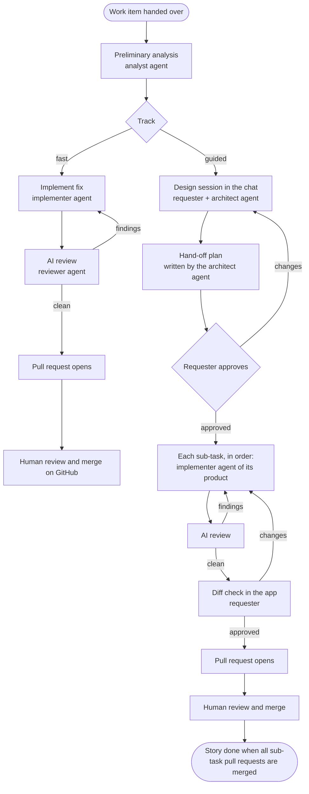

# Orchestrator — Functional Requirements (iteration 2)

| | |
|---|---|
| **Status** | Agreed baseline (v1.5) |
| **Date** | 2026-11-07 |
| **Scope** | The next iteration after the [MVP](mvp.md): pilot-ready experience, focused on understanding the work, shaping the plan and reviewing the result |

## 1. Purpose and context

The [capability map](capabilities.md) says what the orchestrator must be able to do; this document says **what each person can do, step by step, and how we know it works**. It drives the next iteration of the MVP.

| Decision | Answer |
|---|---|
| Goal of the iteration | A convincing **demo and pilot at work** |
| Stack | **GitHub first, Jira-ready**: journeys use Jira concepts (issue types, stories, sub-tasks) mapped onto GitHub, so the business stack slots in later (§4) |
| Autonomy | **Proportional to complexity**: two tracks, chosen after a preliminary analysis (§3) |
| Focus journeys | **Shape the plan** and **review the result** |
| Work it must be good at | Small bugs and fixes, small features, larger features |
| Products | A work item can involve **several products**; a product has one or more repositories and its own agent guidance, toolchain and commands; each sub-task is built by the implementer set up for its product (§5.5) |
| Approvals across products | The requester approves the plan and does every diff check; each product's owners review that product's pull requests, as they do today |

### Terms

| Term | Meaning |
|---|---|
| Requester | The person who hands the work over and works with the agents in the user view (previously called "operator" in discussion; "operator view" stays the name of the technical view) |
| Analyst agent | Does the preliminary analysis of every work item: understands it, asks clarifying questions, classifies it |
| Architect agent | On the guided track, designs the solution with the requester in the conversation and writes the hand-off plan |
| Implementer agent | Implements a sub-task in a sandbox, set up for the sub-task's product (its guidance, toolchain and commands) |
| Reviewer agent | Reviews every change before a pull request opens |
| Front-door agent | The chat assistant in the user view |
| Track | Fast (bugs, small changes) or guided (stories, larger features) |
| Hand-off plan | The plan of a guided-track item, written by the architect agent and approved by the requester: goal, approach and sub-tasks, each built by an agent |
| Product | Something a team owns and ships, made of one or more repositories (for example a service and its web client) |
| Product catalog | The orchestrator's list of products: what each one owns, its repositories, owners, toolchain, and build and test commands |
| Product owners | The people responsible for a product; they review its pull requests (for example through CODEOWNERS) |
| Contract | An interface between products that the plan fixes before anyone builds: an API, an event, a schema or a shared library |

## 2. Product principles

1. **Autonomy follows complexity.** Small, clear work runs without stops; larger work is shaped with the requester before anyone builds.
2. **Agents propose, people decide.** Agents write; the requester steers them in the conversation and decides with explicit actions (track, plan approval, diff check). The requester never edits a plan by hand, and nothing an agent writes can approve itself.
3. **A second pair of eyes, always.** Every change is reviewed by the reviewer agent before a person sees it, and by a person before it is merged.
4. **No surprises.** Before a pull request opens on the guided track, the requester has seen the diff, the tests and the review.
5. **Ticket-native.** The ticket stays the system of record people already use; the orchestrator mirrors plans, sub-tasks and status there.
6. **Products keep their owners.** Agents follow each product's own guidance, change only the repositories the plan names, and each product's pull requests are reviewed by its owners.

## 3. The two tracks

| | Fast track | Guided track |
|---|---|---|
| Typical work | Bugs, small changes with a clear expected behavior | Stories, larger features, anything needing design choices or touching more than one product |
| Products | One | One or more |
| Analysis | Analyst agent, automatic; questions only if something is unclear | Same preliminary analysis by the analyst agent |
| Plan | Short fix approach from the analyst; no approval | Hand-off plan written by the architect agent in a chat with the requester; requester approves |
| Sub-tasks | None | Defined in the hand-off plan, each built by an agent |
| Human stops before the pull request | None (except high-risk changes and unresolved review findings) | Plan approval; diff check of each agent sub-task |
| Pull requests | One | One per agent sub-task, in its product's repository |

## 4. Work model (Jira-ready)

| Concept | GitHub now | Jira later |
|---|---|---|
| Product | Catalog entry listing its repositories (repositories of one owner in the pilot) | Catalog entry: the product's Jira project (one per product) and its Bitbucket repositories |
| Work item | Issue, in any catalog repository | Issue, in any product's project |
| Type (hint for the analysis) | Labels `bug`, `enhancement`, `story` (mapping configurable) | Issue type Bug, Task, Story |
| Hand-over | Label `ai-ready`, or the chat | Label `ai-ready`, or the chat |
| Track | Label `track:fast` / `track:guided`, set by the orchestrator | Label or custom field |
| Sub-task | Sub-issue in the repository it changes (GitHub sub-issues can live in another repository than their parent) | Sub-task when it is in the story's own project; for another product, an issue in that product's project linked to the story (open item, §9) |
| Sub-task assignee | Agent (the orchestrator); developers in a later iteration | Same |
| Status write-back | Labels and comments | Transitions and comments |

## 5. Functional requirements

Priorities: **Now** = this iteration; **Next** = the one after; **Later** = backlog.

### 5.1 Understand the work (analysis and classification)

#### FR-A1 Preliminary analysis · Now · CAP-02, CAP-05
As a requester, I get an analysis of every work item I hand over, so that the agents and I share the same understanding before anything is built.
- The analyst agent reads the ticket (title, description, type, comments, linked issues) and explores the repository.
- It produces an **analysis summary**: what it understood, the products and repositories involved (FR-M2), affected areas and likely files, risks and assumptions, open questions, an estimated size (S, M, L) and a **proposed track with reasons**.
- The summary appears as a card in the run's conversation and as a comment on the ticket.

#### FR-A2 Classification · Now · CAP-02
As a requester, I get a track proposal I can trust, so that small work flows and large work gets attention.
- **Fast track** when all hold: clear expected behavior; changes confined to one area of one product; size S (indicatively ≤ 5 files); no public API, schema or data-migration change; no high-risk files.
- **Guided track** otherwise, when the ticket type is Story, and always when more than one product is involved.
- The ticket type is a hint, never the deciding factor alone: a Bug that touches many modules goes guided.
- Thresholds are configuration, tuned during the pilot.
- The proposal is checked, not trusted: the fast-track limits are checked again on the finished change. If it turned out bigger (more files, a second repository, a contract or high-risk file), the work stops before the pull request and asks me to continue, switch to guided, or cancel.

#### FR-A3 Change the track · Now · CAP-09
As a requester, I can switch the track at any time before a pull request opens, so that I can take control of a tricky bug or speed up a simple story.
- Fast → guided: the work pauses and a design session with the architect agent starts from the existing analysis.
- Guided → fast: allowed until the hand-off plan is approved, and only when one product is involved; the plan is collapsed into a single change.
- The switch, who made it and why are recorded in the run's timeline; the `track:` label on the ticket follows.

#### FR-A4 Clarifying questions · Now (exists) · CAP-09
As a requester, I can answer the agent's questions in the chat or on the ticket, so that unclear work becomes clear without meetings.

### 5.2 Shape the plan (guided track, with the architect agent)

The requester shapes the plan only through the conversation with the architect agent; the plan card shows the result. The requester's own action is the approval.

#### FR-P1 Design session · Now · CAP-02, CAP-10
As a requester on the guided track, I design the solution with the architect agent in the conversation, so that the plan reflects decisions we made together.
- Every run has its own conversation, listed under its ticket (FR-C1); when I started the work from a general chat, that chat shows a link to it. The session starts there by itself once the analyst has classified the work as guided: the architect opens with its reading of the analysis, options and first questions.
- While the session is open my messages in that conversation go to the architect; every message shows which agent wrote it.
- After about 20 minutes of silence the architect's workspace is saved and shut down; my next message resumes it, with a visible "resuming" status while I wait (up to a minute or two).
- I can ask about the code ("where is the retry logic?"), challenge assumptions, choose between options the architect proposes (with trade-offs), and state constraints ("do not change the public API").
- The architect keeps a **draft hand-off plan** up to date as we talk, shown in the plan card.
- The architect has read-only access to the repositories of every product involved (FR-M3).
- The session has no fixed length; it ends when I ask for the plan for approval, or the architect proposes it and I accept.

#### FR-P2 Hand-off plan content · Now · CAP-02
As a requester, I get a plan complete enough for agents to build from and for reviewers to check against.
- **Plan level:** goal, approach, out of scope, risks and assumptions, constraints, definition of done; with more than one product, also the products involved, the contracts between them and the order of changes (FR-M3).
- **Per sub-task:** product and repository, title, description, acceptance criteria, likely files or areas, dependencies on other sub-tasks, size (S, M, L).
- The architect splits the work into sub-tasks along the chunks of activity found in the analysis; each sub-task is independently reviewable and is built by an agent.
- Checks before the plan can be approved: at least one sub-task; every sub-task has acceptance criteria and names a product and repository from the catalog; dependencies have no cycles.

#### FR-P3 Revise the plan in the conversation · Now · CAP-02, CAP-10
As a requester, I change the plan by asking the architect, never by editing it myself, so that every change is thought through and explained.
- Any change (add, remove, split, merge or reorder sub-tasks; change scope, approach or constraints) is requested in the chat; the architect makes it and explains it.
- Each change creates a new plan version, recording the request that prompted it.
- The plan card shows **what changed** compared with the previous version (sub-tasks added, removed, changed); earlier versions remain viewable.
- The requester cannot edit plan fields in the user view or the operator view.

#### FR-P4 Approve the hand-off plan · Now · CAP-09
As a requester, I approve a specific plan version with an explicit action, so that what gets built is exactly what I agreed.
- Approval is a button on the plan card, bound to the version's hash (stale approvals are refused, as today). Typing "approve" in the chat does not approve; the architect points to the button.
- On approval: sub-issues are created (FR-P5) and sub-tasks start in dependency order.

#### FR-P5 Mirror the plan on the ticket · Now · CAP-07
As a requester, and for anyone following the ticket, the plan is visible where people already work.
- The plan summary is posted on the ticket; every sub-task becomes a **sub-issue** in the repository it changes (§4), carrying its description, acceptance criteria and a link back to the story.
- Sub-issues are labelled as agent-owned and closed when their pull request is merged.

#### FR-P6 Fast-track approach · Now · CAP-02
As a requester on the fast track, I can see the intended fix before it is built, without having to approve it.
- A short "approach" (what will change and why) is shown in the analysis card.
- While the fix is being built I can stop it or switch to guided (FR-A3).

### 5.3 Build

#### FR-B1 Sub-tasks · Now · CAP-04
- Sub-tasks run in dependency order, each in its own sandbox set up for its product (FR-M4), on its own branch in its product's repository.
- The implementer runs the project's tests and build where they exist; results are captured for review.
- A sub-task that depends on another in the same repository starts on top of its branch once that sub-task's change is approved; across products, see FR-M4.

### 5.4 Review the result

#### FR-R1 AI review of every change · Now · CAP-12, CAP-14
As a requester, every change I see has already been reviewed, so that my time goes to judgment, not to catching obvious mistakes.
- The reviewer agent checks the change against the acceptance criteria, the plan's scope and constraints, the product's guidance, the contracts between products, code quality, tests (added and passing), security smells and risk.
- It produces a **review report**: verdict (approve / changes needed) and findings with severity (blocking, major, minor), location (file and line), explanation and suggestion.

#### FR-R2 Fix loop · Now · CAP-02
- Blocking and major findings go back to the implementer; up to **2 fix rounds**, each re-reviewed.
- Findings still blocking after 2 rounds stop the work and ask the requester to: open the pull request anyway (findings attached), give guidance and retry, take over the branch, or cancel.
- Minor findings never block; they are listed in the report.

#### FR-R3 Review report on the pull request · Now · CAP-07
- The pull request description includes the review summary, findings resolved and unresolved, and test results, clearly marked as agent-generated.
- With more than one product, it also links the story and the related pull requests in other products, and states the merge order (FR-M5).

#### FR-R4 Diff check in the app (guided track) · Now · CAP-09, CAP-10
As a requester on the guided track, I see and approve each agent change before its pull request opens.
- The card appears in the sub-task's own conversation (FR-C2).
- The **change review card** shows: summary, acceptance criteria with the implementer's evidence for each, files changed with a diff viewer (unified and side-by-side), test results, and the review report.
- Actions: **Approve** (the pull request opens), **Request changes** with feedback (the implementer iterates, the reviewer re-reviews, and the card returns), **Drop the sub-task** (it is closed as not done and noted on the story; sub-tasks that depend on it pause for the requester to decide).

#### FR-R5 Fast-track publishing · Now · CAP-02
- On the fast track the pull request opens right after a clean AI review, when the change is within the fast-track limits (FR-A2); the requester is notified and reviews on GitHub.

#### FR-R6 High-risk changes · Now (exists) · CAP-08
- Changes to CI/CD, infrastructure, dependencies, ownership files or agent guidance files (FR-M6) need an approval before pushing, on both tracks: by the requester in this iteration's single-user setup, by a lead of the product being changed in the business deployment.

#### FR-R7 Story view · Now · CAP-10, CAP-11
As a requester, I see the whole story at a glance.
- Every sub-task, grouped by product, with status (planned, in progress, AI review, awaiting my check, pull request open, merged, dropped) and links, including the link to its conversation (FR-C2).
- The story completes when the pull requests of all sub-tasks that were not dropped are merged, in every product; the ticket is updated accordingly.

### 5.5 Work across products

#### FR-M1 Product catalog · Now · CAP-01, CAP-05, CAP-07
As the person who sets up the orchestrator, I describe the products once, so that agents know what each product owns and how to work on it.
- Per product: name; what it owns and what it does not (used by the analyst to place the work); repositories, each with its role (for example service, web client, library); owners; where its tickets live (GitHub repository, or Jira project later); toolchain (sandbox image, for example with a JDK); build and test commands; extra high-risk paths; contract paths (where its interfaces live: a change there is never fast track); package registries agents may reach.
- In this iteration the catalog is a configuration file (a settings page is FR-N5). It replaces the plain repository list of the MVP.
- Agents never change a repository that is not in the catalog.

#### FR-M2 Identify the products involved · Now · CAP-02
As a requester, I see which products the work touches and why, before any plan is made.
- The analyst places the work using the catalog descriptions and by exploring the candidate repositories read-only; the product where the ticket was filed is a hint, not the answer.
- The analysis summary lists each product involved, the reason, and what changes there.
- I can correct the list in the conversation ("the mobile app is affected too"); during the design session the architect can propose adding or removing a product, and the plan shows it.

#### FR-M3 Design across products · Now · CAP-02
As a requester, I get a plan where the products fit together before anything is built.
- In the design session the architect works across all the products involved, with read-only access to their repositories and their guidance (FR-M6).
- The hand-off plan adds what changes in each product and why, and the **contracts** between products: shape, versioning and backward compatibility, and which sub-tasks provide and which consume each one.
- Each sub-task belongs to exactly one product and changes exactly one repository; work that spans repositories is split.
- The plan sets the order of changes across products (for example, the provider's backward-compatible change before the consumer's) and a short rollout note: merge order, and feature flags where needed.

#### FR-M4 Product implementers · Now · CAP-01, CAP-04
As a requester, each sub-task is built by an agent that works the way the product's team works.
- The implementer of a sub-task runs in a sandbox with its product's toolchain, gets only its repository, and follows its product's guidance and build and test commands.
- A sub-task that depends on a sub-task of another product starts once that sub-task passes its diff check; its implementer gets the contract from the plan and can read the approved change.
- Sub-tasks run one at a time in this iteration, across products too (parallel work is FR-N7).

#### FR-M5 Pull requests across products · Now · CAP-07, CAP-09
As a product owner, I review my product's pull request knowing how it fits the whole story.
- Each sub-task's pull request opens in its product's repository and follows that repository's own rules (branch protection, CODEOWNERS, CI).
- Each pull request links the story, the related pull requests in other products and the merge order ("merge after acme/api#41").
- The story view shows the merge order and flags a pull request merged before one it depends on.

#### FR-M6 Guidance kept by the product team · Now · CAP-01, CAP-05, CAP-12
As a product owner, I keep the guidance for agents in my own repository, so that it evolves with the code.
- Guidance lives in the product's repository, in the files Copilot already reads (`AGENTS.md` or `.github/copilot-instructions.md`): conventions, architecture notes, areas not to touch, how to test.
- The analyst, architect, implementer and reviewer all read the guidance of each product they work on.
- Guidance is repository content and therefore untrusted (design rule 3): it shapes how agents work, but cannot grant tools or network access, change commands set in the catalog, or bypass approvals and risk rules.

### 5.6 Follow the work (conversations)

Conversations form a hierarchy: **ticket → run → sub-task**. It has the same shape as story → sub-issues on the ticket tool.

#### FR-C1 Conversations grouped by ticket · Now · CAP-10, CAP-11
As a requester, I find everything about a ticket in one place, so that I never have to search for the conversation of a run.
- The side panel of the user view lists **tickets**. Under each ticket are its **runs**, newest first; each run is one conversation (FR-P1).
- A ticket that is run again (after a failure, a cancellation or a closed pull request) shows all its runs together, numbered in the order they started.
- The ticket row shows the ticket's reference and title, and whether its newest run is active, finished or failed. A marker shows that something below it waits for me; the marker is also on the run concerned.
- A ticket is open by itself while its newest run is active, while something waits for me, or when it holds the conversation I am reading; I can open and close any ticket. Tickets are ordered by their latest activity.
- Choosing a ticket opens the conversation of its newest run.
- General chats with the assistant are listed separately, below the tickets. A chat that started a run keeps its link card to that run's conversation.
- The Runs page of the operator view groups runs by ticket in the same way, and a run's page links to the other runs of its ticket.

#### FR-C2 A conversation for each sub-task · Now (arrives with sub-tasks) · CAP-10
As a requester on the guided track, I follow and decide each sub-task in its own conversation, so that the diff check of one sub-task is not buried in the story of another.
- The **run's conversation** keeps what concerns the whole work: the analysis, the design session with the architect, the hand-off plan and the story view.
- **Each sub-task has its own conversation under the run**, listed in plan order and labelled with its product. It holds the sub-task's progress, the review report, the change review card (FR-R4) and the pull request; what I ask to change in that sub-task, I ask there.
- Markers for something waiting roll up: sub-task → run → ticket.
- The fast track has one change and no sub-task level: everything stays in the run's conversation.

### 5.7 Next and later

| ID | Requirement | Priority |
|---|---|---|
| FR-N1 | Plain-language live status in the user view ("running tests: 2 failing, fixing"), elapsed time and cost per run | Next |
| FR-N2 | Message a running agent to steer it; pause and resume; retry a step with a hint; take over the branch | Next |
| FR-N3 | The agent addresses pull request review comments and CI failures (bounded, with approval before each push) | Next |
| FR-N4 | "My work" inbox (needs me / running / done), search, history per repository; on top of the ticket hierarchy (FR-C1) | Next |
| FR-N5 | First-run setup and a settings page instead of `.env`, including the product catalog | Next |
| FR-N6 | Re-plan during execution: ask the architect agent to add or change sub-tasks that have not started; the change needs a new approval | Next |
| FR-N7 | Run independent agent sub-tasks in parallel | Later |
| FR-N8 | Per-product classification thresholds and model choice (agent guidance itself is FR-M6) | Later |
| FR-N9 | Jira and Bitbucket on the same journeys (business stack) | Later |
| FR-N10 | Developer sub-tasks: assign a sub-task to a named developer, who builds it on a tracked sub-issue; agent sub-tasks can wait for it | Later |
| FR-N11 | Product-owner approvals: owners of an affected product approve its sub-tasks before they are built, or do their diff checks | Later |

## 6. Success measures

| Journey | Measure | Pilot target |
|---|---|---|
| Classification | Requester keeps the proposed track | ≥ 80% |
| Products | Requester keeps the products the analyst identified | ≥ 80% |
| Fast track | Bugs reaching a pull request with no human intervention | ≥ 70% |
| Fast track | Time from hand-over to pull request | Median ≤ 30 min |
| Guided track | Once the architect proposes the plan for approval, it is approved with at most 2 further revisions | ≥ 70% |
| Diff check | Agent changes approved at the first diff check | ≥ 60% |
| AI review | Human review comments on issues the reviewer should have caught | Trending down; baseline in the pilot |
| Overall | Agent pull requests merged | ≥ 60% (NFR §4) |

## 7. Demo scenario

1. **A bug, fast track.** Label a bug `ai-ready`. Within minutes: the analysis card says fast track, the fix is built and reviewed by the reviewer agent (one finding fixed in the loop), the pull request opens with the review report. Merge it; the ticket closes as done.
2. **A story across two products, guided track.** The catalog has two products: a service and its web client, each in its own repository. Hand over a story in the chat. The analyst finds that both products are involved and proposes the guided track. The architect opens a design session: the requester asks two questions, adds a constraint and asks to split one sub-task; the architect fixes the API contract between the two products and revises the plan, and the card shows what changed. The plan has three sub-tasks: two in the service, one in the web client. The requester approves; three sub-issues appear, each in its product's repository. The first service sub-task reaches the diff check, the requester requests one change, then approves; its pull request opens in the service repository. The web client sub-task starts once the API change has passed its diff check, and its pull request says to merge after the service's. The story view shows the sub-tasks grouped by product. In the side panel the story is one ticket, with its run under it and the three sub-task conversations under the run.

## 8. Impact on the architecture

Detailed in the [reference architecture](architecture.md) v2.0: decisions AD-30 to AD-42, and the build scope and order in its §24.

| Area | Change |
|---|---|
| Agent profiles (CAP-01) | New `analyst` (replaces `readiness-analyst` and `planner`), `architect` and `reviewer` profiles; the implementer is specialized per product from the catalog and the product's guidance, and gains fix-round input |
| Product catalog | New configuration, read by the API and the worker; replaces `GITHUB_REPOS`; the token must cover every catalog repository |
| Workflow (§9) | Track-dependent skeleton; a run belongs to the story ticket, not to a repository; a child workflow per sub-task, carrying its product and repository, with implement → AI review → fix loop → diff check → pull request |
| Workspaces (CAP-04) | Analyst and architect sandboxes get read-only copies of several repositories; implementer sandboxes get one repository, the image of its product's toolchain, and read-only copies of approved changes they depend on |
| Design session | The architect agent converses with the requester across many turns with read-only access to the repositories of every product involved: a session workspace kept warm while the conversation is active, saved and shut down when idle, and restored on the next message (AD-34, AD-35). Each run has its own conversation, routed to the architect while the session is open (AD-38) |
| Plan model | Versioned plans written by the architect, each version recording the request that prompted it; dependencies; approval bound to a version |
| Pull requests | One per agent sub-task, in its product's repository (the architecture default; the MVP used one per run) |
| Component catalog | New cards: analysis summary, hand-off plan with versions and what changed (read-only), change review with diff viewer, review report, story view |
| GitHub integration | Sub-issues across repositories, `track:` labels; Jira mapping per §4 |
| Conversations | A hierarchy ticket → run → sub-task (AD-43): grouping by ticket in both views; a conversation per sub-task, created by its sub-task workflow |

## 9. Open items

| # | Item | Needed by |
|---|---|---|
| 1 | Jira, one project per product: Jira sub-tasks must stay in their parent's project, so a sub-task of another product becomes an issue in that product's project. Linking it to the story by an issue link works everywhere; making it a child of the story's epic works only across company-managed projects. Confirm with the Jira admins which project type the products use | FR-N9 (business stack) |

## Change history

| Version | Change |
|---|---|
| 1.0 | Initial baseline: two tracks, analysis and classification, hand-off plan, AI review with fix loop, diff check, developer sub-tasks |
| 1.1 | Agents build every sub-task in this iteration; developer sub-tasks moved to the backlog (FR-N10); dropping a sub-task replaces reassignment |
| 1.2 | New architect agent shapes the hand-off plan with the requester in a design session (FR-P1, was the analyst's analysis session FR-A5); the analyst does only the preliminary analysis; inline plan editing removed: plans change only through the conversation (FR-P3) |
| 1.3 | Work across products: product catalog, product identification by the analyst, cross-product design with contracts, one implementer setup per product, pull requests in each product's repository, guidance kept in each product's repository (§5.5); Jira mapping open item |
| 1.4 | Aligned with the architecture v2.0: fast-track limits re-checked on the finished change (FR-A2, FR-R5); one conversation per run and session resume behavior (FR-P1); guidance files are high-risk and who approves high-risk changes (FR-R6); contract paths in the catalog (FR-M1); §8 points to the architecture decisions |
| 1.5 | Conversation hierarchy ticket → run → sub-task: conversations grouped by ticket in both views (FR-C1), a conversation for each sub-task under its run (FR-C2); the change review card moves to the sub-task's conversation (FR-R4) |
